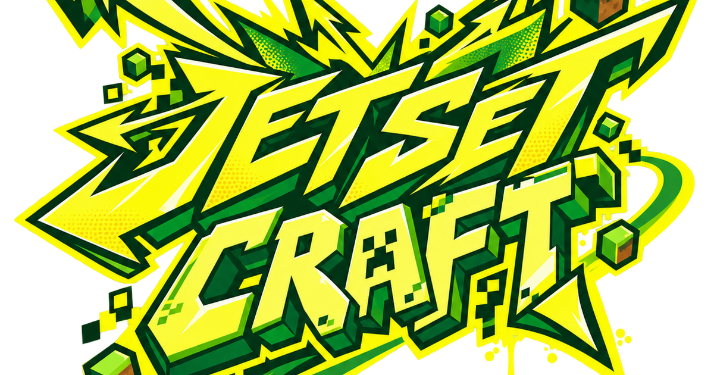
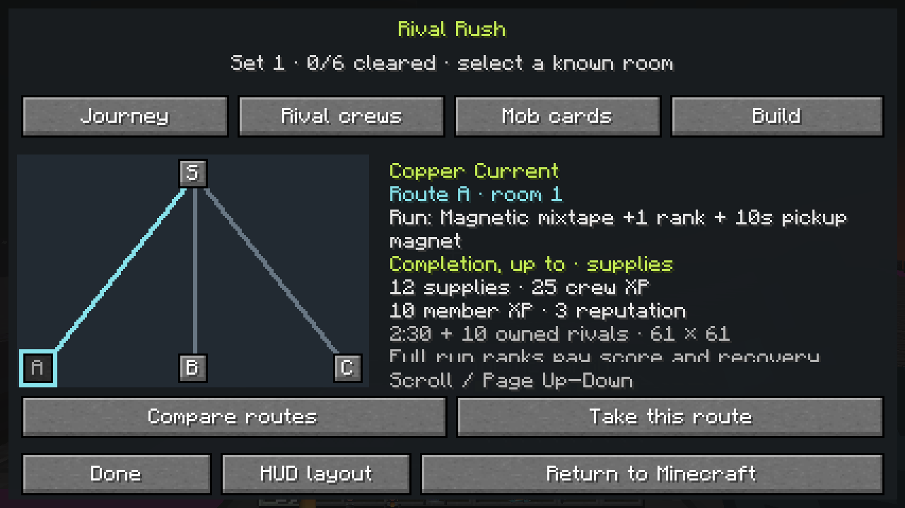
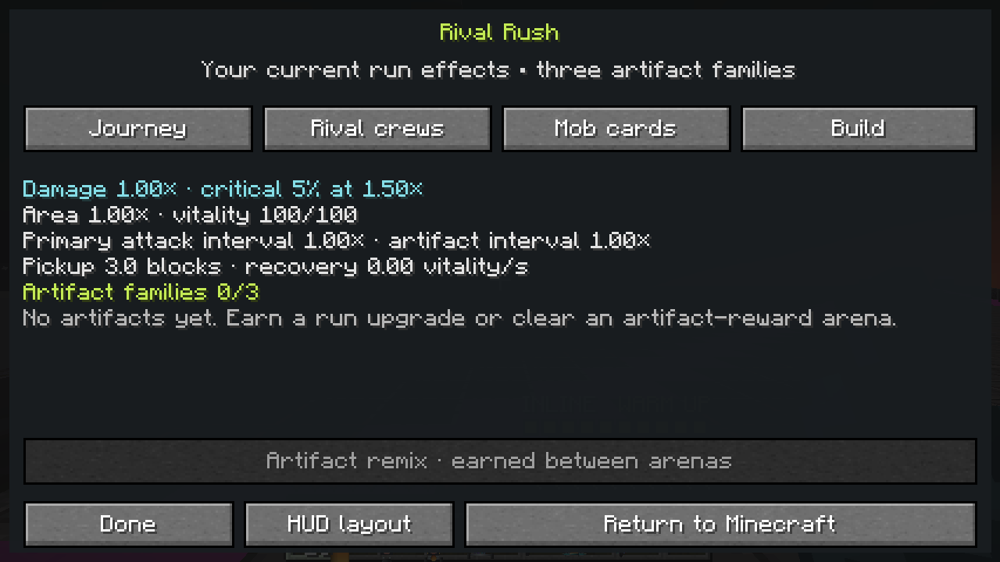
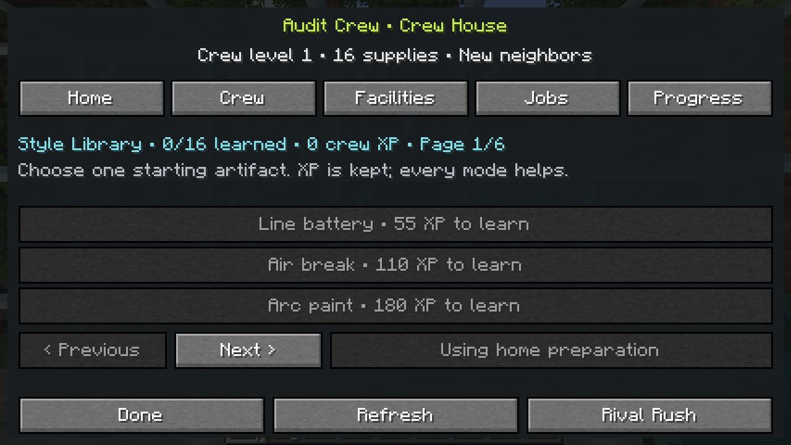
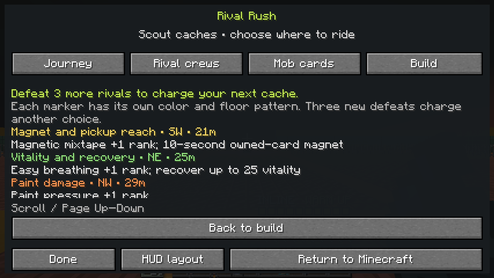
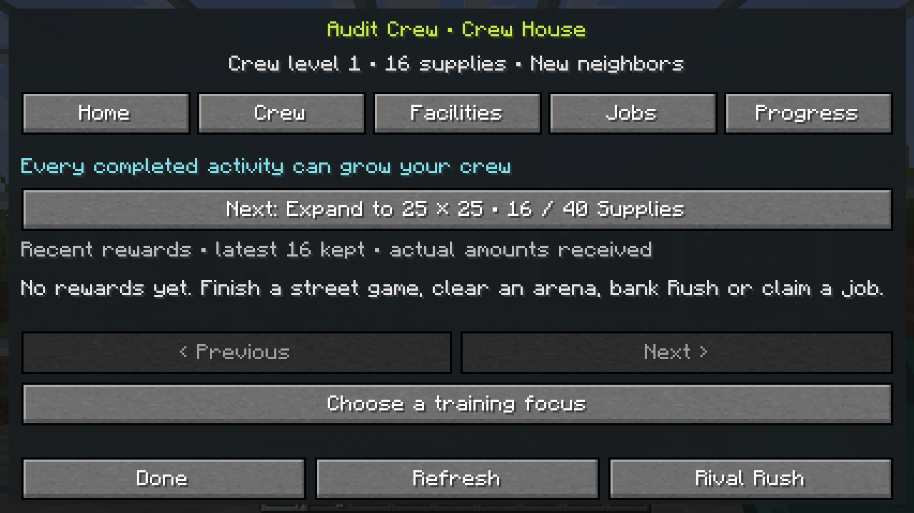
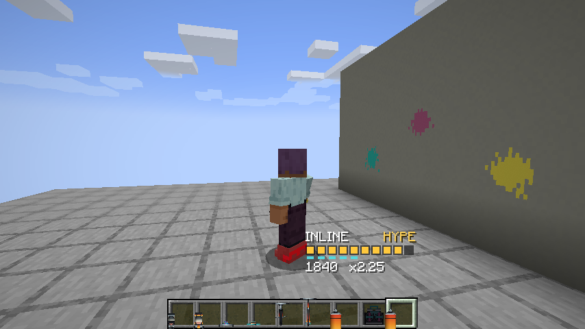
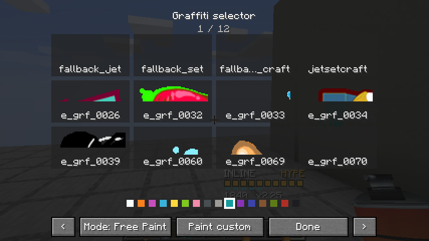
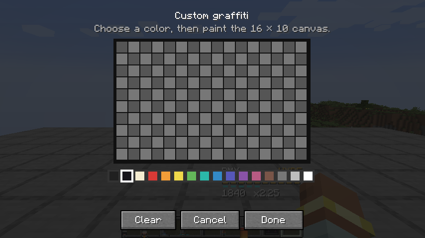

# JetSetCraft

[](https://github.com/Herbertofury/JetSetCraft/actions/workflows/build.yml)
[](https://files.minecraftforge.net/net/minecraftforge/forge/index_1.20.1.html)
[](https://files.minecraftforge.net/net/minecraftforge/forge/index_1.20.1.html)
[](https://github.com/Herbertofury/JetSetCraft/releases/tag/v0.3.0)

JetSetCraft turns ordinary Minecraft terrain into a momentum-first street sports game. Ride, boost, trick, grind, wall-ride, dance, tag walls, equip mobs with Street Gear, and start data-driven gang sessions—without replacing Minecraft’s world, combat, mobs, rails, or movement ecosystems.

## What ships in v0.3.0

- Six persistent ride styles: inline skates, quad skates, street board, BMX, hoverboard, and scooter.
- Twenty-four named tricks and twenty-eight dance moves with combo variety, Flow, boost rewards, landing grades, and multiplayer cyphers.
- Exposed block-edge, fence, wall, pane, vanilla/Forge rail, and optional Create 6.0.8 track grinding.
- Minecraft-native momentum tech across ice, slime, honey, Soul Speed, redstone rails, pistons, explosions, knockback, and small terrain transitions, while vanilla swimming retains complete control.
- Street Art/Spirit Vector movement merge: rhythmic skate strides, charged angular powerslides, three wall kicks, wind redirects, sprint kickoffs, ledge vaults, and same-wall reuse protection—with exact neutral stopping preserved.
- A hands-free, server-authoritative ride slot that leaves both hands and the vanilla boots slot available.
- Combat-safe presentation: ride locomotion owns the lower body while item and weapon systems retain arms, hands, held items, and head.
- A 139-entry graffiti gallery plus an in-game 16 × 10 custom-paint canvas, toggleable 16-color Free Paint, all 16 throwable paint balloons, six-face surface splashes, repaint-in-place behavior, support cleanup, durability, and a configurable per-chunk safety limit.
- Leg-baked rollerblade meshes follow the player's actual animated legs instead of floating as duplicated item models.
- Persistent Street Gear for compatible vanilla and modded mobs, using conservative anatomy rigs without replacing the original entity, AI, ownership, UUID, or registry type.
- A physical Boombox and mob-head gang tuner with data-pack mappings, safe event-only actors, cleanup/anti-farm rules, and eighty original gang entrance stingers.
- A compact vanilla-adjacent Boost/Flow HUD with an instant `H` toggle, plus reduced-motion, camera, FOV, and trick-name controls.

The [wiki](https://github.com/Herbertofury/JetSetCraft/wiki) covers mechanics, configuration, compatibility, modpack tags, and verification in depth.

## Optional Rival Rush mode — development alpha

**Alpha.5 connects every activity to permanent Rush starting styles.** The **Style Library** learns new preparations from the same crew XP earned through Tag, King of the Hill, Showdown, arena clears, qualifying Rush returns and claimed missions. Choose one learned artifact to begin future runs at rank one, even before founding a home. New venom, chill, multishot, healing, shield and soul-burst artifacts deepen the temporary run build, while colored reward caches and a scout view make each arena's rewards easier to find.

Rival Rush remains an opt-in skating, paint-combat and mob-card mode with separate Rush XP, thirty-minute/Endless Free streets and six-arena circuits. Ride against named gangs, draft temporary upgrades, paint walls and visit music stops. Returning restores the saved normal inventory, physical ride and vanilla XP. Ordinary Minecraft and the other JetSetCraft activities continue independently.

Craft a reusable **Rival Rush Flyer** from paper + cyan dye, or use `/jetsetcraft rush`. The alpha supports Easy, Normal and Hard and never changes the world's difficulty. Controls, card rewards and limits are documented in [Rival Rush](wiki/Rival-Rush.md); the [18-game research/design study](docs/RIVAL_RUSH_DESIGN.md) separates deeper build families, bespoke bosses and rhythm-scored challenges from the implemented loop.

The current development version is **`0.4.0-alpha.5`**, merged through [PR #44](https://github.com/Herbertofury/JetSetCraft/pull/44) as [`5bad458`](https://github.com/Herbertofury/JetSetCraft/commit/5bad45891b6fe7a5c7c133ed0a19ac0556dd5af8), with the exact tested source tree. This continuation builds on [alpha.4 / PR #43](https://github.com/Herbertofury/JetSetCraft/pull/43), the shared activity/arena layer from [PR #41](https://github.com/Herbertofury/JetSetCraft/pull/41), Rival Rush from [PR #39](https://github.com/Herbertofury/JetSetCraft/pull/39), and crew houses from [PR #40](https://github.com/Herbertofury/JetSetCraft/pull/40). Stable **`v0.3.0` remains unchanged** and does not contain this mode.

**Verified alpha.5:** [base gate #290](https://github.com/Herbertofury/JetSetCraft/actions/runs/41388639847) and the [provider matrix](https://github.com/Herbertofury/JetSetCraft/actions/runs/41388639856) passed **all 44 real Forge GameTests in each of nine configurations — 396 executions**. Every configuration passed build, dedicated-server readiness, RCON stop and the normal saved-dimensions shutdown check. The base passed its **fifteen-capture native-client gate**. The [Style Library receipt and gallery](docs/verification/style-library/README.md) records the exact source/merge identity and an independent local reproduction of those fifteen screens. CI archive metadata is API-reported; the browser could not download the archive, so the local gallery is not presented as downloaded CI evidence or proof of identical binaries.

The [historical alpha.4 receipt](docs/verification/reward-journeys/README.md) retains its separate 35-test/nine-configuration checkpoint and thirteen reviewed captures.

The [historical alpha.3 receipt](docs/verification/arena-circuit/README.md) preserves its 28-test/nine-configuration checkpoint and ten client captures, with a dated correction: its provider dedicated-server smoke proved startup, while normal dedicated-server save/shutdown was established by the base workflow. [Alpha.2](docs/verification/crew-house/README.md) and [alpha.1](docs/verification/rival-rush/README.md) retain their separate evidence. These are machine integration checks; **human thirty-minute pacing, Endless balance, house progression balance and broad modded-AI playtesting remain outstanding**. [Read the verification scope](wiki/Testing-and-Verification.md).


### Connected activities and arena circuits

Use a tuned Boombox with an empty hand, or `/jetsetcraft activity`, to choose **Random, Tag, King of the Hill, Showdown or Rival Rush**. A random invitation shows its selected game before you accept. Completed objectives contribute to the same crew supplies, house XP, member training and gang reputation; earnings are retained even before your first house is founded.

Rival Rush offers **Free streets** and a **six-arena circuit**. Pick one of three arena rewards, skate along the generated connection, complete its timed combat objective, and take the next route. Choices favor rooms you have not visited in the current set. The catalogue has six base profiles and four optional profiles for Aether, Iron's Spells, Cataclysm and AoA, enabled only when their providers are installed. Arena sizes, layouts, authored block maps and bounded rewards are editable through data packs, and a run keeps its chosen catalogue through reloads. See [Rival Rush](wiki/Rival-Rush.md) for the exact format.

The [three-arena example pack](examples/arena-data-pack/README.md) is ready to copy into a world's `datapacks` folder and edit: **Crossfade Yard** emphasizes critical hits and reputation, **Collector's Loop** emphasizes magnet range and supplies, and **Chorus Terrace** emphasizes ability area and training. Each room has a complete editable definition and separate run/shared rewards.

**Build** shows eleven upgradeable stats and three artifact slots. The sixteen four-rank artifact families include movement-charged tags, landing pulses, exposed targets, chaining, fireworks, control, rail pulses, tempo and recovery. Alpha.5 adds **Venom ink**, **Chill paint**, **Split chorus**, **Radiant groove**, **Beat ward** and **Soul burst**; their damage and recovery operate within Rush's virtual combat system. Each real arena clear earns one optional **artifact remix** between rooms, retaining the replaced family's exact rank without opening a fourth slot. Fifteen artifact families remain available without Iron's Spells. Its optional native Firebolt relay remains a scoped secondary hit; ordinary spellbooks, mana, summons and foreign capability snapshots are outside that adapter.

**Build → Scout reward caches** lists the six physically placed cache destinations with directions, distance, reward effects and recharge state. Matching colored particles and floor markers distinguish magnet, damage, critical chance/power, ability area, recovery and artifact caches. New rooms require three defeats earned in that room to charge a claim; walls, another player's cache and repeated same-tick requests cannot yield rewards.

**Crew Charter → Progress → Style Library** offers sixteen permanent lessons using existing crew XP, from Line battery at 55 XP to the optional Firebolt relay at 2,000 XP. Learning and selection cost no currency. The selected available style replaces the single house preparation for that run; it does not add another starting rank or a fourth artifact slot. Leaving the selection at **House preparation** preserves the physically validated home-facility choice. An unavailable optional provider leaves its saved style dormant and falls back to the house. Shared progression remains separate from Minecraft XP and ordinary loot.

**Try the connected loop:** finish a Tag objective to earn the 55 crew XP for Line battery, select it in the Style Library, then start Rival Rush from the Boombox and choose an arena circuit. Follow the reward you want at each fork, scout the caches once you arrive, and use a room clear's optional remix to reshape your three-artifact build. Returning banks the qualifying shared rewards, so another activity, a house upgrade or the next run can build on that session.

| Journey — actual first fork | Build — actual initial state |
|---|---|
|  |  |

These alpha.4 images show early client states. Completed-room settlement, artifact behavior and remix are exercised by GameTests; the captures do not depict a finished circuit or a developed three-artifact build.

| Alpha.5 Style Library | Alpha.5 reward-cache Scout |
|---|---|
|  |  |

These are native screenshots from the exact-source local reproduction. The library honestly shows **0 crew XP and 0/16 learned**, and the cache Scout shows **three defeats still needed**. The audit's logged arrival teleport reaches an actually generated arena; it does not demonstrate a naturally traversed connector or a completed room.

## Build a crew house — development alpha

Craft a **Crew Charter** from book + cyan dye + copper ingot, place a Boombox, then use the Charter on it to found a house. Build the rooms yourself. The house starts with two named apprentice profiles and grows from a **17 × 17** recognized footprint with **3 roster slots** to **49 × 49** with **12 slots**. Expansions do not construct or protect terrain; they enlarge the area that recognizes your facilities.

Placed crafting/smithing tables, targets, jukeboxes and brewing stands become **workshop, practice, studio and recovery** facilities. Add their supporting blocks, register upgrades and select one optional starting Rush rank. **Courier, Tagger, Technician and DJ** members gain XP from timed dispatch jobs or selected idle-member training earned through completed activities and Rush. Jobs earn separate **Crew Supplies**, crew XP and gang reputation; stronger home-gang reputation reduces recruitment costs. Ordinary Minecraft XP and inventory remain separate. Assignments progress while the server runs and ready rewards wait for an explicit claim.

One Tag, King of the Hill and Crew Showdown win before founding earns **34 Supplies** and **77 training XP**. Founding adds 24 Supplies and transfers that training to Riff, the initial training focus: **58 Supplies and a level-2 Riff**. At current prices, the first plot expansion costs 40 and workshop registration costs 8, leaving 10. You still place the valid workshop blocks yourself, and the expansion needs an eligible footprint. Rival Rush is optional throughout that early progression path.

The **Progress** tab retains sixteen actual reward receipts, including cap reductions, training recipients and level changes. It works before founding and transfers that history with the bank. Activity training uses the selected idle member; a mission trains its assigned member. Nonblocking notifications confirm earned progress, and the next home goal distinguishes having enough Supplies from having the required placed blocks.



The captured audit account has no reward-history entries yet and shows **16/40 Supplies** toward the next **25 × 25** house footprint. Persistent receipts, mission claims and level transitions are verified separately by server tests.

This first slice contains **persistent roster profiles, not visible residents or follower AI**. Full interaction steps, physical upgrade requirements and current limits are in [Player Chapters and Crew Houses](wiki/Player-Chapters-Posse-and-Mob-Archetypes.md). The [eight-game construction/member research](docs/CREW_HOUSE_DESIGN.md) develops the next layer of inhabited rooms, active missions and memorable crew activities.

The optional [soundtrack system](docs/MUSIC_INTEGRATION.md) supports local resource packs for the home and Rush, track credits, fades and `/jetsetmusic on|off|next|status`. The two supplied recording links are catalogued accurately; their audio masters are not yet bundled. The local importer creates streaming Ogg packs and source/encoded hash receipts from project-supplied files.

## In game







## Install

JetSetCraft targets Minecraft 1.20.1 and Java 17.

1. Install Forge 47.4.10 or newer for Minecraft 1.20.1; the release is built and verified with Forge 47.4.23.
2. Put the JetSetCraft JAR in the instance’s `mods` folder.
3. Install PlayerAnimator `1.0.2-rc1+1.20` on every client. It is not required on a dedicated server.
4. Launch with Java 17. Multiplayer servers and clients must use the same JetSetCraft version.

Create 6.0.8, TACZ 1.1.8-hotfix, Epic Fight, Better Combat, The Aether, Twilight Forest, and other Forge rail/block ecosystems are optional. Missing optional mods do not create registry or data-pack failures.

Official dependencies and compatibility targets: [Forge](https://files.minecraftforge.net/net/minecraftforge/forge/index_1.20.1.html), [PlayerAnimator](https://www.curseforge.com/minecraft/mc-mods/playeranimator/files/4587214), [TACZ](https://www.curseforge.com/minecraft/mc-mods/timeless-and-classics-zero/files/8141310), and [Create](https://www.curseforge.com/minecraft/mc-mods/create/files/7178761).

## Controls

All keys are ordinary Forge mappings and can be rebound.

| Input | Action |
| --- | --- |
| Use ride gear | Equip it to the hands-free ride slot |
| `K` / `Shift + K` | Toggle ride / return equipped gear |
| `H` | Show or hide the compact style HUD immediately |
| `Left Alt` | Boost |
| `R` | Contextual air, grind, or ground trick |
| `G` | Grind or wall-ride |
| `C` | Manual; Hip-Hop dance selector |
| `V` | Brake/powerslide; Breaking dance selector |
| `Space` while grinding | Hop or transfer |
| `Space` while wall-riding | Kick away; up to three wall kicks before touching ground |
| `Sprint + Space` with movement | Kickoff from the ground |
| `Space` at a clear ledge | Collision-checked ledge vault |
| `B` / `Shift + B` | Dance or change move / stop dancing |
| `W/S/A/D + B` | Select Toprock, House, Locking, or Popping |
| Use spray can in air | Open the paged graffiti selector |
| Shift + use spray can on a block | Open the selector without painting |
| Use spray can on a wall | Paint the selected decal |
| Tag / Free Paint selector toggle | Switch between full tags and quick six-face color splashes |
| Use a paint balloon | Throw a wide surface-aware color splash |
| Use ride gear on a mob | Equip persistent Street Gear |
| Sneak + empty-hand use on geared mob | Recover its gear |

## Build and verify

The repository includes the Gradle 8.8 wrapper. Use Java 17:

```text
python -m pip install -r tools/requirements.txt
python tools/generate_models.py
python tools/generate_animations.py
python tools/generate_brand.py
python tools/validate_assets.py
python tools/validate_gameplay_contract.py
python tools/validate_java_syntax.py
python tools/validate_premium_polish.py
python tools/validate_wiki.py
./gradlew clean build
./gradlew runGameTestServer
```

On Windows, use `gradlew.bat`. The JAR is written to `build/libs/`. CI regenerates deterministic assets, rejects dirty generator output, performs a clean build, requires every declared Forge GameTest, including activities, arena circuits, shared settlement and optional-provider boundaries, starts a real dedicated server, and publishes the JAR, checksums, and logs as one workflow artifact.

In a development world, `/jetsetcraft status` reports authoritative movement and style state. Operators can use `/jetsetcraft build_vanilla_lab` to create a compact acceptance course and `/jetsetcraft set_momentum <speed>` as a controlled test aid. Maintainers can run `gradlew.bat -Djetsetcraft.visualAudit=true runClient` for an unattended real-client inline-skate/HUD/painted-wall/Free-Paint-selector/editor capture.

## Architecture and compatibility

Clients send bounded input samples; the server owns movement, scoring, equipment, gang, and persistence state. Tracking clients receive sanitized snapshots. Optional APIs are isolated, optional data-pack entries use `required: false`, no mixins/coremods replace third-party behavior, event actors never force-load chunks, and fake/test players without a network channel remain safe.

See [Architecture](docs/ARCHITECTURE.md), [Upstream Merge](docs/UPSTREAM-MERGE.md), [Compatibility Covenant](docs/STANDALONE_COMPATIBILITY_COVENANT.md), [Asset Provenance](docs/ASSET_PROVENANCE.md), and [Changelog](CHANGELOG.md).

## Inspiration and research

Explore the **[visual Inspiration Atlas](https://herbertofury.github.io/JetSetCraft/research.html)** or the **[wiki research hub](https://github.com/Herbertofury/JetSetCraft/wiki/Inspiration-and-Research)**. The November 1, 2026 expansion adds **136 references**, bringing the collection to **505 entries**: **76 games, 160 music candidates, 40 art/culture references, 38 engineering references, 18 research papers**, and the preserved **173-entry earlier atlas**.

| Explore | What is inside |
|---|---|
| [Games, movement and rides](https://github.com/Herbertofury/JetSetCraft/wiki/Research-Street-Movement-and-Rides) | Official images/videos, specific design lessons, ten refinements and six course briefs. |
| [Music, graffiti and audio](https://github.com/Herbertofury/JetSetCraft/wiki/Research-Graffiti-Music-and-Audio) | A 16-track starting sequence, seven shelves, cover art and crew-specific audition candidates. |
| [Art, animation and creators](https://github.com/Herbertofury/JetSetCraft/wiki/Research-Animation-Models-and-Creators) | Street culture, readable visual direction and current choreography research. |
| [Engineering and performance](https://github.com/Herbertofury/JetSetCraft/wiki/Research-Frameworks-Java-and-Bedrock) | Code-aware improvement ideas, primary documentation and meaningful acceptance checks. |

Start with **[the latest additions](https://herbertofury.github.io/JetSetCraft/research.html?batch=2026-11-01)** or **[the new 12-track listening route](https://herbertofury.github.io/JetSetCraft/research.html?path=city-after-hours)**. The browser supports search, dated research passes, image/direct-video filters, two ordered listening paths, a local shortlist and CSV export. The wiki adds eight briefs for creator tools, replays and social play alongside the original six course studies. Research proposals and music candidates retain their evidence and audition status. The [source catalogue, validation and build instructions](docs/research/README.md) keep future updates reproducible.

## Rights

Project code and original JetSetCraft content are All Rights Reserved unless a file or ledger entry says otherwise. Third-party/reference inputs retain their own permissions and are not relicensed. See [LICENSE](LICENSE), [THIRD_PARTY_NOTICES.md](THIRD_PARTY_NOTICES.md), and the asset ledger before redistributing or adding external material.
