# Arena circuits and shared activity progression — verified checkpoint

**`0.4.0-alpha.3`, verified on 2026-11-01 and merged through [PR #41](https://github.com/Herbertofury/JetSetCraft/pull/41).** The base mod and all eight optional-provider configurations passed the same **28 real Forge GameTests** and dedicated-server readiness checks. The base configuration also verified normal dedicated-server save/shutdown, completed the real graphical-client audit and produced **ten unchanged 1280 × 720 captures**, all inspected after download. Provider dedicated-server shutdown was not an asserted gate at this checkpoint; see the dated correction below.

This checkpoint connects completed street games, Rival Rush arenas and run settlement to crew progression, adds the Boombox activity chooser and six-room circuits, and implements scoped native provider integrations. Player instructions are in [Rival Rush](../../../wiki/Rival-Rush.md), [crew houses](../../../wiki/Player-Chapters-Posse-and-Mob-Archetypes.md) and [compatibility](../../../wiki/Compatibility.md). The [Crossfade Yard example](../../../examples/arena-data-pack/README.md) demonstrates a complete editable arena definition.

## Scope correction — 2026-11-02

The earlier description overstated the eight provider **dedicated-server** smoke results as normal save/shutdown proof. The [workflow at the tested alpha.3 source](https://github.com/Herbertofury/JetSetCraft/blob/c733852b260ef5dbf2cb54e7d41fc98ac10b8363/.github/workflows/wave2-provider-compat.yml) required startup readiness, then sent SIGTERM to the process group, waited two seconds and attempted SIGKILL cleanup while ignoring the exit status. It did not issue an RCON stop or require a saved-dimensions shutdown marker. Those smoke jobs prove **startup**, not graceful dedicated-server shutdown.

The historical successful job conclusions, 28-test results in all nine configurations, provider gameplay markers and original hashes remain valid and unchanged. Normal-save evidence from the **GameTest server** is distinct from the later dedicated smoke process; the **base #280 and #282** normal dedicated-server save/shutdown proofs also remain valid. The separate alpha.4 [base #286](https://github.com/Herbertofury/JetSetCraft/actions/runs/41379581968) and [provider matrix #59](https://github.com/Herbertofury/JetSetCraft/actions/runs/41379581891) have now passed the stronger readiness/RCON-stop/saved-dimensions gate in all nine configurations, alongside 35 GameTests per configuration. The [alpha.4 reward/journey receipt](../reward-journeys/README.md) records that new evidence. These later results are not attributed retroactively to the alpha.3 jobs.

## Exact source and binary

| Identity | Value |
|---|---|
| Feature commit | `c733852b260ef5dbf2cb54e7d41fc98ac10b8363` |
| Tested PR integration commit | `2626a8d63c7c065a6ca5c241610993a28bdb58ca` |
| Actual merge on `main` | `e57e9ab9732a84d90e6ac35a82439e54cd4461ab` |
| Identical feature/tested/merged tree | `e5e127156d0335a9c6f2e33ba153e8ecfc75e757` |
| JAR | `jetsetcraft-1.20.1-0.4.0-alpha.3.jar` |
| JAR size | 5,569,919 bytes |
| JAR SHA-256 | `61b75c01537037acc65e262d3a5ba3d1ba62e15b4716e279c88a0cbceff0feff` |
| GitHub artifact | `13103557170` — `jetsetcraft-forge-1.20.1-2626a8d63c7c065a6ca5c241610993a28bdb58ca` |
| Artifact ZIP size | 6,495,440 bytes |
| Artifact ZIP SHA-256 | `02dd91630c3daaf898e78ecb531fedee53d29cc77111234e6935f6b5a964582e` |

The downloaded ZIP matched GitHub's artifact digest, and the JAR matched the artifact's `libs/SHA256SUMS`. GitHub's commit records confirmed that the tested integration and actual merge have the same tree. The delivered JAR remains that exact PR #41 artifact. The later PR #42 correction changes two opt-in visual-audit classes and is recorded separately below; ordinary gameplay sources and resources are identical. This final receipt update does not rebuild the JAR. The stable **v0.3.0** release remains a separate published release.

Runtime: **Minecraft 1.20.1, Forge 47.4.23, Java 17, PlayerAnimator 1.0.2-rc1+1.20 on clients, JetSetCraft network protocol 12**. A dedicated server does not require PlayerAnimator.

The machine-readable [verification.json](verification.json) records the identities, jobs, test markers, native provider checks, screenshot hashes and limitations. [SHA256SUMS](SHA256SUMS) covers that receipt and the unchanged evidence images.

## Completed runtime gates

| Configuration | Final successful job | Evidence |
|---|---|---|
| Base | [Verify JetSetCraft #280](https://github.com/Herbertofury/JetSetCraft/actions/runs/41356358215/job/124997134020) | Clean Forge build; 28 tests; server ready/normal shutdown; ten actual client captures |
| Alex's Mobs | [Provider #56 — alexsmobs](https://github.com/Herbertofury/JetSetCraft/actions/runs/41356358302/job/124997134620) | 28 tests; provider registry and six representative gameplay checks; dedicated-server startup smoke |
| Alex's Caves | [Provider #56 — alexscaves](https://github.com/Herbertofury/JetSetCraft/actions/runs/41356358302/job/124997134535) | 28 tests; provider registry and six representative gameplay checks; dedicated-server startup smoke |
| Cataclysm | [Provider #56 — cataclysm](https://github.com/Herbertofury/JetSetCraft/actions/runs/41356358302/job/124997134668) | 28 tests; provider registry and six representative gameplay checks; dedicated-server startup smoke |
| Mobs + Caves + Cataclysm | [Provider #56 — all](https://github.com/Herbertofury/JetSetCraft/actions/runs/41356358302/job/124997134415) | All three installed together; 28 tests and dedicated-server startup smoke |
| The Aether | [Provider #56 — aether](https://github.com/Herbertofury/JetSetCraft/actions/runs/41356358302/job/124997134603) | 28 tests; actual Aether → Rush → Aether state return; dedicated-server startup smoke |
| Iron's Spells | [Provider #56 — irons_spells](https://github.com/Herbertofury/JetSetCraft/actions/runs/41356358302/job/124997134635) | 28 tests; real Firebolt collision, ownership and native-state checks; dedicated-server startup smoke |
| Advent of Ascension | [Provider #56 — aoa](https://github.com/Herbertofury/JetSetCraft/actions/runs/41356358302/job/124997134536) | 28 tests; actual Precasia → Rush → Precasia state return; dedicated-server startup smoke |
| Aether + Iron's + AoA + Cataclysm | [Provider #56 — adventure_all](https://github.com/Herbertofury/JetSetCraft/actions/runs/41356358302/job/124997134611) | All four installed together; both native dimensions and Firebolt exercised; 28 tests and dedicated-server startup smoke |

This is **252 successful test executions across nine configurations**, not 252 different tests. All jobs were checked for the complete 28-marker set, Forge's all-required-tests-passed summary and successful dedicated-server startup. The base workflow additionally asserted normal dedicated-server save/shutdown; the provider smoke cleanup did not establish that result. GameTest-server normal-save output remains separate evidence. The full runtime and final job logs are included in the downloadable verified bundle.

The added coverage includes actual Tag and hill objectives, activity ownership and cancellation safety, shared receipts and pre-house banking, provider dimension return, the native spell relay, arena catalogue/rules and a real arena session. Existing movement, combat sovereignty, graffiti, Street Gear, Rush, house and mission tests remain in the gate.

Remote FakePlayer fixtures use temporary, expiring GameTest-only chunk tickets; normal activity and arena code does not acquire those tickets. The hill fixture clears native terrain above its test floor and asserts its expected height. The graffiti lifecycle test observes 40 actual supported entity ticks before removing support and checks native discarded removal afterward. These corrections make the fixtures exercise the intended state across the provider seeds without relaxing production clearance or lifecycle rules.

## Follow-up: repeatable client fixture and final guides

The automatic post-merge [base repetition](https://github.com/Herbertofury/JetSetCraft/actions/runs/41357044926/job/124999233200) passed its clean build, all 28 GameTests and dedicated-server smoke, then stopped after eight client captures because the activity audit could not find the placed house Boombox. The preceding disposable-world fixture had no supported standing room, and the activity handoff searched only near the player's later position.

[PR #42](https://github.com/Herbertofury/JetSetCraft/pull/42) prepares a real dry room and stone floor in that guarded audit save, observes 20 grounded client ticks, and passes the completed home's authoritative anchor to the activity audit. Both sides validate the loaded native Boombox and ordinary interaction distance. It retains normal item-use packets, native screenshots and the original inventory/XP/dimension assertions. Only `ActivityJourneyVisualAudit.java` and `CrewHouseVisualAudit.java` differ under `src` from the PR #41 merge; production gameplay and resource files are unchanged.

The follow-up [Verify JetSetCraft #282](https://github.com/Herbertofury/JetSetCraft/actions/runs/41357798877/job/125001513156) passed the clean build, all 28 GameTests, dedicated-server smoke and ten native client captures, with all three visual-audit PASS markers. Its log records `JETSETCRAFT_CREW_AUDIT_ROOM_OBSERVED` with `grounded=true dry=true` and `JETSETCRAFT_ACTIVITY_AUDIT_ANCHOR_VERIFIED` at the actual house anchor before the ordinary Boombox interaction.

| Follow-up identity | Value |
|---|---|
| Feature | `fe679cf32dfcaee145a77a8d3c7f3d8a52c23592` |
| Tested PR integration | `c0b202846e6c0a0b448906c81b25dd7eaa7b103d` |
| Actual merged commit | `76f44fe808fa4141c811df3dd5dc7f57713c687d` |
| Identical feature/tested/merged tree | `ffc85769b8d50143cb7c2e1c66f240ed01515bf8` |

The fresh follow-up ran the base workflow. The nine-configuration provider evidence and delivered JAR above remain the original PR #41 checkpoint; they are not relabeled as PR #42 results. The ten client images below remain the original inspected captures. The supplemental machine record and downloadable logs preserve the failed repetition and successful correction separately.

## What the graphical client actually did

The audit launched the real client, entered Free streets using the ordinary packet flow, captured setup/HUD/album, returned to Minecraft, used a real Charter to found a home, registered a physically placed workshop and dispatched a three-minute job. It then opened the Boombox activity preview, deliberately selected Rival Rush, obtained a genuine first circuit offer, selected a route, entered its connected travel path and returned again.

The observed saved-state fixture contained **seven diamonds, five bread, level 23, total XP 17 and XP progress 0.22077923**. The audit asserts exact inventory NBT, level and total-XP equality; XP progress within `0.000001`; the original dimension; and return position within one block. These checks are evidence for both street and arena return, beyond what a menu screenshot alone can show.

The client log reports `JETSETCRAFT_CREW_VISUAL_AUDIT_PASS`, `JETSETCRAFT_ACTIVITY_VISUAL_AUDIT_PASS` and `JETSETCRAFT_RUSH_VISUAL_AUDIT_PASS`. For the last two images, it also records the native cursor remaining away from controls before capture. Screenshot pixels were never edited. Captures 05–07 preserve ordinary native hover tooltips.

### 01 — Free-street setup

The real setup offers a named crew, Free streets/Arena circuit selection, a thirty-minute street run and Endless streets. This image shows **Free streets selected**; it is not evidence of the separate single circuit-launch button.

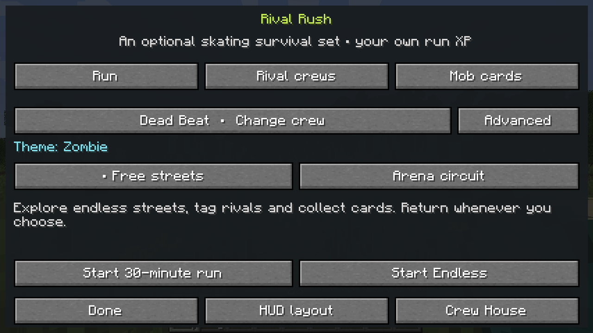

### 02 — Early street run and independent HUD

Separate Rush XP and vitality appear over the actual generated district and skating presentation. This is an early run, not a screenshot of sustained high-density combat. The compact objective line intentionally abbreviates.

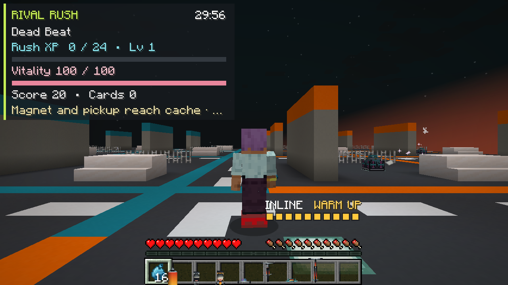

### 03 — Fresh player's album

This audit player had not picked up a card. The image therefore proves the real empty state and available exit, not a populated mastery ladder. Card collection and progression are separately exercised by the server tests.

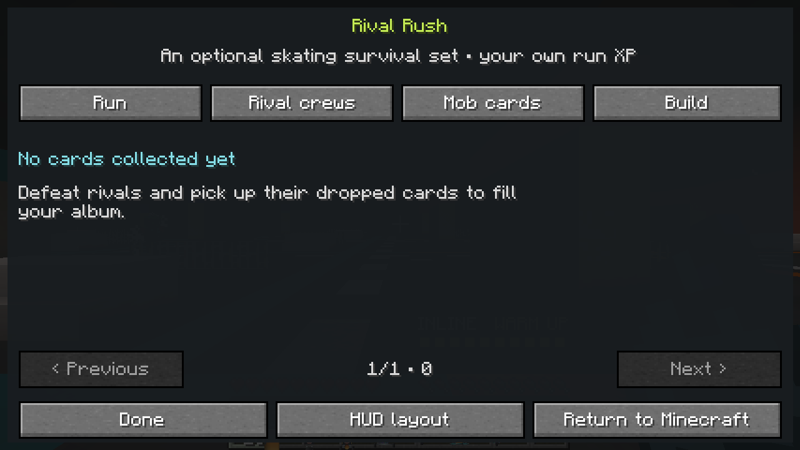

### 04 — Actual returned session

The result reports score 20, one rival and zero collected cards. The short visual run does not meet the crew settlement participation threshold; the state-restoration assertions and settlement GameTests provide their respective evidence.

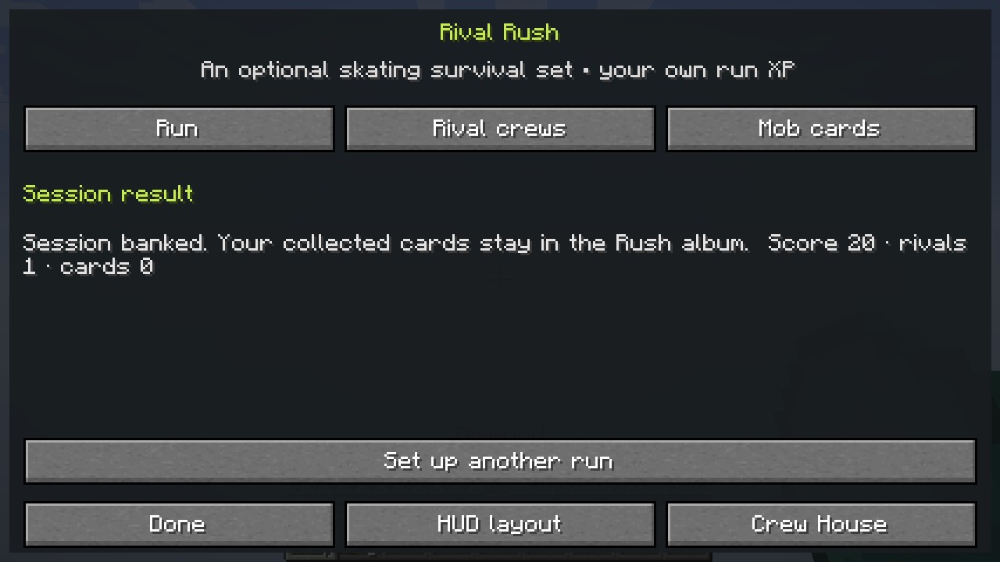

### 05 — Founded crew house

The house has two members, three roster slots, an eight-block radius and 24 starting Supplies. The native preparation tooltip is preserved and covers some lower-right controls.

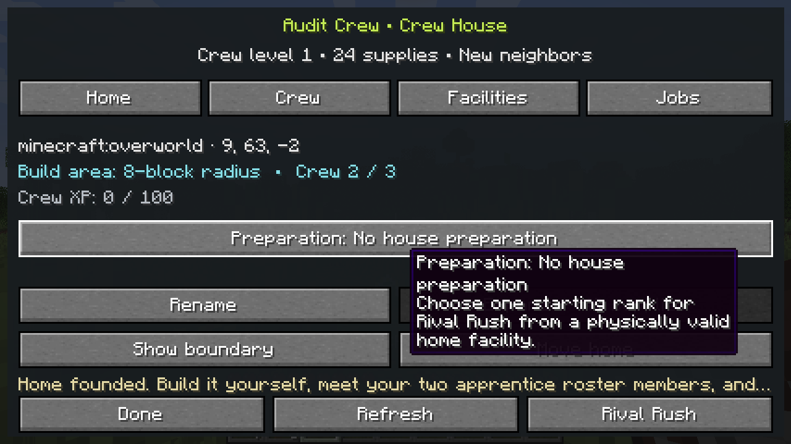

### 06 — Starter roster and training focus

Riff is the initial training focus and Patches is idle. These are persistent roster/mission profiles. The capture does not depict physical resident or follower AI.

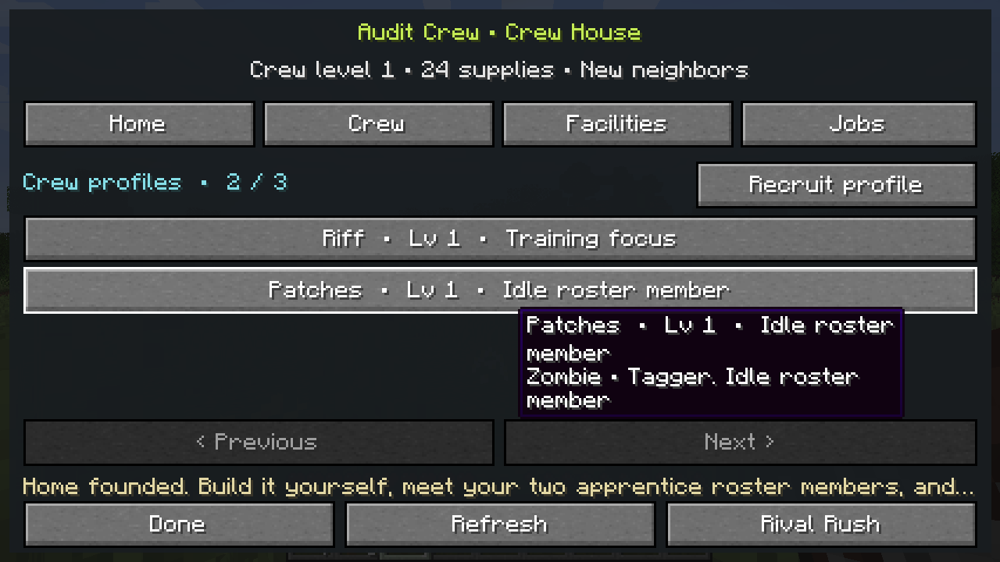

### 07 — Physical workshop registration

The Paint workshop is **Tier 1 · Operational** and registration reduced Supplies from 24 to 16. A native Practice yard tooltip covers parts of the other facility rows; this is not an unobstructed overview of all facilities.

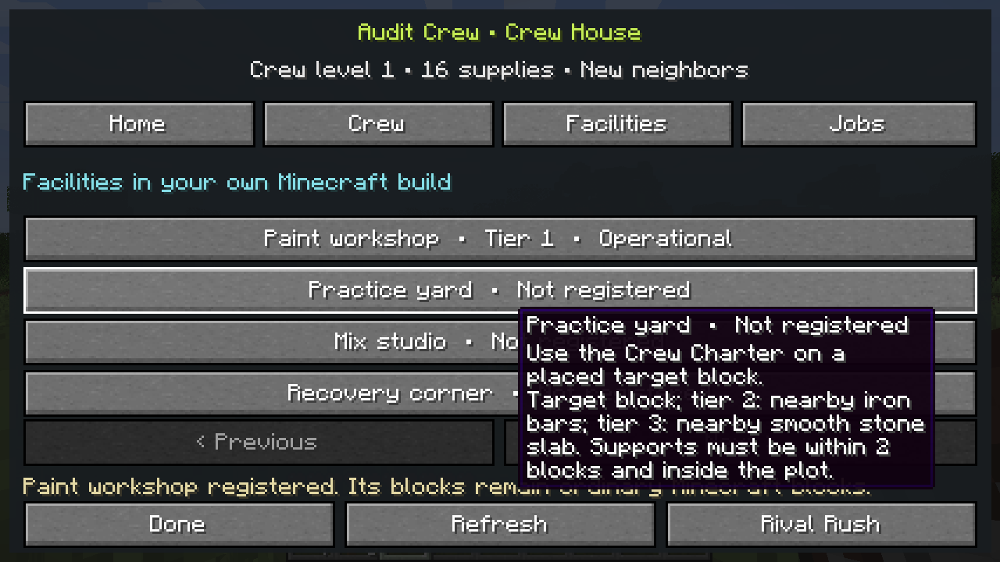

### 08 — Dispatched mission

Riff has a three-minute Neighborhood delivery occupying one of two job slots. The mission is running in this image. Finished claims and once-only settlement are covered by server tests.

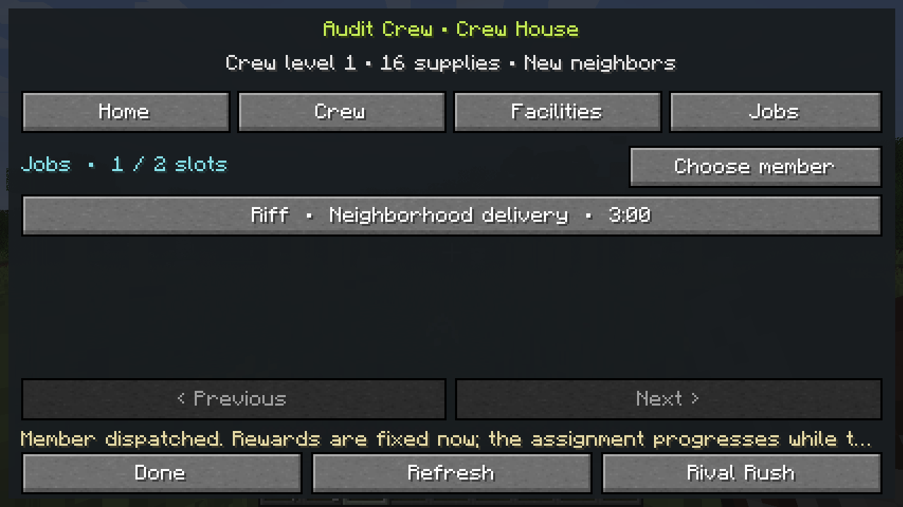

### 09 — Explicit Boombox activity choice

The real chooser shows Surprise me, Tag, King of the Hill, Crew Showdown and Rival Rush. Tag is selected in this preview, with its complete shared-reward amounts visible before Start. The following audit actions explicitly selected Rival Rush.

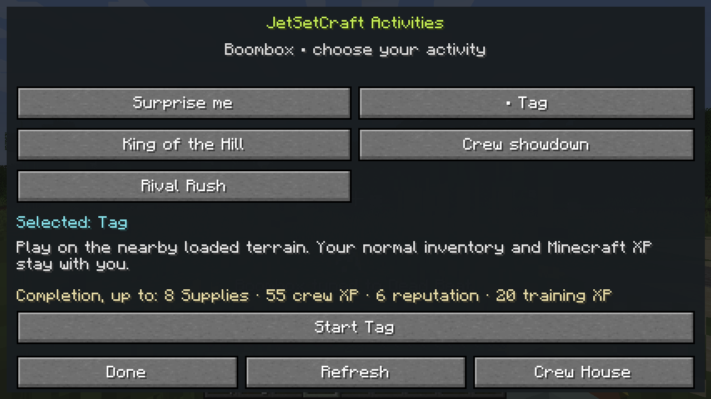

### 10 — First genuine circuit fork

Three actual offered rooms expose their different build rewards, shared crew reward emphasis, durations and dimensions. The progress strip, all four tabs and Return to Minecraft are visible. Descriptions intentionally abbreviate to one line; the full descriptions remain available through native tooltips. The audit selected a route and entered connected travel after this capture.

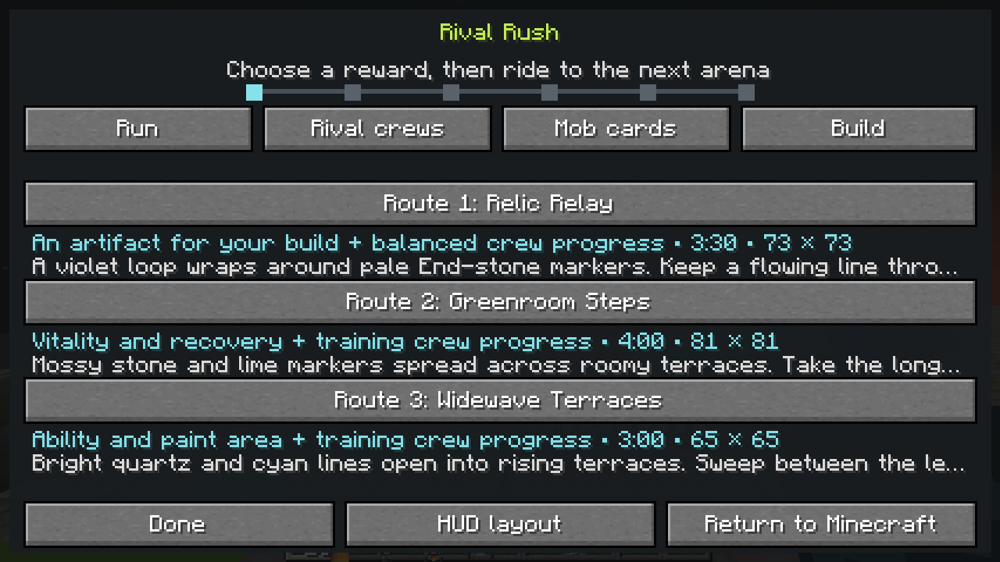

### 11 — Actual merged pull request

The browser shows PR #41 merged into `main` at `e57e9ab`, nine checks passed, and the successful closed state. This is an unmodified browser capture of the completed merge.

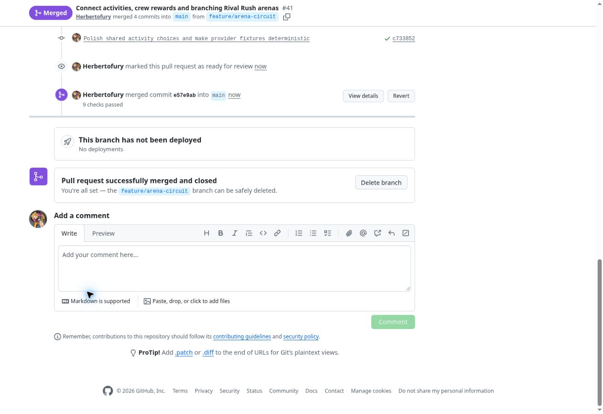

### 12 — Actual audit follow-up merge

The browser shows PR #42 merged into `main` at `76f44fe`, one passing base check and the successful closed state. This unmodified capture records the audit correction and guide publication separately from the original gameplay merge.

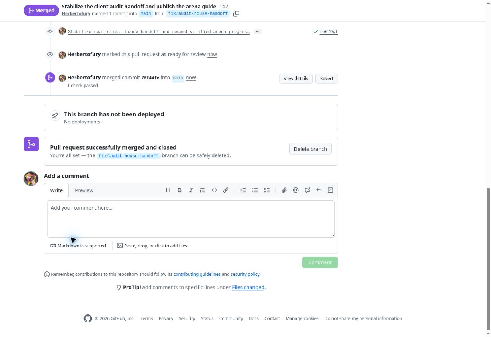

## Provider scope and observed upstream messages

The new provider pins are **Aether `1.20.1-1.5.2-neoforge`**, **Iron's Spells `1.20.1-3.4.0.2`**, **AoA `3.7.1` for Minecraft 1.20.1** and **Cataclysm `3.31`**. The Aether file is the pinned Forge-compatible 1.20.1 build despite the filename suffix. The AoA lane does not substitute the later Minecraft 1.21 release.

The Iron adapter creates the provider's real registered Firebolt and handles its real collision only for the server-created, marked, owner-bound Rush relay. It preserves native health, inventory, XP and mana in the tested path. It does not claim to import the entire spellbook, arbitrary status effects, summons or every provider capability.

The combined adventure server also logged two provider-owned issues:

- AoA's Forge version checker could not parse its remote update-check response. This was not an arena or world data-pack parse failure; the evidence does not determine whether the remote body was invalid JSON or an unexpected response.
- Iron's recipe `irons_spellbooks:curios/concentration_amulet` referenced unregistered `irons_spellbooks:mithril_ingot` and was rejected. That particular crafting recipe was unavailable. This does not establish that every other acquisition route for the amulet was unavailable. The [pinned provider recipe source](https://github.com/iron431/irons-spells-n-spellbooks/blob/ebd1972277d46be48170467b813d6cd8b04d15b8/src/main/resources/data/irons_spellbooks/recipes/curios/concentration_amulet.json) contains the reference.

Those configurations started and passed the specified integration checks. Their dedicated-server smoke cleanup did not assert graceful shutdown. The results do not certify all provider content or recipes.

## Practical limits of this checkpoint

- This is machine integration plus direct inspection of native captures. Human thirty-minute pacing, difficulty and house economy balance, prolonged Endless performance and broad modded-AI playtesting remain open.
- The visual audit does not complete an arena or six-room journey. Real server GameTests exercise combat, time-plus-defeat clear conditions and settlement using shortened test clocks. No completed job claim, populated card ladder or Build-tab screen is pictured.
- Crew members are roster/mission profiles; visible residents and follow-along NPCs are future work. Plot expansion recognizes more facility space and capacity; the player builds the house and it is not a general protection claim.
- Native dimension return and one Iron projectile integration are demonstrated. Every modded boss, foreign capability, spell, summon, recipe and cross-mod combination is not.
- Base-workflow normal dedicated-server save/shutdown and GameTest-server normal-save paths are tested. The eight provider dedicated smoke jobs prove startup only; their cleanup did not assert graceful save/shutdown. Forced crashes, storage failures and interrupted external provider state are not certified.
- Custom arena packs expose bounded maps, layouts and rewards. They do not import arbitrary structure NBT or supply an in-game editor. Crossfade Yard is statically validated and has not received a separate human playtest.
- Dungeons-inspired artifact families are implemented as JetSetCraft mechanics. This is not an import of the full Minecraft Dungeons I/II item catalogue or assets.
- The soundtrack importer and two exact supplied recording metadata entries are present. Sonic audio masters are not bundled or auditioned in this build.

Earlier receipts remain separately identifiable: [alpha.2 crew-house verification](../crew-house/README.md) and [alpha.1 Rival Rush verification](../rival-rush/README.md). Their older test counts and screenshots are historical checkpoints, not substitutes for this candidate's results.
