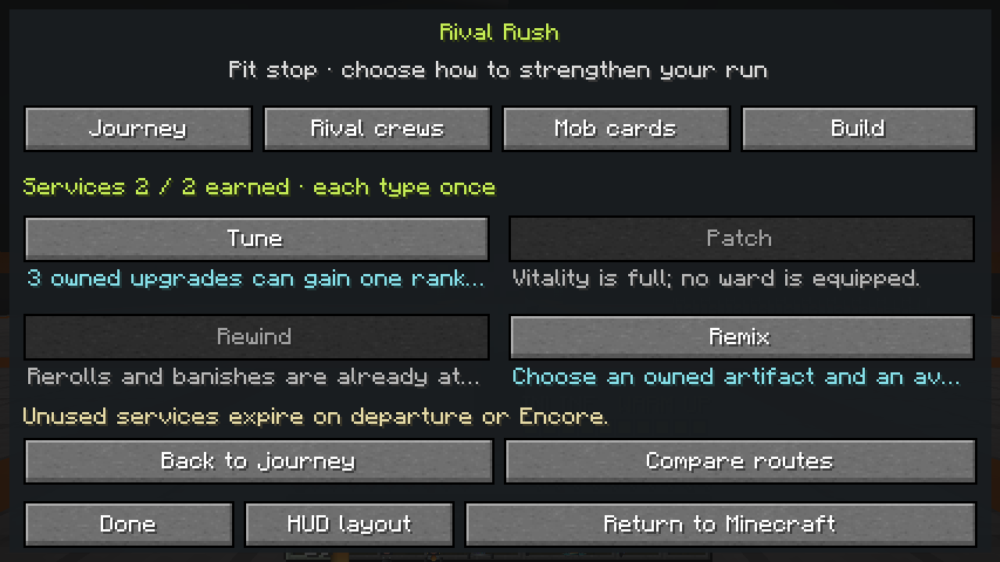

# Arena contracts, Pit stops and accepted feedback — alpha.7

**Verification status: PASS. Merge: `af8e7f1b7a41b0e491f04d3f3f8ca4288ac5eed7`.** This receipt covers `0.4.0-alpha.7` and [PR #46](https://github.com/Herbertofury/JetSetCraft/pull/46). It adds optional room goals and shared between-room services to the existing connected arena journey. The 23 Minecraft PNGs are an independent local reproduction. Historical results remain in the [alpha.6 receipt](../headliners/README.md).

## Source and artifact identity

| Identity | Recorded value |
|---|---|
| Local tested checkpoint | `3e211313f8b2fd4898abc05c9836099817f6a249` |
| Public feature head | `56b27b6b42ad55ac668e40ae294cadecf1f3948c` |
| PR integration | `e8115bf2339318273618846a26e1bdb40434aa8b` |
| Identical tree for all four sources | `e33c221bb02df4c949c28766007893215d7ca2ed`; fetched comparisons are empty |
| Actual merge | `af8e7f1b7a41b0e491f04d3f3f8ca4288ac5eed7`; the same fetched tree and empty diff against the tested source |
| Base workflow | [Run 41397720888](https://github.com/Herbertofury/JetSetCraft/actions/runs/41397720888) — PASS |
| Eight-provider workflow | [Run 41397720946](https://github.com/Herbertofury/JetSetCraft/actions/runs/41397720946) — PASS |
| Local rebuilt JAR | **5,893,408 bytes** |
| Local JAR SHA-256 | `c3886a511082baf295934f469cf7c385542bbf167bfc287badc77308261f37d0` |

Runtime: **Minecraft 1.20.1 / Forge 47.4.23 / Java 17 / PlayerAnimator 1.0.2-rc1+1.20**. Network protocol is **15**; clients and servers need matching versions. Stable `v0.3.0` remains separate.

[verification.json](verification.json) records source, workflow and artifact identities. [local-evidence.json](local-evidence.json) identifies local evidence and PNG hashes; the [redacted runtime summary](evidence/runtime-verification-summary.json) and [public CI metadata](evidence/ci-metadata.json) preserve their distinct scopes. [SHA256SUMS](SHA256SUMS) seals the final receipt. The runtime summary is an allowlisted summary, not a complete log. Raw environment metadata and credentials are excluded.

The local JAR hash does not establish CI binary equality. ForgeGradle runtime tasks execute `sourceSets.main` while the distributable JAR is built separately. This is not an independently installed reobfuscated-JAR runtime. Public CI job and step conclusions were checked against the exact-source workflow gates. No CI archive bytes or CI screenshots were independently inspected, and no equality with the local JAR is claimed.

## What players can do

Use a tuned **Boombox** with an empty hand, choose **Rival Rush**, review the invitation and select **Arena circuit → Start 6-arena journey**. It remains beside Tag, King of the Hill, Crew showdown and **Surprise me**. Random invitations reveal the selected game before launch. Separate Rush setup retains Free streets and its finite/Endless options.

Compare up to three routes, inspect **Briefing**, then ride the connector into the chosen room. **Journey** records actual visited rooms and current offers. Required time, owned-rival quota and any headliner gate still determine the clear. The optional goal adds a reason to ride, paint or seek dangerous rivals while completing that room:

| Contract | Accepted progress | Bound |
|---|---|---|
| **Relay** | Continuous riding through ordered, owner-visible beacons; direction and distance identify the next point. | 2–4 checkpoints; pauses and standard teleport resets break continuity. |
| **Paint** | Fresh, distinct accepted wall patches inside the active room. | 1–8 patches; duplicate or outside-room patches do not count. |
| **Hunt** | Actual virtual defeats of owned elites/captains, including headliners. | 1–4 defeats; ordinary rivals, foreign targets and removed bodies do not count. |

A pending/unloaded Relay point waits; unsafe standing space disables that optional task without blocking the normal room reward. Missing contract data defaults to none. Completing a contract alone grants no payout: its bonus is banked only with the real clear.

### One shared Pit stop budget

A clear earns **one service**, or **two total** with its completed contract. Resolve earned XP drafts first. Services are available between rooms and at the sixth-room Encore decision. Each kind is usable once per stop, and departure/Encore closes unused choices.

| Service | Actual bounded effect |
|---|---|
| **Tune** | Add one rank to an already-owned stat or artifact within its cap and provider availability. The bonus cannot buy a second Tune at the same stop. |
| **Patch** | Restore up to **40% maximum vitality** and **50% equipped ward capacity**, limited by what is missing. It does not create a ward. |
| **Rewind** | Restore one reroll and one banish, capped at **3/2**. Existing exclusions remain excluded. |
| **Remix** | Replace an eligible owned artifact at its exact existing rank; clear removed-family charge and consume this same budget. |

Previews show actual capped changes. Accepted results show before/after values. Owner, run UUID, revision, phase and clear receipt are checked server-side; stale, repeated and no-effect requests spend nothing. Shared Supplies, crew XP, focused-member training and reputation continue through the existing settlement, with no separate currency or extra permanent service payout.

The four-entry feedback feed reports accepted caches, mastery, contracts, clears, headliners, evolutions and services. **Last run** adds contracts banked and accepted services used; older Schema 1 reports default those optional counters to zero. **Crew House → Progress** remains the shared reward history.

## Verified matrix

The suite contains **63 distinct Forge GameTests**: 55 retained tests plus four contract, three Pit stop model and one Pit stop runtime test. Both workflows require the complete suite, build, dedicated-server readiness and normal saved-dimensions shutdown. Base additionally requires five native audit pass markers, including `JETSETCRAFT_CONTRACT_VISUAL_AUDIT_PASS`, and all 23 named captures. Final outcome: **all nine configurations passed on their first attempt: 567 executions of 63 distinct tests**, with builds and normal dedicated-server save/shutdown. Base also passed all 23 named native captures. The independent local replay passed all six validators, research-browser checks, clean build, all 63 GameTests, dedicated-server readiness/RCON stop/normal saved shutdown, and the reviewed 23-screen native audit. The three asset generators were invoked; optional brand source was absent, so existing tracked brand derivatives were retained.

| Configuration | Pinned providers |
|---|---|
| Base | No optional provider selection |
| `alexsmobs` | Alex's Mobs **1.22.9** |
| `alexscaves` | Alex's Caves **2.0.2** |
| `cataclysm` | L_Ender's Cataclysm **3.31** |
| `all` | Alex's Mobs + Alex's Caves + Cataclysm at those pins |
| `aether` | Aether **1.20.1-1.5.2-neoforge**, the pinned Forge-compatible archive |
| `irons_spells` | Iron's Spells 'n Spellbooks **1.20.1-3.4.0.2** |
| `aoa` | Advent of Ascension **3.7.1** |
| `adventure_all` | Aether + Iron's + AoA + Cataclysm at those pins |

These are two specific combinations, not all six providers installed together. Only base produces the native gallery. Retained tests reconcile curated Alex/Cataclysm registries and representative challenge returns, exercise actual Aether and AoA Precasia origins, and verify Iron's native Firebolt collision/ownership/cleanup. Provider absence remains supported. Broad native spellbooks, every foreign mob or boss phase, and arbitrary foreign-capability restoration are not established.

### Eight new pass markers

| Marker | Exercised behavior |
|---|---|
| `rush_contract_catalogue` | Optional legacy defaults, valid bounds, malformed profile rejection and detached previews. |
| `rush_contract_relay` | Ordered production riding observations; pause/teleport resets; blocked-beacon behavior. |
| `rush_contract_paint` | Actual accepted wall handler, inclusive arena boundary, duplicate rejection and progress before earned draft pause. |
| `rush_contract_hunt` | Owned captain/elite virtual defeats, foreign/ordinary/removed exclusions and unchanged native health. |
| `rush_pit_stop_rules` | Canonical clear receipts, one shared budget, duplicate/revision guards, closure and Remix sharing. |
| `rush_pit_stop_effects` | Final-room service availability, owned-rank caps, partial vitality/ward recovery and no-effect spending rejection. |
| `rush_pit_stop_snapshots` | Rewind caps and retained exclusions, detached snapshots, actual results and old-report counter defaults. |
| `rush_pit_stop_runtime` | Actual contract/clear/settlement, production action boundary, accepted feedback, Tune/Rewind, route closure and returned report. |

Model assertions and server runtime fixtures have different scopes. Fixtures shorten clocks and supply controlled movement/positioning to reach the tested boundary. Runtime action tests call the production server handler; the native audit below additionally uses real UI confirmations and packets. No remote network-socket or human-duration claim follows.

## Twenty-three native Minecraft captures

The original **1280 × 720, GUI scale 3** PNGs were captured in the guarded disposable audit world. All were directly reviewed across the team. The allowlisted native summary records each of the five audit PASS markers once, 23 capture markers and audited source-state restoration. These local observations do not determine CI or merge status.

| Captures | Observed state and scope |
|---|---|
| 01–04: [setup](01-setup.png), [HUD](02-district-hud.png), [album](03-album.png), [return](04-return-result.png) | Baseline **0 XP/score/cards**, readable controls, empty album; first report **0:05**, one rival, zero cards/rooms/contracts/services and **21.0 primary damage**. |
| 05–08: [home](05-crew-home.png), [roster](06-crew-roster.png), [facilities](07-crew-facilities.png), [jobs](08-crew-jobs.png) | Two crew profiles, operational workshop and an assigned **3:00** job. Hover tips obscure some secondary controls; the job is not completed or claimed. |
| 09–13: [activities](09-activities.png), [routes](10-arena-route.png), [Journey](11-journey-map.png), [Build](12-run-build.png), [Progress](13-crew-progress.png) | Activity/reward previews; Copper Current, room one, **0/6** cleared and optional Relay; **0/3 artifacts**, disabled Pit stop, **16 supplies**, empty reward history. |
| [14: Cache Scout](14-cache-scout.png), [15: Style Library](15-style-library.png) | Three visible cache rows and **three defeats still needed**; **0/16** learned, zero crew XP, page **1/6**. |
| [16: Build paths](16-build-paths.png), [17: Draft agency](17-draft-agency.png) | Cryo requirements **0/3 + 0/3**, disabled forge; actual offers after actions, rerolls **2/3**, banishes **1/2**, one exclusion. |
| [18: Headliner tell](18-headliner-tell.png) | Undefeated **561/561** headliner, phase-one **Paint drop / 1.2s**, full counterplay instruction and red ground circle. |
| [19: Run debrief](19-run-debrief.png) | Separate Free streets result: **5:02**, score **190**, two rivals/cards, zero arenas/headliners/contracts/services, **42.1 primary damage**. Lower report rows require scrolling. |
| [20: Contract briefing](20-contract-briefing.png) | Actual Signal Yard selection, Paint target three, no optional progress or room clear. |
| [21: Contract progress](21-contract-progress.png) | Native HUD after one accepted authored-wall patch: **1/3**, still incomplete. |
| [22: Pit stop](22-pit-stop.png) | Actual settled room and completed contract; **two earned choices**, four service kinds. |
| [23: Service result](23-service-result.png) | Real Tune confirmation: owned rank **1 → 2**, one credit spent and **one remaining**. |
| [24: PR merge](24-pr-merge.jpg) | Actual reviewed GitHub screenshot of the merged PR and nine passing checks. Separate from the 23 Minecraft frames. |

### Exactly what the native fixtures did

The earlier progression sequence uses two logged owned-rival hit fixtures, actual pickups and earned drafts. Its active clock advances **82 → 6,000** to expose the scheduled headliner; only camera orientation is adjusted for the tell. Its separate saved result contains **6,053 active ticks**, two defeats/cards and **42.084** raw primary damage. `ReturnRewardStatus=not_recorded` is a logged state check, not visible proof from frame 19. No headliner victory or evolution is granted.

The later Signal Yard sequence uses logged arrival/safe-position teleports and nearby chunk loading. Three accepted production wall-handler calls target inspected authored solid supports; no fallback wall is fabricated. Scripted owned-rival positioning and production hits accelerate combat while pickups and drafts follow ordinary rules. Only after the actual Paint task and required defeats are satisfied does the remaining clock advance **311 → 2,415**. The next normal manager tick clears and settles the room.

The returned run records **2,416 active ticks, eight defeats, eight cards, one arena clear, one contract banked and one service used**, with an accepted return award. A real UI confirmation and production packet apply Tune. The fixture does not assign completion flags, service credits, ranks, reward receipts or client snapshots. Audited ordinary inventory, Minecraft XP, original dimension and position are restored. The unused second service is not an extra award or a claimed use.

## Practical limits

This gallery proves a controlled Paint/service flow, not human Relay/Hunt completion, a six-room traversal, boss victory, evolved build or full human session. Automated clock values are not elapsed human play time. The bottom body line in frames 11/14/19 is partially clipped inside the scrollable viewport; the visible scroll hint and fixed footer remain readable. Lower report rows require scrolling; those captures do not independently verify every below-fold row.

Custom arenas remain bounded data packs: six base profiles and four provider-gated profiles, radius **16–48**, combat time **30–360 seconds** and up to **4,096** authored blocks. They are generated in Rush, not imported provider dungeons or a freeform in-game editor. Original Dungeons-inspired effects are not the complete native Dungeons I/II equipment catalogue. Human pacing, long-session economy, multiplayer scale and comparative enjoyment remain unmeasured; this receipt does not claim the entire finish contract is complete.
