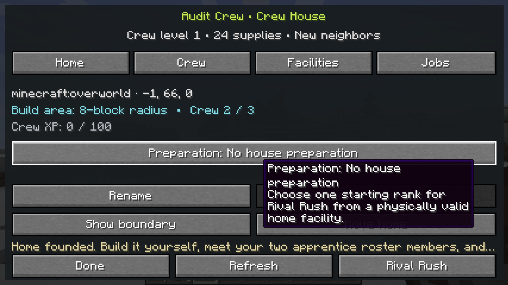
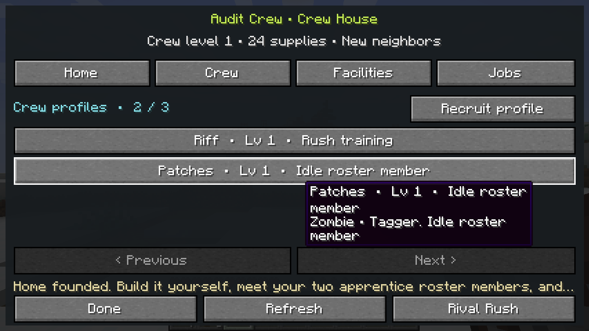
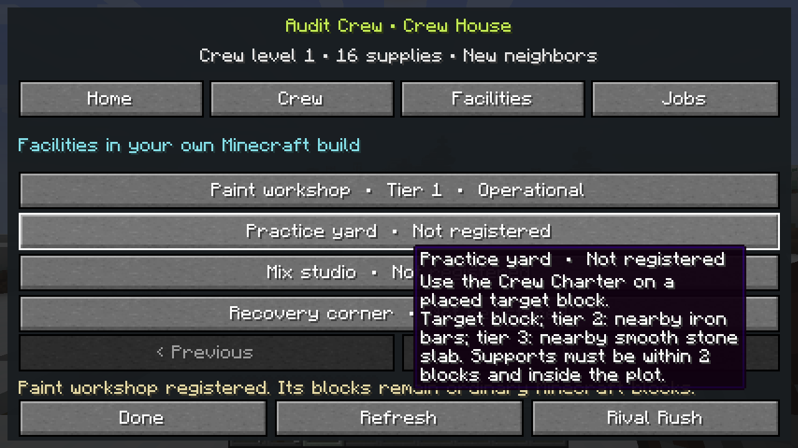
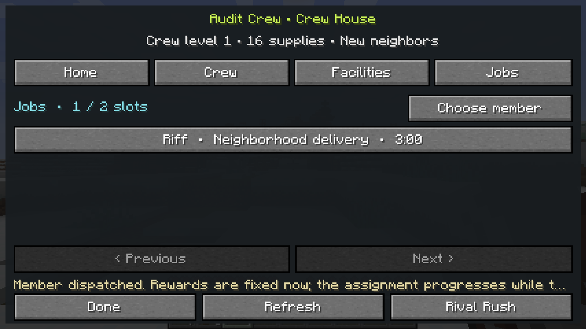
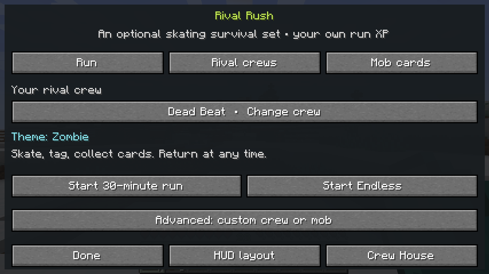
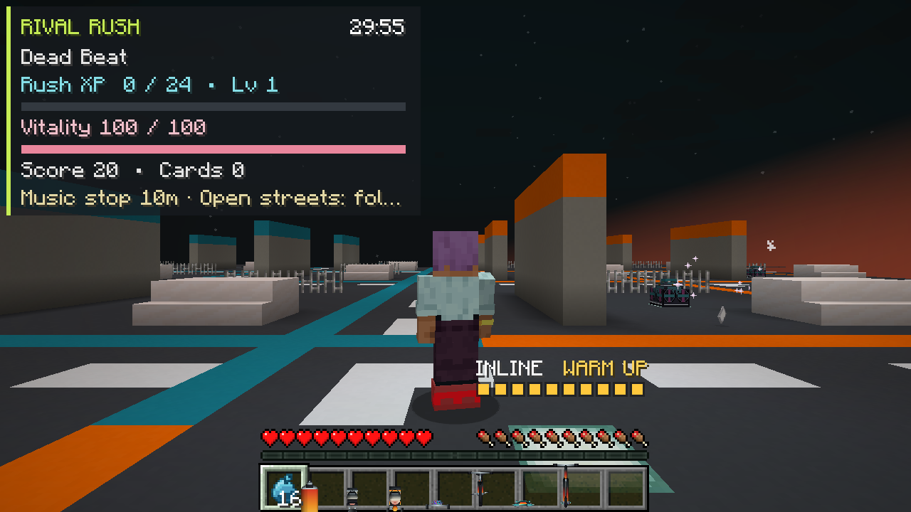
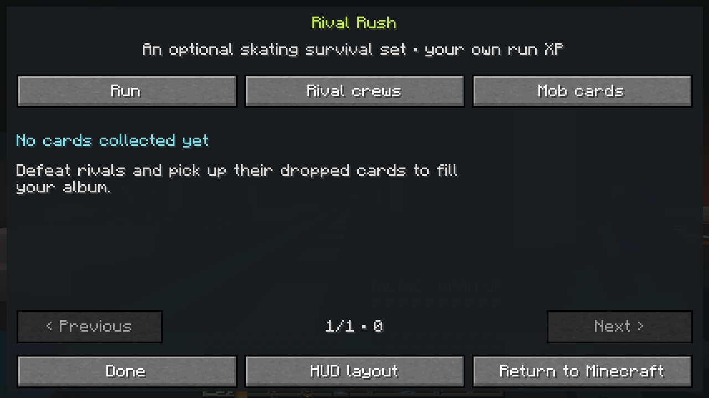
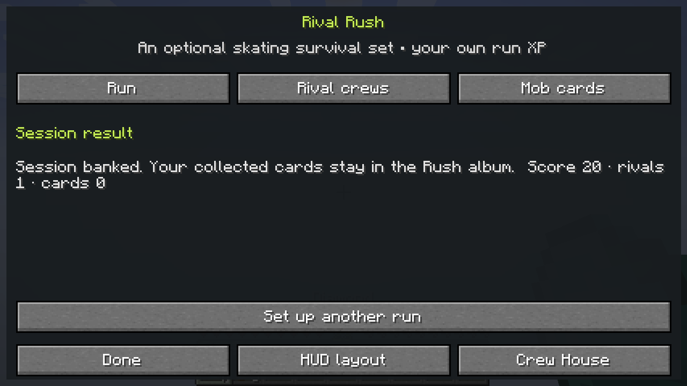
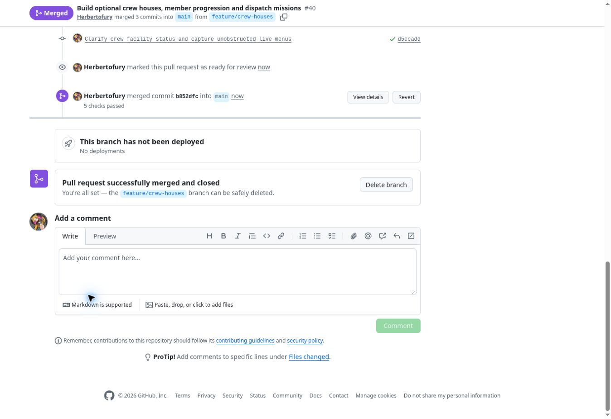

# Crew houses — verified alpha.2 build and real-client gallery

**JetSetCraft 0.4.0-alpha.2, verified 1 November 2026 and merged through [PR #40](https://github.com/Herbertofury/JetSetCraft/pull/40).** The published stable `v0.3.0` release remains separate. This development build adds player-built crew houses, member profiles and levels, reputation, dispatch jobs, physical facilities, optional Rush preparation and local-pack soundtrack support.

The [base Forge/client workflow](https://github.com/Herbertofury/JetSetCraft/actions/runs/41350812751) and [four optional-provider configurations](https://github.com/Herbertofury/JetSetCraft/actions/runs/41350812645) all passed. Each configuration compiled and passed **the same nineteen real Forge GameTests**, then completed dedicated-server readiness and graceful shutdown checks. The base run also exercised the actual graphical Minecraft client and produced the eight captures below.

## Actual crew-house screens

These are unchanged **1280 × 720 PNGs** from the final verified client. All eight images were visually reviewed. Home, Crew and Facilities retain ordinary hover help from the runner's mouse position; the images have not been retouched to hide it. Jobs shows the genuine active assignment. The automatic audit's attempted native cursor move did not clear those tooltips on this runner.

| Founded house: 24 supplies, two starter profiles | Persistent named roster and training selection |
|---|---|
|  |  |

| Placed workshop registered and operational | Riff dispatched on a real three-minute delivery |
|---|---|
|  |  |

The audit used vanilla fixture commands to place an actual Boombox and crafting table and give the player a Charter. It used the real Charter interaction and crew packet flow to confirm founding, observe two saved starter profiles, register the placed workshop and dispatch Riff. It required later mutations to increase the server revision. It did **not** fabricate completed jobs, claim a visual mission reward, or advance the visual assignment's timer. Its log ended with `JETSETCRAFT_CREW_VISUAL_AUDIT_PASS`.

## Rival Rush remains independent and optional

| Choose a thirty-minute or Endless session | Enter the separate street district |
|---|---|
|  |  |

| Fresh player's genuine empty album | Return to normal Minecraft |
|---|---|
|  |  |

The audit defeated one rival and did not collect its field card. The empty album and result showing one rival and zero cards reflect that actual state. Card claims, duplicate rewards, mastery thresholds and album persistence have separate GameTest coverage.

Before entry, actual vanilla commands supplied **7 diamonds, 5 bread, 23 XP levels and 17 XP points**. The client observed that nonempty fixture and used the real entry/return packets. It required exact inventory NBT, XP level and total-XP equality on return; XP progress within `0.000001`; the original dimension; and a position within one block of the saved position. The final log contains `JETSETCRAFT_RUSH_VISUAL_AUDIT_PASS` and all eight capture markers.

## Exact source, binary and workflow record

| Record | Value |
|---|---|
| Feature commit | [`d5ecadd0651c35fdffb505fa2790bda718e830db`](https://github.com/Herbertofury/JetSetCraft/commit/d5ecadd0651c35fdffb505fa2790bda718e830db) |
| Tested PR integration | [`b9bcec8258e164aa41af5838a89df8aac04bd7c7`](https://github.com/Herbertofury/JetSetCraft/commit/b9bcec8258e164aa41af5838a89df8aac04bd7c7) |
| Main merge | [`b852dfce9b17eadbb29699ee8d5d50e2c6ab8101`](https://github.com/Herbertofury/JetSetCraft/commit/b852dfce9b17eadbb29699ee8d5d50e2c6ab8101) |
| Identical tested and merged Git tree | `ae09822741b04f96cd4631e54a3f286277afb8ab` |
| Base workflow | [Verify JetSetCraft #274](https://github.com/Herbertofury/JetSetCraft/actions/runs/41350812751), job `124980345998` |
| Provider workflow | [Verify Wave 2 Providers #51](https://github.com/Herbertofury/JetSetCraft/actions/runs/41350812645), all four configurations passed |
| Runtime | Minecraft `1.20.1`, Forge `47.4.23`, Java `17` |
| Client dependency | PlayerAnimator `1.0.2-rc1+1.20` |
| Network protocol | `11`; use matching JetSetCraft versions on clients and server |
| Workflow artifact | `13101203337` — JAR, checksums, raw logs and eight screenshots |
| JAR | `jetsetcraft-1.20.1-0.4.0-alpha.2.jar`, **5,409,832 bytes** |

JAR SHA-256:

```text
226729453ede7d386251c1744bf5a4e2c4ed453459399b9ddf01bde13d4f9831
```

The downloaded artifact ZIP was **6,058,200 bytes** and matched GitHub's recorded SHA-256:

```text
259b1781bf9f8dd58e60f17e74d72abab1355a72ad0418d6da6705c437964d0a
```

The [machine-readable receipt](verification.json) records every job ID, test marker, screenshot hash and comparison tolerance. [SHA256SUMS](SHA256SUMS) records the JAR checksum. The source tree was compared directly before and after the merge and is identical. This documentation/evidence publication changes no runtime source; later runtime changes require their own checks. JAR binaries are distributed through artifacts and download bundles, not committed into the source repository.

## What the new tests establish

The nineteen-test gate consists of nine existing tests, six Rival Rush tests and four new crew tests:

| Test | Scope |
|---|---|
| `crew_house` | Founding, plot and physical-facility progression, costs, capacities, owner validation and bounded construction behavior |
| `crew_missions` | Real saved dispatch state, reward calculation, busy-member rules, deadline/claim/cancel behavior, stale and repeated requests |
| `crew_persistence` | World-saved profile/job progression, reload, dormant or missing anchors, relocation and unsupported-schema preservation |
| `crew_rush` | An actual eligible house and facility, optional starting preparation, real director-spawned rivals and defeats, crew reward banking after return and replay prevention |

Mission deadline and long-duration eligibility cases use controlled server-clock advancement so the tests remain bounded. The `crew_rush` fixture still requires at least three actual director-created rival defeats and verifies the real return/reward path; it is not a human one-minute play session. None of those fixtures establish enjoyment or progression pacing.

The main server reached ready state, accepted a normal RCON stop and saved all dimensions. Alex's Mobs, Alex's Caves, Cataclysm and their combined configuration each passed the same nineteen-test suite and dedicated-server gate. Those installed-provider checks are not a claim that every species or scripted boss works in Rush.

## Music and practical limits

The client loaded **two optional soundtrack metadata entries**. No Sonic audio master was supplied, bundled or auditioned. The importer smoke test used an original JetSetCraft stinger and checked streaming Vorbis output, valid stereo audio/duration, source and encoded hashes, overwrite refusal and invalid-path rejection. [Music integration](../../MUSIC_INTEGRATION.md) identifies the exact linked recordings and explains importing supplied masters.

Crew members in this build are **persistent roster/mission profiles**. Visible household residents, skating followers, playable mission segments and rhythm-scored musical activities remain future work. Plot expansion recognizes more facility area and roster capacity; it does not build a house or protect blocks.

This is machine integration evidence and visual review of a short session. It does not establish human thirty-minute pacing, long Endless balance or performance, every provider mob's AI, forced-crash/storage-failure behavior, or restoration of arbitrary third-party player capabilities. Normal progression persistence follows completed Minecraft world saves.

Continue with the [crew-house player guide](../../../wiki/Player-Chapters-Posse-and-Mob-Archetypes.md), [eight-game house/member research](../../CREW_HOUSE_DESIGN.md), [Rival Rush guide](../../../wiki/Rival-Rush.md) and [eighteen-game roguelite study](../../RIVAL_RUSH_DESIGN.md). The [alpha.1 record](../rival-rush/README.md) remains available as historical evidence.

## Confirmed GitHub merge


