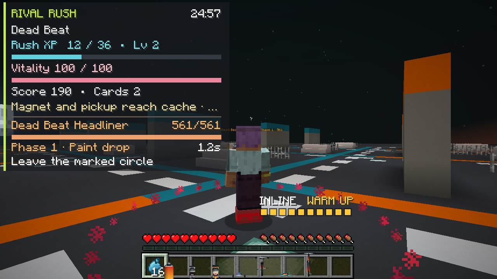

# Headliners, build evolutions and run debriefs — alpha.6

**Verified and merged: `0.4.0-alpha.6`, [PR #45](https://github.com/Herbertofury/JetSetCraft/pull/45). All nine CI configurations passed.** This receipt covers the new encounter, evolution, draft and debrief systems. The nineteen Minecraft PNGs are an independent local reproduction from the exact feature source. Historical alpha.5 results remain in the [Style Library receipt](../style-library/README.md).

## Source identity

| Identity | Recorded value |
|---|---|
| Local tested checkpoint | `f438241e32f8d753cab095ff8f70a03c1302116c` |
| Uploaded feature head | `1e8da0f47b2a9622a9ed454cbe8ac10fafdbad0a` |
| Tested PR integration | `988362f3dc4159df2ded4889059f67c8ed9406b0` |
| Identical source tree for all three | `b2618bbabd94649a88039eefdd2625f9f0839127`; fetched comparisons are empty |
| Actual squash merge | `6e85fb3015620a19a6bd4a69b0154cbe8d248527`; the same tree and an empty diff against the tested source |
| Base workflow | [Run 41392665091](https://github.com/Herbertofury/JetSetCraft/actions/runs/41392665091) — **PASS** |
| Provider workflow | [Run 41392665154](https://github.com/Herbertofury/JetSetCraft/actions/runs/41392665154) — **all eight jobs PASS** |
| Local rebuilt JAR SHA-256 | `b74c11fb5b3130157e020e9252806abdf92d680795299c33220af10d0560bdbf` — 5,803,146 bytes; local only |

Runtime: **Minecraft 1.20.1 / Forge 47.4.23 / Java 17 / PlayerAnimator 1.0.2-rc1+1.20**. Network protocol is **14**. Clients and servers need the matching alpha version. The published stable release remains v0.3.0.

CI results are read from public workflow and job/step metadata and interpreted against the exact checked-in workflow gates. [verification.json](verification.json) records the source, matrix and artifact identities; [raw CI metadata](evidence/ci-metadata.json) preserves the responses and [SHA256SUMS](SHA256SUMS) seals this receipt. No CI archive or CI JAR bytes were downloaded, and the local JAR hash does not establish CI binary equality. Native pixel review applies to the local PNGs only.

ForgeGradle's `runServer`, `runGameTestServer` and `runClient` use `sourceSets.main`. These gates verify the exact source in native Forge runtime while separately building the distributable JAR. They do not independently install and execute the reobfuscated JAR; this receipt is for an alpha continuation and does not close the finish contract's final packaged-release gate.

## What this contribution adds

### Encounters with visible counterplay

The director supports at most four elites, eight pending tells and one headliner. The selected original vanilla or modded mob body retains its native health, attributes and effects; Rush owns the temporary virtual encounter state.

| Elite | Warning and response |
|---|---|
| Linebreaker | A fixed ten-block lane with a 30-active-tick warning; dodge sideways. |
| Bombardier | A fixed disk with a 32-active-tick warning; leave the marked circle. |
| Basswarden | A fixed ring with a 36-active-tick warning; move inside or outside it. |

Warnings stop tracking the player once placed, pause with the run, and recheck loaded terrain, line of sight, ownership and impact bounds. Steering stops during the tell and recovery. Recovery gives a **25% virtual-damage opening**. Chill delays the next cast without moving an already-visible deadline.

Three-phase headliners appear at five-active-minute intervals in Free streets and gate circuit rooms **three and six**. A live boss prevents another from queuing; missed time windows do not produce a backlog. A genuine owned victory grants its existing captain rewards, one nonstacking evolution opportunity and one reroll refill up to three. A missing or invalid boss triggers safe interrupted return without a boss or room payout. The thirty-minute Free streets bank/Encore decision remains intact.

### Build evolutions and controlled drafts

Each evolution needs both listed artifact families at **rank three** and a headliner-earned opportunity. Selection is allowed at an XP draft, between rooms or at Encore. One evolution can be selected; replacing it needs another opportunity. Removing a prerequisite makes it dormant until the ranks are restored. The existing three-family limit still applies.

| Evolution | Prerequisites | Actual effect |
|---|---|---|
| Cryo shatter | Venom ink + Chill paint | A primary hit on an already inked and chilled rival consumes both statuses and creates a bounded, visible-target burst. It has a 60-active-tick cooldown. |
| Railstorm | Line battery + Rail shockwave | A primary hit that consumes the fully charged movement battery sends a bounded forward lane through additional visible rivals. Secondary hits do not consume another battery or recursively proc primary effects. |
| Radiant barrier | Radiant groove + Beat ward | Actual unused healing from the sixth-primary-hit Radiance proc restores up to six ward, capped by shield capacity. It cannot bank overheal. |

Runs begin with **three rerolls and two banishes**. A reroll keeps the earned level and XP and does not spend its budget if it cannot produce a useful change. Banishes exclude future XP-draft offers while preserving earned ranks and eligibility for physical caches or remixes. The screen shows next-rank effects, remaining controls and excluded choices. Run UUIDs, revisions and decision phase are checked by the server.

Accepted primary damage and its bounded secondary effects finish before defeat XP opens a new draft. This ordering matters for a charged hit that kills an elite or captain: the final hit still receives its legitimate Railstorm and other primary-triggered effects.

### A report that matches accepted progress

**Last run** persists after normal inventory/XP/position restoration and settlement. It records the saved outcome and reason, actual active time, final build, evolution, actual damage/recovery, cards, room/headliner clears and draft controls spent. Damage is capped to the vitality actually removed rather than including overkill.

The reward section identifies the accepted **Rush-return receipt only**. It does not relabel all earlier arena payouts as a new return reward. Owner/run/gang checks, detached bounded data, schema handling and clone copying protect the display record. The report cannot authorize a payout or replay the temporary inventory. A server restart without a surviving detailed session does not invent a new report.

Existing shared Crew Supplies, crew XP, member training, reputation, starting styles, cache rewards, arena journeys and normal return remain connected and covered by the retained tests.

## Verification and the eleven new tests

The clean isolated local source passed all five requested validators, a clean Forge build, **all 55 required real Forge GameTests**, dedicated-server readiness, an authenticated loopback RCON stop, normal saved-dimensions shutdown and the nineteen-screen native audit. All nineteen local images were reviewed for clipping, overlap, readability and truthful displayed state.

The complete, unchanged [build/GameTest log](evidence/local-build-gametest.log), [dedicated-server log](evidence/local-dedicated-server.log) and [native-client log](evidence/local-native-client.log) retain their success and normal-shutdown markers. Ordinary and escalated filesystem reads produced identical hashes. [local-evidence.json](local-evidence.json) records their byte identities, the local JAR identity and each reviewed image. Asset-generation commands were observed during preparation but have no separately retained transcript; no transcript was reconstructed.

The CI matrix passed **55 tests in each of nine configurations: 495 executions of 55 distinct tests**. Each lane passed build and normal dedicated-server save/shutdown. Base additionally passed all nineteen named captures and the progression/fixture/return observations. Both workflows passed on their first attempt.

| Configuration | Pinned providers | Result |
|---|---|---|
| Base | No optional provider selection | PASS |
| `alexsmobs` | Alex's Mobs 1.22.9 | PASS |
| `alexscaves` | Alex's Caves 2.0.2 | PASS |
| `cataclysm` | L_Ender's Cataclysm 3.31 | PASS |
| `all` | Alex's Mobs + Alex's Caves + Cataclysm | PASS |
| `aether` | Aether 1.20.1-1.5.2-neoforge, the pinned Forge-compatible release | PASS |
| `irons_spells` | Iron's Spells 'n Spellbooks 1.20.1-3.4.0.2 | PASS |
| `aoa` | Advent of Ascension 3.7.1 | PASS |
| `adventure_all` | Aether + Iron's + AoA + Cataclysm | PASS |

These are two particular combined configurations, not all six optional providers installed together. Only base runs the native client gallery.

| Added marker | Exercised behavior |
|---|---|
| `rush_draft_controls` | Earned draft/XP retention; bounded budgets and exclusions; useful rerolls; stale/replayed spending rejection. |
| `rush_evolution_rules` | Rank-three requirements, earned opportunities, three slots, dormant/reactivated paths and actual recovery accounting. |
| `rush_debrief_rules` | Bounded detached reports, schema preservation and rejection of unrelated or mismatched reward receipts. |
| `rush_evolution_cryo` | Real primary hits, pre-existing statuses, status consumption, cover, cooldown and owner-only secondary targets. |
| `rush_evolution_railstorm` | Production movement charge supplied through six bounded four-block samples and actual primary consumption; forward/visible target bounds; the captain-killing hit resolves before the XP draft. Retained tests separately exercise physical movement observation. |
| `rush_evolution_return` | Radiance's actual unused healing, ward cap, real server action boundary, safe return and accepted receipt/debrief round trip. |
| `rush_elite_tells` | Real owned bodies for all three elites; paused warnings, dodge and recovery bonus, plus ring and tell-cap geometry checks. |
| `rush_tagger_cover` | A real delayed tagger attack is blocked by cover placed after its warning. |
| `rush_headliner_victory` | Three phases, foreign/stale hit rejection, exactly-once victory/evolution rewards and direct missed-window/no-backlog scheduling checks. |
| `rush_headliner_arena_gate` | The actual third-room manager fight and settlement cannot complete before the headliner is defeated; direct final-room abort/gate checks. |
| `rush_headliner_recovery` | Missing-body interrupted return, finite-deadline withdrawal and preserved street bank/Encore behavior. |

These are controlled fixtures. Some clocks, prerequisite ranks and route objectives are advanced directly to reach the behavior under test. The room-three fight is exercised through the manager; room-six abort/gate rules also have direct production-model checks, not a second full six-room playthrough. The new Rush action fixtures call the production server handler directly; retained crew-style tests separately cover their codec round trip. No remote network-socket test is implied. Compatibility success applies to the pinned versions and exercised paths, not every spell, mob or arbitrary combination.

The new evolution/headliner fixtures use the Dead Beat zombie-family roster. Their provider lanes establish coexistence with the installed packs, not all headliner phases on every foreign mob. Separate retained tests reconcile the exact Alex's Mobs/Alex's Caves/Cataclysm registries and representative challenge round trips; Aether/AoA tests exercise real dimension-origin returns. The Iron's integration exercises the existing JetSet-created native Firebolt relay and preserves provider mana. Broad native spellbook support and arbitrary foreign-capability restoration are not implied.

## Nineteen native Minecraft captures

Every PNG is **1280 × 720 at GUI scale 3**, captured by the real client from the same tested source. The native audit uses a guarded disposable `RivalRushAudit` world. Its ordinary inventory, Minecraft XP, source dimension and return position are compared after leaving Rush.

| Capture | Observed state and scope |
|---|---|
| 01–04: [setup](01-setup.png), [district](02-district-hud.png), [album](03-album.png), [return](04-return-result.png) | Readable entry and HUD, an honest empty album, and the first saved report: **0:05 active time, one rival, zero cards, 21 primary damage**. |
| 05–08: [home](05-crew-home.png), [roster](06-crew-roster.png), [facilities](07-crew-facilities.png), [job](08-crew-jobs.png) | Actual founding and workshop placement; early two-member crew. The three-minute job is assigned, not completed or claimed. Ordinary hover tooltips temporarily cover underlying rows in 05–07 and remain on screen. |
| 09–13: [activities](09-activities.png), [routes](10-arena-route.png), [Journey](11-journey-map.png), [Build](12-run-build.png), [Progress](13-crew-progress.png) | Rival Rush beside Tag/KOTH/Showdown/Surprise; prospective rewards labeled “up to”; first branch choices, **0/3 artifacts** and empty reward history. |
| [14: Cache Scout](14-cache-scout.png) | Three of six cache summaries are visible with scrolling; three fresh room defeats are still required. The logged arrival teleport uses a genuinely built room and does not represent human connector traversal or a completed arena. |
| [15: Style Library](15-style-library.png) | Three locked lessons on page **1/6**, **0/16 learned**, zero crew XP and home preparation. |
| [16: Build paths](16-build-paths.png) | Cryo shatter page **1/3**, both prerequisites actually **0/3**, no earned opportunity and a disabled headliner-gated action. |
| [17: Draft agency](17-draft-agency.png) | Three real offers, exact next effects, **2/3 rerolls**, **1/2 banishes** and one exclusion after accepted actions. |
| [18: Headliner tell](18-headliner-tell.png) | An actual undefeated headliner at **561/561 displayed health**, phase one, **Paint drop / 1.2s**, complete counterplay instruction and a visible red fixed circle. |
| [19: Run debrief](19-run-debrief.png) | Top of the reopened saved report: **5:02 active time, two rivals, two cards, zero arenas/headliners, 35.1 primary damage, one reroll and one banish**. Its lower build/reward sections require scrolling. |
| [20: PR merge](20-pr-merge.jpg) | Actual GitHub browser screenshot of the successful merge and nine passing checks; separate from the nineteen Minecraft frames. |

The new draft sequence defeats actual server-owned actors with production primary tags and collects their actual pickups. To reach a scheduled boss promptly, an explicitly logged fixture advances **only the active clock from 77 to 6,000 ticks**. It does not assign ranks, kills, an evolution opportunity or a reward. The final report records **6,054 active ticks** and `ReturnRewardStatus=not_recorded`: two actual defeats do not meet the three-defeat participation requirement. That receipt status is verified in audited state/logs, not the visible top of frame 19. The screenshots do not establish five minutes of human play or a headliner victory.

## Corrections made before this checkpoint

The first compile exposed two `long`/`int` mismatches in deferred XP handling; both were corrected. An earlier full test attempt reused an old world and passed 51/55. Two old founding tests collided with persistent plots at their fixed anchors. The boss victory test also conflated the current surviving elite threat with the independent headliner outcome, and the arena fixture used a teleport call that expects a real player connection. The result now has an explicit `HeadlinerState`, and the fixture uses the established fake-player movement idiom. A seed-dependent draft choice was removed from the recovery-bonus fixture. The final isolated world passed all 55 without relaxing production payout or ownership rules.

## Practical limits

This is a deeper playable alpha, not a claim that the entire finish contract or roguelike ambition is complete. Human pacing, long-session/Endless economy, multiplayer scale and comparative enjoyment remain open. The complete native Dungeons I/II equipment catalogue, broad spellbook/mana integration, companions and beams are not implemented by this contribution. Custom arenas remain bounded data packs. Future content must preserve the shared once-only rewards, optional-provider isolation and saved return journal verified here.
