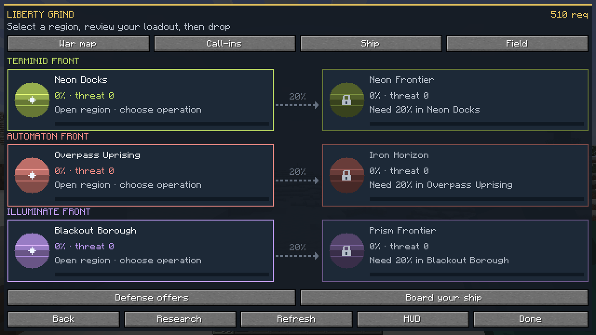
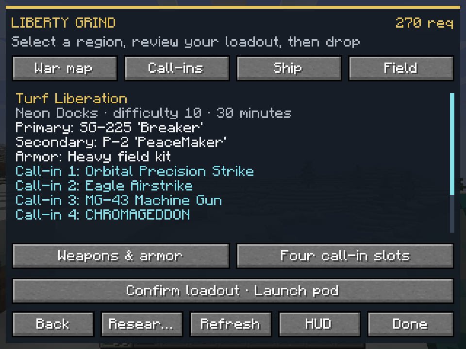
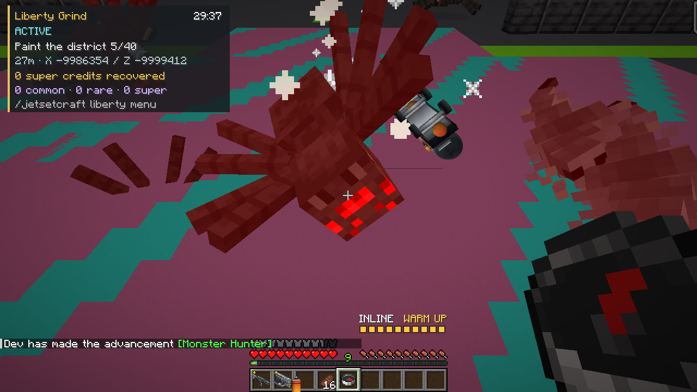
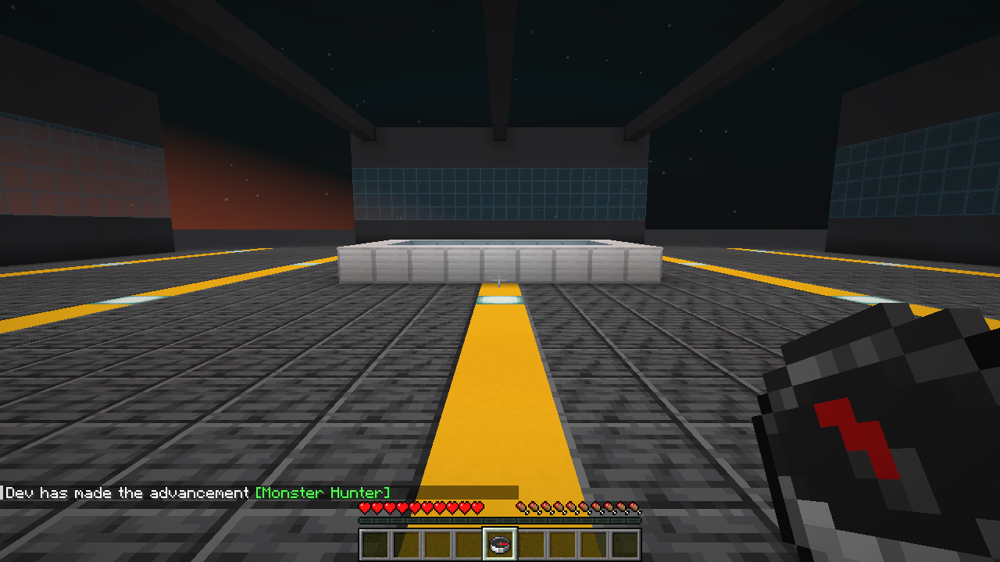

# Liberty Grind campaign — alpha.9 verification receipt

## Continuation status — 3 November 2026 UTC

The follow-up to PR #49 changes production source after the local checkpoint below. It adds bounded retirement of abandoned ordinary combatants, fairer access to shared admissions, terrain-grounded home routes, varied repeatable defense offers and extraction-deadline handling. It also repairs two native timing/isolation fixtures and the hosted client gate's outdated fixture marker. Four new required GameTests bring the source inventory to **122 distinct required cases**; the existing native director case additionally checks relocation and replacement pressure.

The current workspace passes asset, gameplay-contract, premium-polish, provider-manifest, wiki, research-browser, Python-compilation and whitespace checks. The unchanged Java syntax validator helper also parses all **240 Java files** successfully through Java 17 source launching; the stock wrapper requires an unavailable `javac` executable. **Forge compilation, the 122-case native matrix, the rebuilt installed JAR and new native-client captures are pending hosted verification.** This workspace cannot download the Gradle distribution, so the archived local results must not be treated as verification of the changed source. The provider workflow now prepares a separate official Forge installation from pinned original providers and tests the exact newly built JAR, retaining its checksum and sanitized evidence.

## Archived local checkpoint — 2 November 2026

**118/118 required GameTests passed in each of three configurations, and all nineteen native-client captures passed individual pixel review for the exact source and JAR identified below.** The clean build, ten offline gates and independently installed dedicated-server smoke check also passed at that checkpoint. Candidate 1’s earlier installed smoke remains archived against its own JAR; these records do not establish a later source revision's outcome.

This expansion supplies 28 seeded mission adaptations, difficulties 1–10, 20/25/30 minute operation budgets, six shared campaign regions, the pre-pod armory/four-call review, a walkable ship and explicitly accepted home defense. The catalogue distinguishes 100 selectable calls from 25 shared/mission/historical references; exact native provider mappings and JetSetCraft adaptations are documented separately. Read the [implementation guide](../../LIBERTY_GRIND.md), [player guide](../../../wiki/Liberty-Grind.md), [mission source mapping](../../research/LIBERTY_MISSION_RESEARCH.md) and [per-call behavior mapping](../../research/LIBERTY_CALLIN_IMPLEMENTATION.md).

## Recorded gates

| Gate | Observed result and evidence |
| --- | --- |
| Final clean build | **PASS**, exit 0 in **22.30 seconds**. Built the reobfuscated alpha.9 JAR with both optional providers available. [Build log](final-build.log); [matrix metadata](final-matrix.json). |
| Ten offline gates | **PASS**, each exit 0: assets, gameplay contract, premium polish, Wave 2 compatibility, Java syntax, wiki, research-source consistency, 34 research-browser logic checks, Python compilation and whitespace. [Exact commands/output](offline-checks.json). These are preflight evidence, not native gameplay or pixel review. |
| Full native-provider GameTests | **118/118 PASS**, exit 0 in **269.65 seconds**. All required real-provider, campaign, home-safety and lifecycle markers were present, with **zero Liberty skips**; exact source, compiled classes/resources and JAR were unchanged. [Exact log](gametest-final-full-provider.log). |
| TaCZ present, required gun pack absent | **118/118 PASS**, exit 0 in **143.61 seconds**. Admission executed and reported `provider=true pack=false`; **21 provider-dependent Liberty cases recorded explicit skips**. [Exact log](gametest-final-missing-pack.log). |
| Standalone, no TaCZ or MCDivers | **118/118 PASS**, exit 0 in **139.30 seconds**. Admission executed and reported `provider=false pack=false`; the same **21 optional-content cases recorded explicit skips** while the shared suite remained usable. [Exact log](gametest-final-base.log). |
| Independently installed final JAR | **PASS for the exact `cf892b…` JAR**, exit 0. The official Forge server reopened its existing isolated no-player world, reached readiness in **20.54 seconds**, verified all provider/content/guard diagnostics, answered registered-command checks and saved all dimensions after authenticated normal stop; total **26.65 seconds**. [Installed receipt](installed-smoke.json), [server log](installed-server.log), [loader log](installed-loader.log), [stop log](installed-rcon-stop.log). The receipt identifies the input `level.dat` hash. This is installed-package/reopen/save evidence, not mission gameplay or a fresh-world claim. |
| Final native campaign client | **Retry 4 PASS**, process exit 0 in **101.24 seconds**, with **all nineteen exact PNGs individually reviewed by two reviewers**. The authoring agent also independently reviewed four key frames. Actual menus, moving pod, native selected gun, CHROMAGEDDON paint/progress, ship movement and two original-world returns are visible. [Audit receipt](native-audit.json), [root pixel review](root-pixel-review.json), [source manifest](native-source-manifest.json), [full log](native-client.log), [marker excerpt](native-audit-excerpt.log), [24-file checksums](NATIVE_SHA256SUMS). |
| Hosted CI / PR / merge | No hosted run, downloaded CI artifact or merge outcome is claimed by this local receipt. Record publication separately when it exists. |

The [final matrix](final-matrix.json) records **354 registered required-test completions across 118 distinct cases**. The intentional-absence lanes include their disclosed skips; those skipped native scenarios were executed in the full-provider lane. No required full-provider marker was missing.

Each configuration used a newly created independent run directory through `gameTestRunDirectory`, with a fresh world and its deliberately selected content. The runner excluded recompilation/resource processing after the clean build and verified unchanged source inputs, compiled classes/resources and JAR after every lane. It left the shared development world and gun-pack directory untouched. The machine-readable receipt records those checks for each lane.

## Exact source and artifact identity

| Identity | Recorded value |
| --- | --- |
| Mod / network | `0.4.0-alpha.9` / protocol `17`; matching client and server required |
| Minecraft / Forge | Minecraft `1.20.1`, Forge `47.4.23` |
| Final source inputs | **689 files**, covering `src/main` plus `build.gradle`, `gradle.properties` and `settings.gradle`; [per-file manifest](final-source-manifest.json) |
| Source-input digest | `48afdfa7fece7bb786b08d9f7cd30dcb7edaa101b612a8fdc0a05bae06b3c134` |
| Compiled classes/resources digest | `90f6509ad857aa689c1e2a37e14a9548c4d908672dbba7d6019912c3466d794a` |
| Distributable | `jetsetcraft-1.20.1-0.4.0-alpha.9.jar`, **6,495,215 bytes** |
| JAR SHA-256 | `cf892bd0bc04fb3f9678ad665b764342c94c141e84435ee2f4dd5c6781937251` |

The source digest hashes the manifest's canonical JSON rows, including each relative path, size and SHA-256. It is not a Git commit or tree ID. Documentation and evidence can be added afterward without changing these compiled inputs. A client manifest may use a different aggregate format; establish equality using its actual per-file records rather than comparing unlike aggregate algorithms.

For the final client, all **689 individual file hashes match the final build manifest exactly**. Its documented checksum-line aggregate is `a7dbd9df7653c24c90dac372d727621c251b2e23167cc5ed189bf247c8f95ef8`; the different aggregate serialization does not represent different source. Compiled inputs and the final JAR also remained unchanged, and the audit wrapper restored its settings files byte-for-byte.

Each installed smoke check identifies the exact reobfuscated JAR copied into its separate official Forge installation; an earlier artifact’s pass does not transfer to a rebuilt JAR. ForgeGradle GameTests and `runClient` instead execute the project's source set in native Forge. These are separate evidence boundaries: the installed smoke proves loading, registered commands, applied guards and normal save/stop; source-set native fixtures prove their exercised gameplay paths; reviewed screenshots prove the visible states they actually show. None alone substitutes for the other two.

### Pinned optional content

| Component | Exact upstream identity |
| --- | --- |
| TaCZ | `tacz-1.20.1-1.1.8-hotfix2.jar`, 57,472,579 bytes; SHA-256 `2cbb89f44333d2eb4e825d86d789ff119b272ff75184390b55bafd4f0e7f10c2` |
| MCDivers | `mcdivers-forge-1.20.1-1.0.3.jar`, 2,160,981 bytes; SHA-256 `49c4ab153c50dab8766fca15ab7affcc14b1c9a8e7e52d58a9683c06ac4ceac0` |
| Merged Helldivers gun pack | `[eof]helldivers_gun_pack.zip`, 72,883,841 bytes; SHA-256 `fe4e01693cf3957d971e556a1d2fcd9ae0c98cb973cf47aa6d52e157c187378a` |

The [pack guide](../../LIBERTY_GRIND_PACK.md) and [installed receipt](installed-smoke.json) retain upstream download references, player-animation dependency and official Forge installer identity. These third-party binaries/content are not embedded in JetSetCraft. The merged pack's missing optional Create recipes are upstream content diagnostics; the tested archive remains unmodified.

## Passing full-provider gameplay coverage

The final source has **118 required GameTests**, including the retained movement, crew, activity, Rival Rush and original Liberty cases. The campaign expansion adds 34 required cases over alpha.8's 84. A pass count includes explicitly skipped optional-content cases in the intentionally absent-provider lanes; their logs must distinguish a successful admission-denial test from an unexecuted native-provider scenario.

All six [campaign runtime cases](../../../src/main/java/com/herberto/jetsetcraft/gametest/LibertyCampaignRuntimeGameTests.java) passed in the full-provider lane using the real manager and native server ticks. Their observed completion markers have prefix `JETSETCRAFT_LIBERTY_CAMPAIGN_RUNTIME_PASS`:

| Marker suffix | Required exercised behavior |
| --- | --- |
| `liberty_campaign_native_director_caps` | Actual difficulty-10 deployment and live director admissions, with per-operation resident, per-tick and cumulative pressure checks. Passive survival cannot complete an objective. This fixture does not establish sustained multi-player load at the shared ceiling. |
| `liberty_campaign_native_tacz_core` | Actual selected TaCZ weapon consumes ammunition and produces a native projectile; its native collision kills an owned core and advances only the applicable demolition objective. Remaining real core deaths finish that base without skipping its simultaneous peer. |
| `liberty_campaign_native_floor_turf` | Actual loaned free-paint spray creates owned floor decals, distinct ground cells count once, and underlying block states remain unchanged. |
| `liberty_campaign_native_home_preservation` | A legitimate owner-specific offer enters an actual home operation; existing block volume, chest NBT, ordinary mob and old graffiti survive, temporary actors/paint are removed, and deep inventory, ride, XP and source state return. A failed attempt releases the same offer for retry. |
| `liberty_campaign_native_ship_redeploy_return` | Real ship entry and campaign redeployment traverse the production packet codec/handler, retain the original journal and restore the original world and deep belongings. |
| `liberty_campaign_native_stratagem_lifecycle` | Real initial pod and reinforcement pod reject calls without closing the engine. Native lethal damage enters Downed; the actual reinforce packet consumes a drop. The same engine, delivery, loadout, supply balance and exact cooldown deadlines survive, calls work after landing, and return closes/cleans support. |

Additional native cases cover all 68 live gun definitions, real armor attributes, packet action/nonce routing, actual MCDivers actors, native TaCZ incendiary/explosive/interactive-target boundaries, owned Witch splash effects, foreign targets, ordinary controls and home callbacks. The home-mob case uses actual director-owned actors to exercise hard-mode zombie aid denial, conversion containment, raid exclusion, shulker duplication prevention, ore/egg/pressure-plate behavior and ordinary behavior after return. Model fixtures separately cover deterministic plans, each objective action, stage ordering, campaign/ship transactions, bounded rewards and four-slot resource rules.

The existing native lifecycle suite still includes actual extraction, serialized same-identity rejoin recovery and durable return/settlement acknowledgements. Those controlled server cases are distinct from the shortened client capture route; a field, ship or return screenshot is not evidence that the client naturally completed a whole campaign.

### Why the native safety checks matter

The three strictly validated containment sources have different jobs. `LibertyTaczProjectileMixin` gates the pinned optional provider's native bullet hit callbacks before foreign-target or terrain side effects. `LibertyHomeEntityMixin` and `LibertyHomeBlockStateMixin` guard actual home participants/owned actors at Minecraft 1.20.1 contact dispatch. The installed-server diagnostic verifies the actual injected marker interfaces in the reobfuscated environment; source selectors alone are insufficient. Home admission fails closed if the guards are absent.

Public Forge hooks contain remaining owned conversion, reinforcement, vibration, trample and damage paths. Native initialization prevents unowned jockeys and ordinary-raid membership. Home rosters use cave spiders in place of silverfish and strays in place of skeletons, avoiding their known unhooked world-writing/conversion paths. Ordinary actors retain native callbacks; normal mob/Gang Form compatibility still rejects other injection paths. See the [implementation boundary](../../LIBERTY_GRIND.md#shared-campaign-and-safe-home-defense).

## Fixture interventions and limits

The native server cases use disposable worlds, uniquely identified fixture players, explicit loaded-region tickets and controlled relocation to make assertions deterministic. Most cases use Forge FakePlayer. The call lifecycle case uses an actual ServerPlayer with a no-socket outbound listener, because Forge FakePlayer deliberately rejects all damage and omits native death handling. It acknowledges the controlled dimension transfer through the native public hook, then applies a controlled lethal hit attributed to a real director-owned mob; native damage/death and the production Downed handler remain intact. Core tests lower one target to one health and shorten a gun draw setup; the shot, ammunition, native projectile, damage and death attribution remain real. Home-offer fixtures submit explicitly failed public campaign results instead of injecting an offer or compressing the shared campaign clock.

Home safety fixtures create a disposable stone test platform and ordinary block/entity controls, freeze/reposition actual admitted director actors, temporarily select Hard only for a synchronous reinforcement assertion, and restore the setting immediately. The test calls native conversion paths with disclosed controlled timing. These interventions establish side-effect boundaries and lifecycle behavior; they do not establish naturally generated terrain traversal, human accuracy, a complete 20–30 minute playthrough or difficulty balance.

The client audit used only the explicitly named disposable `LibertyGrindAudit` save. A clean baseline was verified by exact `level.dat` and player-data hashes. A logged synthetic result through the real ship settlement API granted **510 requisitions**, funding the actual **240-requisition CHROMAGEDDON purchase** and slot-four equip through native UI/packets. This demonstrates purchasing and equipment flow, not naturally earned unlock pacing. The audit chose the actual Breaker, Peacemaker and Heavy kit, then launched difficulty 10 with a thirty-minute budget.

After genuine pod descent, disclosed server staging placed the player beside an actual active territory site and enabled invulnerability/flight permissions for reliable observation. Camera/view angles and viewport were controlled; mission clocks and objective progress were not patched. The real field radio invoked CHROMAGEDDON: the sampled blast frame shows **5/40 cells**, **14 actual owned paint entities** were observed and verified removed on return, and the later field panel shows **1/5 required sites secured**. The final reopened map shows **330 requisitions and Neon Docks threat 30** after that partial operation's real settlement.

The ship movement check used **25 ticks of actual forward-key input**, traveling **5.136875 blocks**, with the real floor and compiled chunk checked. Both the campaign early return and ship return restored the original deep inventory NBT, Minecraft XP and Overworld destination. Original settings were restored. This client route did not complete a campaign extraction or buy a ship module. The native server suite separately exercises the relevant rules and retained extraction lifecycle.

## Native gallery

These are unchanged screenshots from the actual Minecraft/Forge client, with original filenames, dimensions, byte lengths and SHA-256 hashes in [native-audit.json](native-audit.json). Default views are **640 × 360 logical pixels** in a 1280 × 720 framebuffer; minimum views are **320 × 240 logical pixels**. The [root review](root-pixel-review.json) is anchored to each image's exact bytes. Native advancement toasts overlap upper-right chrome in captures 15 and 16; objective/hardware text and actions remain readable. The images retain those toasts.

| Capture | Visible state |
| --- | --- |
| [01 — campaign war map](01-campaign-war-map-default.png) | Six regions, faction fronts and three parent-to-frontier routes. |
| [02 — operation plan](02-campaign-plan-default.png) | Actual difficulty 10, thirty-minute plan and explicit pre-pod review action. |
| [03 — call-in catalogue](03-callin-catalog-default.png) | Search, unlock/cost state and 125-entry catalogue pagination. |
| [04 — CHROMAGEDDON equipped](04-chromageddon-equipped-default.png) | Actual purchase result, remaining balance, mission limit and equipped slot four. |
| [05 — all-gun armory](05-armory-all-weapons-default.png) | Primary/secondary/armor navigation, live selection and 68-definition pagination. |
| [06 — Heavy armor, minimum](06-armor-heavy-minimum.png) | Real kit and displayed armor/toughness/movement tradeoffs. |
| [07 — weapon search, minimum](07-armory-weapon-search-minimum.png) | Native search resolves the exact selected Breaker. |
| [08 — war map, minimum](08-campaign-war-map-minimum.png) | All six region cards, route links, locks and primary controls fit. |
| [09 — operation plan, minimum](09-campaign-plan-minimum.png) | Difficulty/duration, mission text and review remain usable. |
| [10 — full loadout, minimum](10-loadout-review-minimum.png) | Both guns, armor, all four calls, editing controls and explicit launch confirmation. |
| [10b — scrolled review, minimum](10b-loadout-review-scroll-minimum.png) | Mission-loan and original-state restoration explanation, with fixed controls. |
| [11 — full loadout, default](11-loadout-review-default.png) | Complete review and restoration explanation fit together. |
| [12 — moving pod](12-live-pod.png) | Physical pod surrounds the seated rider; heavy armor/skates and Dropping HUD are visible. |
| [13 — native gun and HUD](13-selected-native-gun-hud.png) | Real selected Breaker model/ammunition HUD and actual themed opponents. |
| [14 — CHROMAGEDDON](14-chromageddon-paint-blast.png) | Real pink/cyan paint, native damage/death effects and sampled 5/40 territory progress. |
| [15 — field, minimum](15-field-progress-minimum.png) | Later 1/5 secured state and readable field/call-in/return actions; native toast retained. |
| [16 — ship modules, minimum](16-ship-hardware-minimum.png) | All four module names/prices, 330 requisitions, armory and return controls; native toast retained. |
| [17 — physical ship deck](17-walkable-ship-deck.png) | Metal deck, yellow path, central platform, windows and roof structure; native movement checked separately. |
| [18 — reopened home map](18-returned-home-map.png) | Actual reopened war map after original-world return, with settled requisitions/threat and ship action. |

## Preserved failed iterations

| Attempt | Observed failure and subsequent correction |
| --- | --- |
| GameTest attempt 1 | Stopped because Forge-generated event listeners from nested test classes with the same simple name collided. Test listener classes received unique names. The contaminated run is not a gameplay acceptance result. [Log](gametest-attempt-1.log). |
| GameTest attempt 2 | **112/115**, before the later regression cases were added. Two home tests exposed a real transport check that discarded valid owned home pods outside the Liberty dimension. The all-gun assertion also passed TaCZ compatibility arguments in the wrong order; that was a fixture correction. The runtime ownership check and fixture were corrected separately. [Log](gametest-attempt-2.log). |
| Candidate 1 / GameTest attempt 3 | **113/118**, with unchanged source/artifact identities during the run. The home-preservation fixture had not prepared all land required by the stricter preflight; the lethal-hit fixture used Forge's deliberately invulnerable FakePlayer; the returned-player egg control omitted the native server fall dispatch; the retained Rush fixture asserted a headliner before its actual readiness. Separately, the live `zeta:las12` heat weapon exposed a real adapter omission. Prepared terrain, a genuine damage-capable ServerPlayer, the public fall callback and state-based Rush readiness repaired the fixtures; native heat-feed support repaired the adapter. [Log](gametest-attempt-3.log); [candidate matrix](candidate-1-final-matrix.json); [original source](candidate-1-final-source-manifest.json). Its successful [installed smoke](candidate-1-installed-smoke.json) remains attached to JAR `af238e…`, not a later rebuilt artifact. |
| Client attempt 1 | Stopped after three captures because the production packet allowlist rejected new pre-pod actions. The action allowlist was corrected and real packet regression coverage added. [Log](client-attempt-1.log). |
| Client attempt 2 | Produced **14 ordinary captures through label 13, plus a failure capture**. Actual post-landing call readiness exposed that the first pod tick closed the live stratagem engine. The context now remains active through Dropping while phase rules still prohibit calls; the real pod/downed/reinforcement lifecycle regression was added. Process exit 0 did not turn the audit's failure marker into a pass. [Log](client-attempt-2.log). |
| Client attempt 3 | Produced **three ordinary captures plus a failure capture**. The strict clean-baseline precondition found the previous attempt's purchase in the disposable save and stopped before deployment. Explicit leaf-file restoration and independent byte comparisons repaired the fixture; no game source changed. Its 689 per-file inputs match Candidate 1's archived source manifest despite the client manifest's different aggregate format. [Log](client-attempt-3.log); [diagnosis](client-attempt-3-diagnosis.json). |

[GameTest attempt metadata](attempts.json) and [client attempt metadata](client-attempts.json) preserve source identities, original/published log hashes and observed outcomes. Published text logs replace absolute machine paths, and the installed logs redact any private RCON secret; diagnostics remain intact. Those transformations are disclosed in the JSON receipts. Final native PNG evidence is preserved as exact copies, with each image’s hash recorded in the audit and pixel-review receipts.

## Remaining scope and predecessor evidence

Deployments are solo, with a shared server campaign. Escort and evacuation objectives move rigs/markers rather than a population of rescued NPCs. The 20/25/30 minute selections are operation budgets, not guaranteed human session lengths. The 100 selectable call-ins include documented JetSetCraft adaptations; only their explicit provider mappings claim native implementations. One-rider hardware does not imply the original game's multiplayer vehicle systems.

Human pacing, aim feel, the complete equipment economy, natural high-difficulty clears, sustained multi-player server load, every combination of 100 call-ins and arbitrary third-party mods/capabilities still require playtesting. An installed server with no connected player does not prove mission gameplay; controlled source-set fixtures and a shortened client audit do not prove a human 30-minute operation.

The [alpha.8 receipt and fifteen-image gallery](../liberty-grind/README.md) retain their original source, binary and hosted identities. Earlier Rival Rush and crew receipts likewise remain historical evidence, not substitute verification for this expansion.
