# Shared rewards, journey maps and skating builds — verified alpha.4

**JetSetCraft `0.4.0-alpha.4` was verified on 2026-11-02 and merged through [PR #43](https://github.com/Herbertofury/JetSetCraft/pull/43).** The base mod and all eight optional-provider configurations passed the same **35 real Forge GameTests**. All nine dedicated-server smoke processes reached readiness and then passed an authenticated normal RCON stop, saved-dimensions check and successful launcher exit. The base client produced **thirteen unchanged 1280 × 720 captures**, all inspected after download.

This milestone makes shared progress visible through actual credited receipts, a nonblocking reward notification and **Crew Charter → Progress**. It adds a map of known journey rooms, exact arena settlement details, a readable current build, one optional rank-preserving artifact remix per clear and three skating-driven artifact families. Player instructions are in [Rival Rush](../../../wiki/Rival-Rush.md), [crew houses](../../../wiki/Player-Chapters-Posse-and-Mob-Archetypes.md) and [Compatibility](../../../wiki/Compatibility.md). [Crossfade Yard](../../../examples/arena-data-pack/README.md) remains an editable custom arena example.

## Exact source and download identity

| Identity | Value |
|---|---|
| Feature commit | `b120db1b0a75870f5b9275f81e5e072f836a3893` |
| Tested PR integration | `b0506b052e2e8d7b8f762bd5da3e6daea878a27f` |
| Actual merge on main | `e826694c3429394b2b264f153cd9ea34b1fb9051` |
| Identical feature/tested/merged tree | `1aab5454652554bffee78299a8f86a2c19013261` |
| JAR | `jetsetcraft-1.20.1-0.4.0-alpha.4.jar` |
| JAR size | 5,644,758 bytes |
| JAR SHA-256 | `182e4b589191c288472b059e9be71b89374687768f079580301153d97498e24c` |
| Base artifact | `13113306160` — `jetsetcraft-forge-1.20.1-b0506b052e2e8d7b8f762bd5da3e6daea878a27f` |
| Artifact ZIP size | 6,669,289 bytes |
| Artifact ZIP SHA-256 | `9f82e262cda113231060613ee78ea67223a1925722205ef897ece50f42afd4f3` |

All nine artifact ZIPs were downloaded and matched GitHub's recorded digests. Their **nine JARs are byte-identical** to the hash above. The delivered binary is the tested base artifact, not a later local rebuild. GitHub commit records establish exact tree equality between the feature, tested integration and actual merge. The subsequent documentation/receipt publication does not change this binary. Stable **v0.3.0** remains a separate release.

Runtime: **Minecraft 1.20.1, Forge 47.4.23, Java 17, PlayerAnimator 1.0.2-rc1+1.20 on clients, network protocol 13**. Dedicated servers do not require PlayerAnimator. The CI JAR contains the full generated **139-entry graffiti catalogue**.

[verification.json](verification.json) contains every artifact identity, job, complete test-marker set, native-provider diagnostic, log checksum, screenshot checksum and limitation. [SHA256SUMS](SHA256SUMS) seals that machine-readable receipt and the fourteen unchanged evidence images.

## Completed runtime gates

Base [Verify JetSetCraft #286](https://github.com/Herbertofury/JetSetCraft/actions/runs/41379581968) and optional-provider [matrix #59](https://github.com/Herbertofury/JetSetCraft/actions/runs/41379581891) are the final candidate runs.

| Configuration | Successful job | GameTests | Dedicated smoke |
|---|---|---|---|
| Base | [125067211271](https://github.com/Herbertofury/JetSetCraft/actions/runs/41379581968/job/125067211271) | 35 / 35 | Ready, normal stop, dimensions saved, launcher success |
| Alex's Mobs | [125067210841](https://github.com/Herbertofury/JetSetCraft/actions/runs/41379581891/job/125067210841) | 35 / 35 | Ready, normal stop, dimensions saved, launcher success |
| Alex's Caves | [125067210692](https://github.com/Herbertofury/JetSetCraft/actions/runs/41379581891/job/125067210692) | 35 / 35 | Ready, normal stop, dimensions saved, launcher success |
| Cataclysm | [125067210466](https://github.com/Herbertofury/JetSetCraft/actions/runs/41379581891/job/125067210466) | 35 / 35 | Ready, normal stop, dimensions saved, launcher success |
| Mobs + Caves + Cataclysm | [125067211000](https://github.com/Herbertofury/JetSetCraft/actions/runs/41379581891/job/125067211000) | 35 / 35 | Ready, normal stop, dimensions saved, launcher success |
| The Aether | [125067210745](https://github.com/Herbertofury/JetSetCraft/actions/runs/41379581891/job/125067210745) | 35 / 35 | Ready, normal stop, dimensions saved, launcher success |
| Iron's Spells | [125067210739](https://github.com/Herbertofury/JetSetCraft/actions/runs/41379581891/job/125067210739) | 35 / 35 | Ready, normal stop, dimensions saved, launcher success |
| Advent of Ascension | [125067210702](https://github.com/Herbertofury/JetSetCraft/actions/runs/41379581891/job/125067210702) | 35 / 35 | Ready, normal stop, dimensions saved, launcher success |
| Aether + Iron's + AoA + Cataclysm | [125067210795](https://github.com/Herbertofury/JetSetCraft/actions/runs/41379581891/job/125067210795) | 35 / 35 | Ready, normal stop, dimensions saved, launcher success |

This is **315 successful test executions across nine configurations, comprising 35 distinct tests**. Every downloaded runtime log contains the complete 35-marker set. The dedicated smoke evidence is separate from the GameTest server's own shutdown. The workflow requires a real normal stop, saved dimensions, a nonempty world `level.dat` and a successful launcher exit; forced cleanup is a failure path.

The previous provider smoke gate checked startup and then terminated its process group. It did **not** establish graceful dedicated shutdown. This milestone strengthens that gate and reruns every configuration. The [dated alpha.3 correction](../arena-circuit/README.md#scope-correction--2026-11-02) preserves the old successful startup/test results and hashes while correcting that claim. These new results are not attributed to old jobs.

### New behavior exercised

Seven added test markers cover shared history, account caps, mission attribution, journey previews/history, build rules and actual build runtime. Existing movement, combat sovereignty, graffiti, activities, houses, missions, Rush return, arena catalogue/rules/session and native-provider tests remain in the gate.

- **Shared rewards:** actual credited deltas after caps; sixteen-entry display history separate from the 128-receipt replay guard; original pre-house receipts retained; pending progress transferred once; mission training credited to the assigned member. Tag + Hill + Showdown before founding produce 34 Supplies and 77 training XP; founding adds 24 starting Supplies and applies training to Riff, reaching 58 Supplies and member level two without double credit.
- **Journey:** only actual known room data, maximum previews versus accepted settlements, no duplicate history totals, bounded room history and a fresh map on Encore while the run build remains.
- **Remix:** one nonstacking opportunity per genuine clear, exact-rank transfer to an unowned family, three-slot limit, provider availability, explicit confirmation flow and rejection of invalid or stale requests without spending the opportunity.
- **Movement artifacts:** observations reject non-riding, nonfinite and discontinuous positions; standing still cannot charge the battery; a genuine moving airborne interval and ground transition trigger the landing pulse; wall-hidden rivals cannot receive the mark. Native health and potion-effect NBT stay unchanged in the tested virtual combat path.
- **Active-time expiry:** five upgrade-paused manager calls advance neither the run clock nor the mark. Rank-one mark remains active at tick 49, expires at tick 50, removes its visible label and restores unmarked secondary damage. Every configuration contains the `JETSETCRAFT_RUSH_MARK_EXPIRY active_ticks=50 paused_calls=5` diagnostic.
- **Primary/secondary boundaries:** invalid or foreign targets do not spend a charge; secondary damage and the provider's real native Firebolt collision preserve it; one valid primary tag consumes it once.

The local Java 17 source parser accepted 163 Java files. Asset, gameplay, premium-polish, provider-manifest and wiki validators passed, as did the research browser check, all 34 research-browser logic tests and whitespace checks. Full Forge compilation and runtime acceptance came from the final CI jobs above.

## What the graphical client actually did

The real client entered Free streets through ordinary packets, captured setup/HUD/album, returned with one collected card, founded a house through a real Charter, registered a physically placed workshop and dispatched a timed job. It opened the native Boombox chooser, deliberately selected Rival Rush, received a real three-room offer, opened Journey and Build, chose a route, entered connected travel, returned and opened Crew Progress. No completed room or claimed mission was manufactured for the images.

The saved-state fixture contained **seven diamonds, five bread, Minecraft level 23, total XP 17 and XP progress 0.22077923**. The audit asserts exact inventory NBT, level and total-XP equality, XP progress within `0.000001`, the original dimension and source position within one block. Its arena-return assertions run **before** opening Progress. The raw log includes the Crew, Activity and Rush visual PASS markers and `JETSETCRAFT_ACTIVITY_AUDIT_RETURN_RESTORED`.

The thirteen client images are the exact artifact bytes; native hover tooltips in 05–07 are retained. Early empty history, zero artifacts and no completed journey rooms are intentional evidence limits. Populated receipts, remix logic and completed settlements have separate GameTest coverage, not screenshots of outcomes the client audit never reached.

### 01 — Free-street setup

The real setup shows Free streets selected, named crew choice, Arena circuit, a thirty-minute run and Endless. Opening this menu does not begin a run.

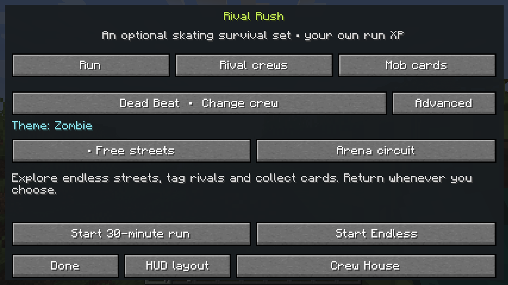

### 02 — Early street run

The independent Rush HUD appears over the actual generated district. This is an early 29:56 state with one visible Dead Beats rival, not evidence of sustained high-density combat.

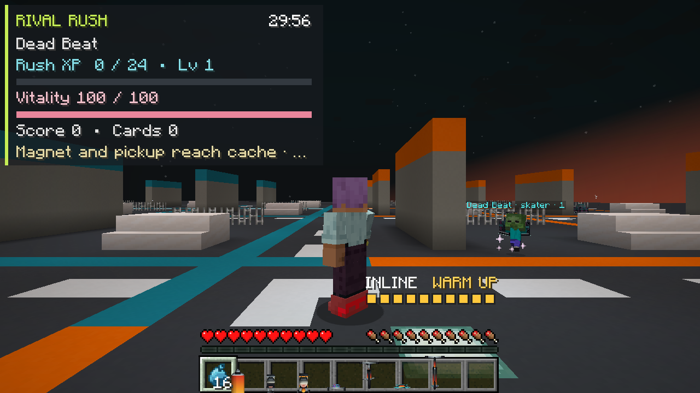

### 03 — Fresh album

The album was empty at capture time. Card collection, mastery and persistence are covered by server tests; a populated ladder is not pictured here.

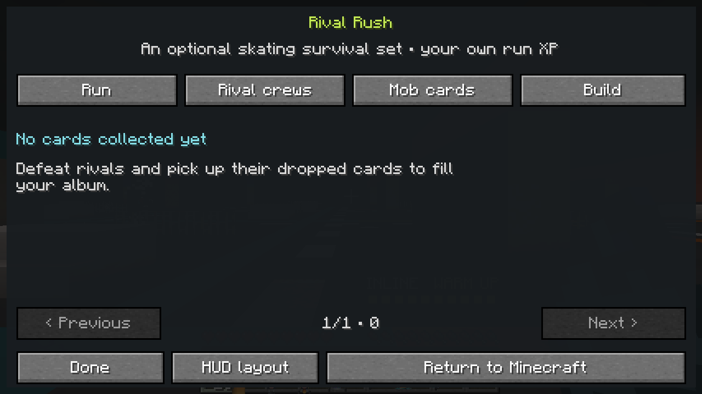

### 04 — Actual returned result

The short street session reports score 95, one rival and one collected card. It does not meet the shared-crew participation threshold. Exact saved-state restoration is asserted separately in the client log.

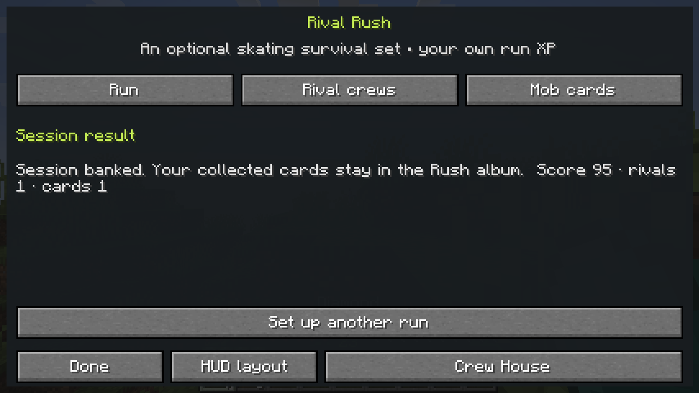

### 05 — Founded house

The house has 24 Supplies, two members in three slots and an eight-block radius. An ordinary native hover tooltip is preserved and covers some lower-right content.

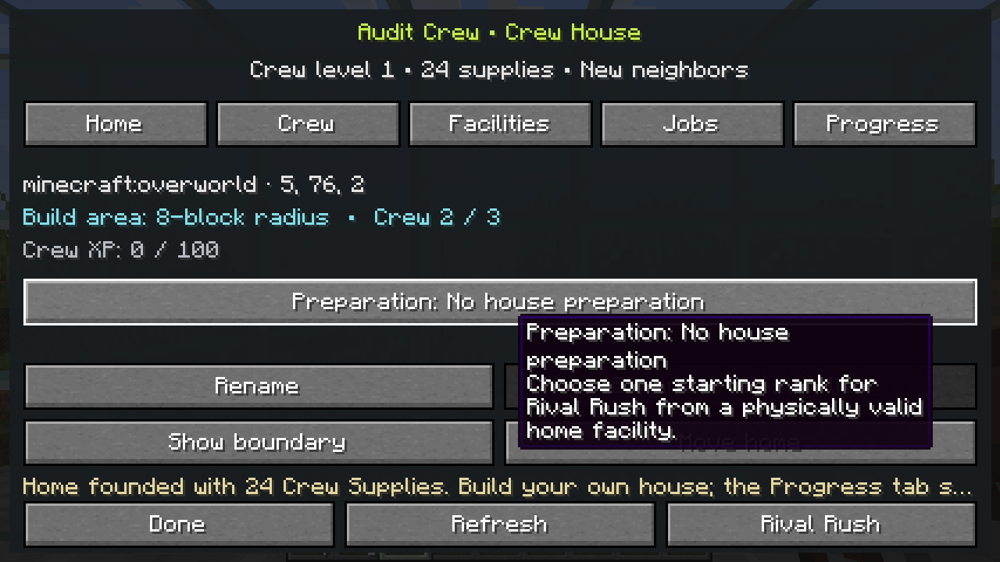

### 06 — Training focus

Riff is the level-one training focus and Patches is idle. These are persistent roster and mission profiles; physical resident or follower AI is not shown. The native hover tooltip is unchanged.

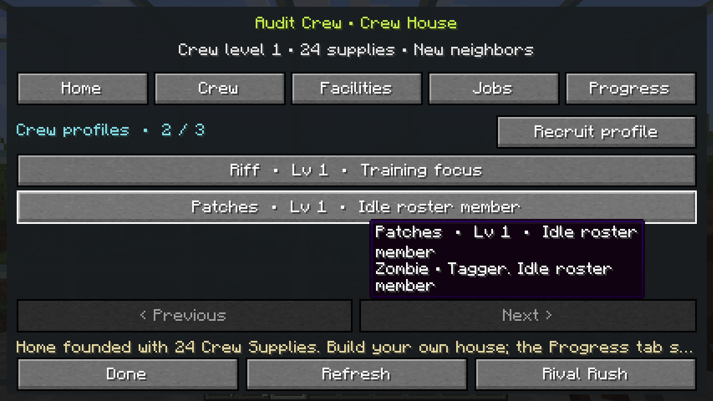

### 07 — Placed workshop registered

A physically placed Paint workshop is Tier 1 and Operational. Registration reduced Supplies to 16. An ordinary Practice yard hover tooltip covers some other rows.

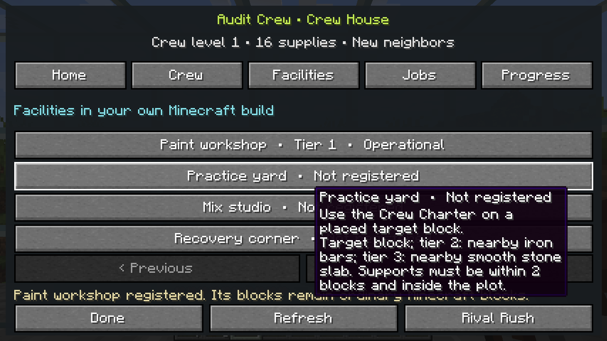

### 08 — Mission dispatched

Riff is on a three-minute Neighborhood delivery occupying one of two mission slots. This is a running job, not a completed claim. Claim settlement and assigned-member training are covered by GameTests.

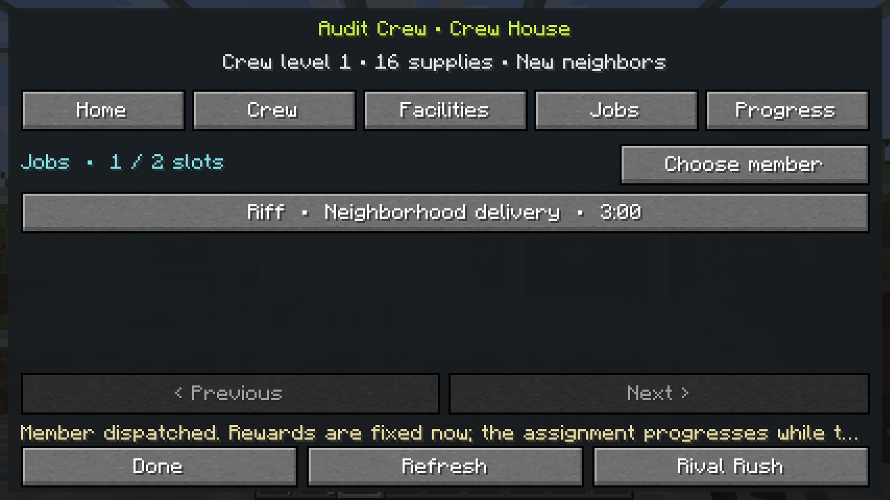

### 09 — Mode and reward preview

Surprise me, Tag, King of the Hill, Crew Showdown and Rival Rush share one chooser. Tag is selected, with a preview of up to 8 Supplies, 55 crew XP, 6 reputation and 20 training XP. The audit next explicitly chooses Rush.

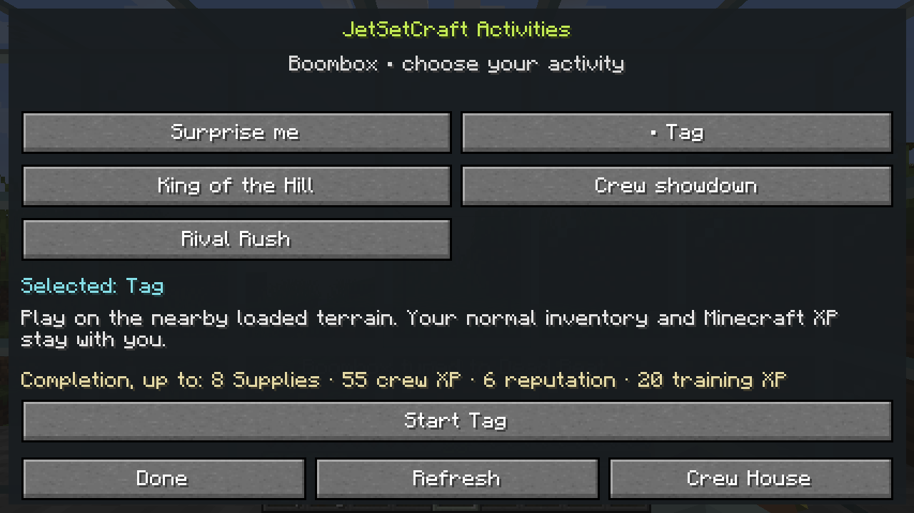

### 10 — First genuine route offer

The server offers Copper Current, Relic Relay and Widewave Terraces with different durations and run/crew rewards. They are real current offers. The audit subsequently chooses a route and enters its connected travel path.

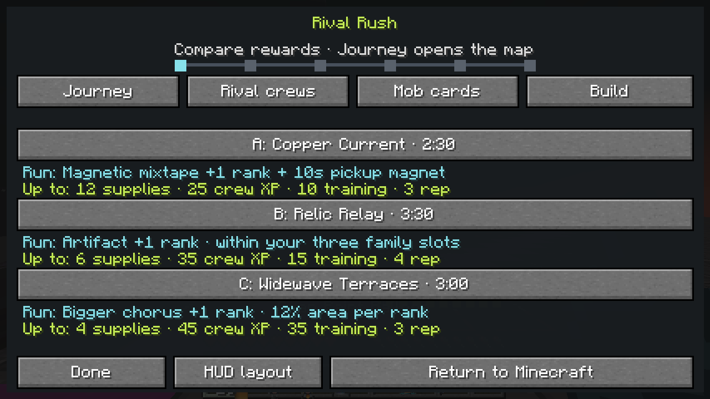

### 11 — Actual Journey map

The start S and current A/B/C choices are visible at 0/6 completed rooms. Copper Current is selected, showing a 61 by 61 room, 2:30 combat plus ten owned defeats, its build reward and maximum shared rewards. No future branches or completed rooms have been invented.

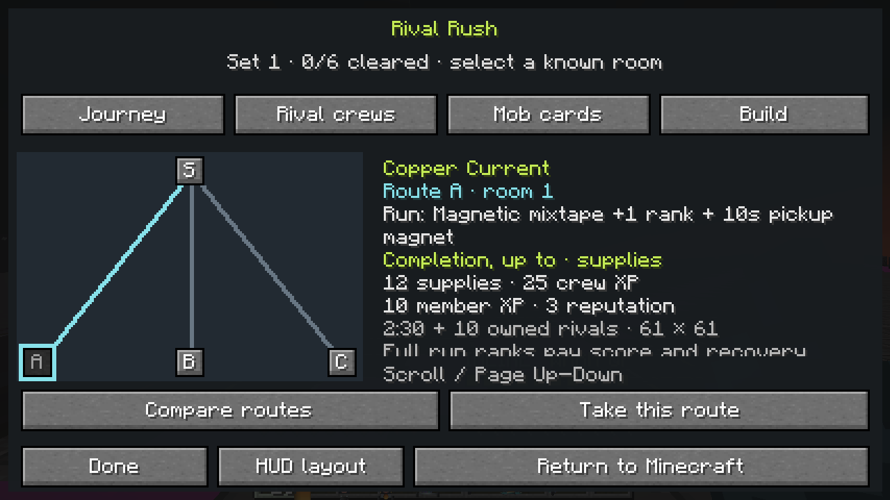

### 12 — Current Build

The actual early build shows 1x damage, 5% critical chance at 1.5x, 1x area, 100 vitality, 1x intervals and three-block pickup reach. It has zero of three artifacts and no earned remix. This capture does not demonstrate a populated artifact build or confirmation screen.

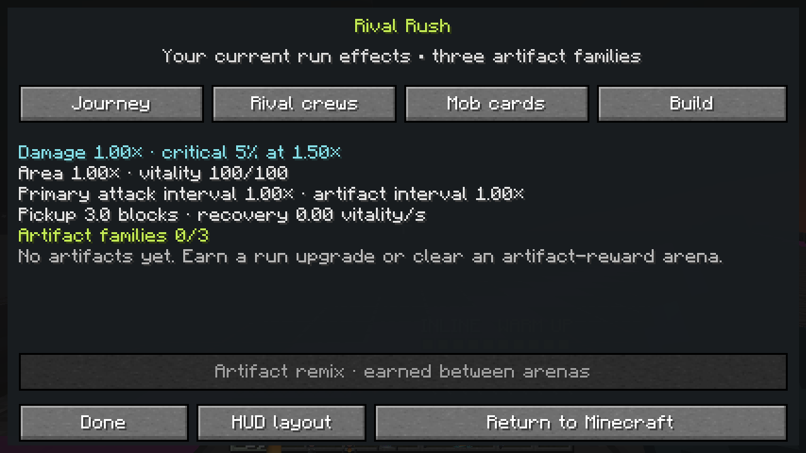

### 13 — Actual Progress view

The house has 16 Supplies and no settled activity receipt yet. Its practical next goal is a 25 by 25 plot expansion, showing 16/40 Supplies. The empty history is genuine; populated/capped history, pre-house transfer and mission attribution are tested on the server.

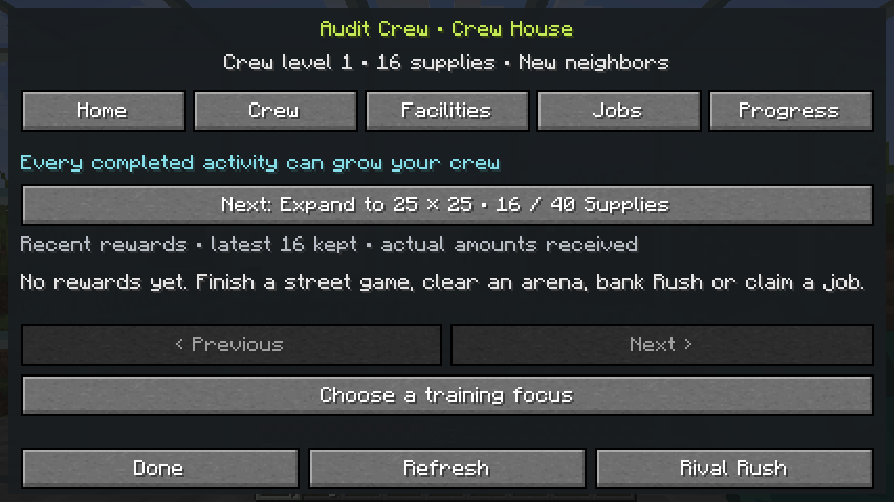

### 14 — Completed source merge

The unmodified cloud-browser capture shows PR #43 merged at e826694, nine checks passed and the successful closed state. The recorded merge tree matches the exact tested integration tree.

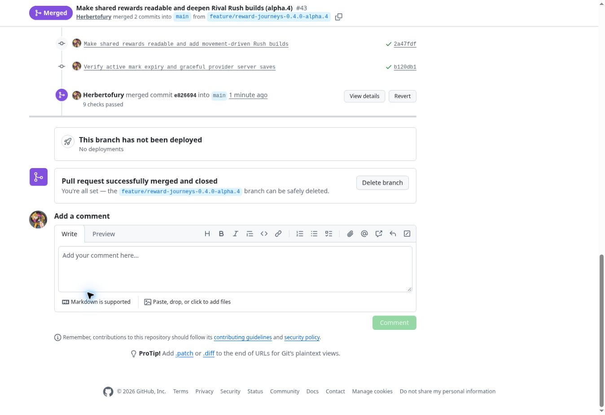

## Provider scope and observed upstream issue

The pinned optional versions are **Aether 1.20.1-1.5.2-neoforge** (the Forge-compatible 1.20.1 build), **Iron's Spells 1.20.1-3.4.0.2**, **AoA 3.7.1 for Minecraft 1.20.1**, **Cataclysm 3.31**, **Alex's Mobs 1.22.9** and **Alex's Caves 2.0.2**. Dependency logs are retained with each downloaded artifact.

The provider-present tests again exercise actual Aether → Rush → Aether and Precasia → Rush → Precasia returns. Iron's integration creates its registered Firebolt and observes the real collision for a marked, owner-bound Rush relay while preserving the tested native health, inventory, XP and mana state. This milestone also asserts that the collision cannot spend Line battery or masquerade as a primary paint hit.

The final combined adventure GameTest and dedicated-server logs both reject **`irons_spellbooks:curios/concentration_amulet`** because it references unregistered **`irons_spellbooks:mithril_ingot`**. That crafting recipe is unavailable in the tested configuration; these logs do not establish whether other acquisition paths are available. The configurations still pass the stated integration and normal-save gates. These results do not certify every provider recipe or content system. The AoA update-check response problem recorded in the older receipt is historical and is not asserted as a new observation in this final run.

## Practical limits

- Machine integration tests and directly inspected native captures do not establish human thirty-minute pacing, economy balance, prolonged Endless performance or broad modded AI behavior.
- The graphical audit does not clear an arena, finish six rooms, claim a completed mission, populate reward history, display the new toast or confirm a remix. Receipt creation, settlement, completed-room history and remix logic are separately covered by server GameTests with controlled fixtures. Native toast rendering and reduced-motion chat presentation are not visually verified.
- Crew members remain roster and mission profiles. This milestone does not implement physical resident or follower NPC AI, a general land-protection claim, or automatic house construction.
- Custom arenas expose bounded layouts, authored blocks and reward choices; arbitrary structure NBT and an in-game arena editor are not implemented. The editable Crossfade Yard example is statically validated, not separately human-playtested.
- Native Aether and Precasia returns and one marked Iron Firebolt path are demonstrated with pinned versions. Every spell, boss, summon, recipe, foreign capability and cross-mod combination is not certified.
- Normal save and shutdown are asserted in all nine final dedicated-server configurations. Forced crashes, storage failures and arbitrary third-party capability recovery remain outside that proof.
- Dungeons I/II references inform original JetSetCraft mechanics. Neither full game catalogue nor its equipment, art or audio assets is imported.
- Sonic recording metadata and import support remain available; Sonic audio masters are not bundled or auditioned in this build.

Earlier checkpoints remain separately identifiable: [alpha.3 arenas and activities](../arena-circuit/README.md), [alpha.2 crew houses](../crew-house/README.md) and [alpha.1 Rival Rush](../rival-rush/README.md). Their counts and captures remain historical evidence.
