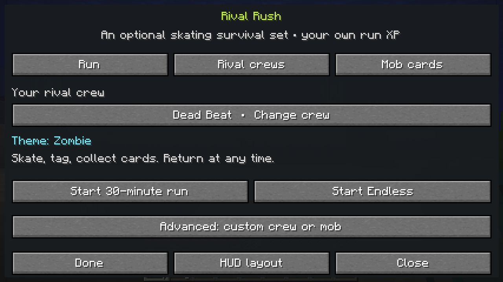
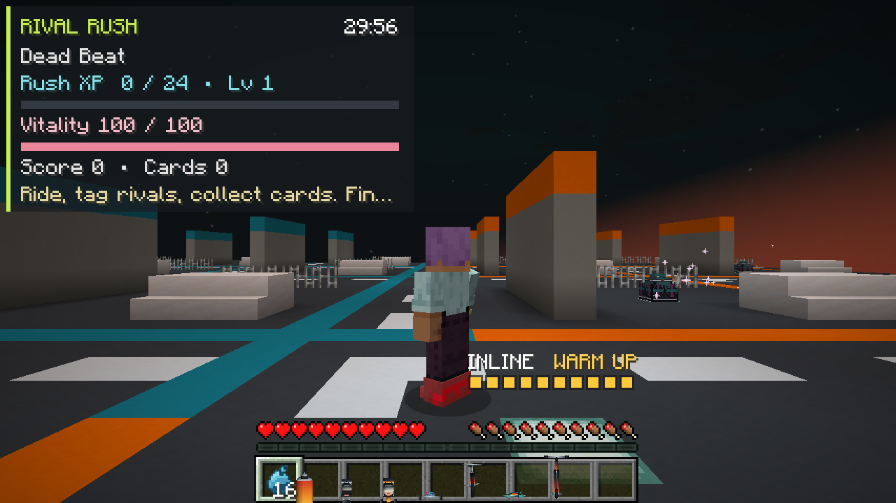
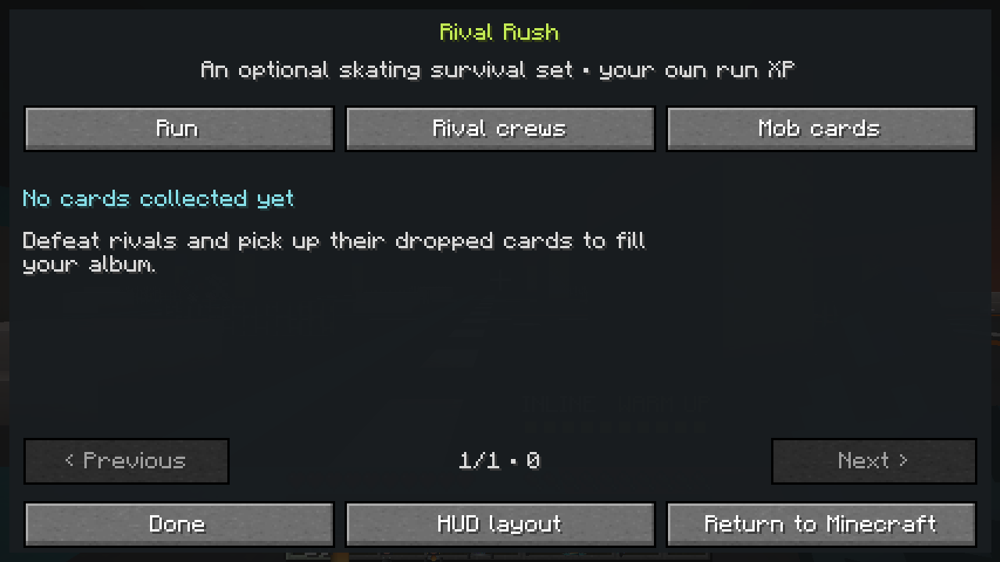
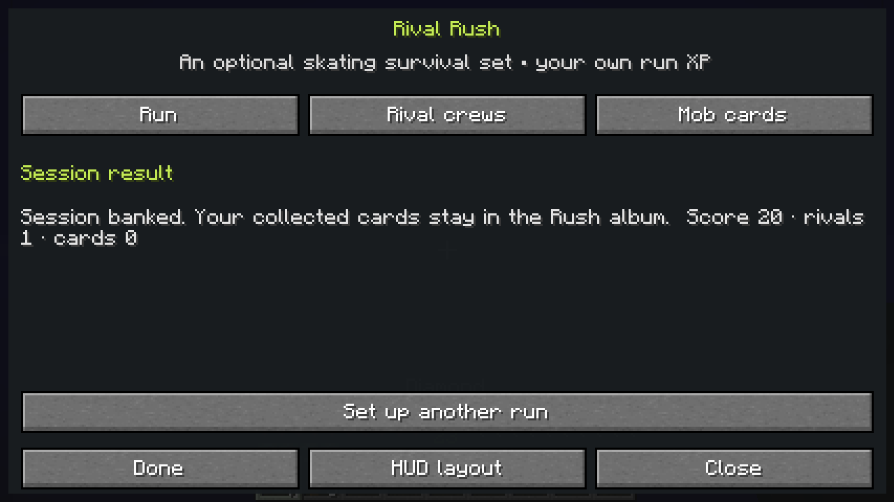

# Rival Rush alpha — real-client captures and verification

**JetSetCraft 0.4.0-alpha.1, verified 1 November 2026.** This is the optional Rival Rush development build, merged through [PR #39](https://github.com/Herbertofury/JetSetCraft/pull/39). The published v0.3.0 release remains separate.

The [base Forge/client workflow](https://github.com/Herbertofury/JetSetCraft/actions/runs/41347299665) and [four optional-provider configurations](https://github.com/Herbertofury/JetSetCraft/actions/runs/41347299683) passed. All five configurations compiled and passed **the same 15 real Forge GameTests**. The base workflow also verified normal dedicated-server shutdown and an actual graphical-client entry/return round trip.

## Actual client gallery

These unchanged **1280 × 720 PNGs** were produced by the real Minecraft client. All four were visually reviewed. The audit temporarily selected Minecraft's normal tutorial-off option in its disposable world, restored that option on exit, and waited for fixture notifications to expire naturally.

| Choose a crew and session | Enter the generated street district |
|---|---|
|  |  |

| Fresh player's empty album | Return result |
|---|---|
|  |  |

The album image records the fresh player's actual empty collection. The short audit defeated a rival but did not collect its field card; its result therefore shows one rival and zero collected cards. Card claims, duplicate rewards, mastery thresholds and album persistence are exercised by the separate GameTests.

## Exact source and binary

| Record | Value |
|---|---|
| Feature commit | [`88b2c75497315e867e53703d60437828ca82e99e`](https://github.com/Herbertofury/JetSetCraft/commit/88b2c75497315e867e53703d60437828ca82e99e) |
| Tested PR integration commit | [`f2ac0c1938fb9ec4568492ed4b124a21f96dfe36`](https://github.com/Herbertofury/JetSetCraft/commit/f2ac0c1938fb9ec4568492ed4b124a21f96dfe36) |
| Main merge commit | [`b894bd3460947590cd72edff36df732be450aada`](https://github.com/Herbertofury/JetSetCraft/commit/b894bd3460947590cd72edff36df732be450aada) |
| Identical tested and merged Git tree | `e46b9886edaa28d31692b8915078bda7aa931e32` |
| Minecraft / Forge / Java | `1.20.1` / `47.4.23` / `17` |
| Client dependency | PlayerAnimator `1.0.2-rc1+1.20` |
| Artifact | `13099872462`, available from the [passing workflow](https://github.com/Herbertofury/JetSetCraft/actions/runs/41347299665) |
| JAR | `jetsetcraft-1.20.1-0.4.0-alpha.1.jar`, 5,296,456 bytes |

JAR SHA-256:

```text
1beffeafbe2f0ca5893e31282f9c24ed33c275d1e6d19518faf692652a1e7925
```

The downloaded workflow ZIP also matched GitHub's recorded SHA-256, `7e8f5b628073aea8ed84e6dbda3be855404c7db2bec40c6825d5e7bce811b82e`. The [machine-readable receipt](verification.json) includes job IDs, screenshot hashes, fixture values and exact comparison tolerances. [SHA256SUMS](SHA256SUMS) records the JAR checksum. Binary JARs are distributed through build artifacts, not committed to the source repository.

## What the client checked

The disposable audit world used actual vanilla commands to supply **7 diamonds, 5 bread, 23 XP levels and 17 XP points**. The client observed those values before using the real entry and exit packets. On return it required exact inventory NBT, XP-level and total-XP equality; XP progress within `0.000001`; the original dimension; and a position within one block of the saved position. Its log ended with `JETSETCRAFT_RUSH_VISUAL_AUDIT_PASS`.

The main server reached ready state, accepted a normal loopback RCON stop, saved every dimension and exited successfully. The provider jobs add installed-mod regression coverage for Alex's Mobs, Alex's Caves, Cataclysm and the combined configuration.

## Practical limits

This is machine integration evidence and a visual review of a short session. It does not establish human thirty-minute pacing, long Endless balance or sustained performance, every provider mob's AI, forced-crash/storage-failure behavior, or arbitrary third-party player capability restoration. Current gameplay scope and the distinction between implemented features and proposals are documented in the [mode guide](../../../wiki/Rival-Rush.md) and [18-game design study](../../RIVAL_RUSH_DESIGN.md).
