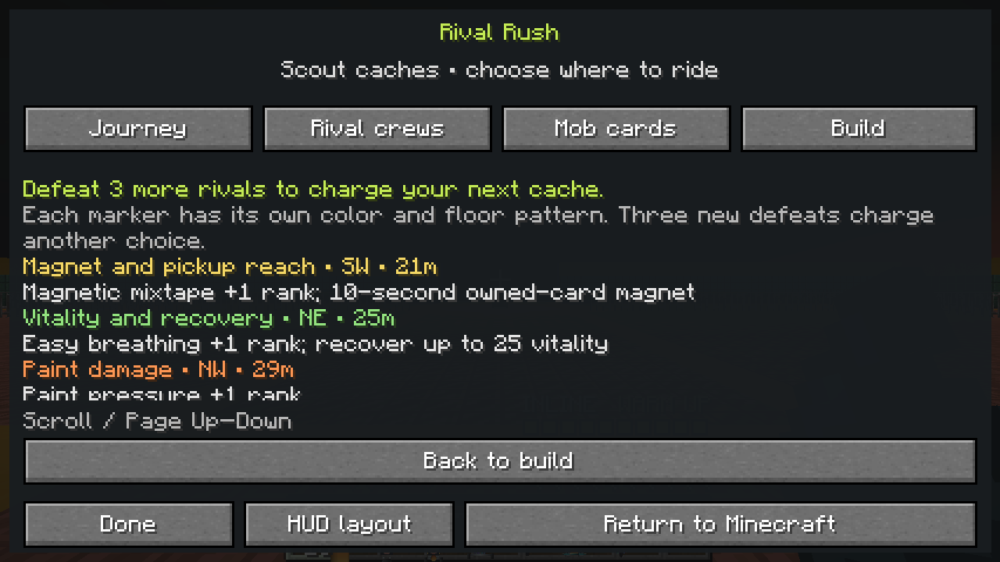
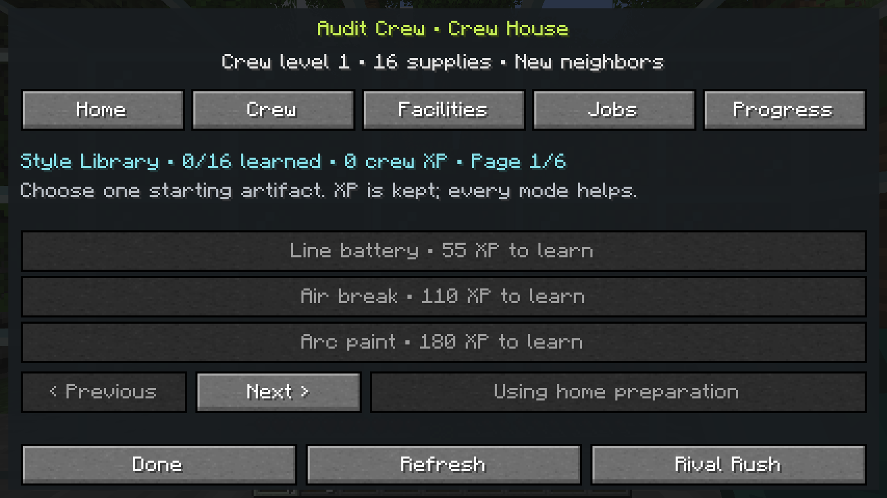

# Style Library and deeper Rush builds — alpha.5

**Verified and merged: `0.4.0-alpha.5`, [PR #44](https://github.com/Herbertofury/JetSetCraft/pull/44).** All nine CI jobs passed. The fifteen reviewed PNGs here are an **independent local reproduction from the exact tested source**, not downloaded CI captures. Historical alpha.4 evidence remains in its [separate receipt](../reward-journeys/README.md).

## Source and evidence identity

| Identity | Recorded value / evidence boundary |
|---|---|
| Feature commit | `8bb7109042decfe636ae0b621b8af88169bf61ce` |
| Tested PR integration | `6701db2997395f5df90861965a081f8c7708df5e` |
| Actual squash merge | `5bad45891b6fe7a5c7c133ed0a19ac0556dd5af8` |
| Identical tree for all three commits | `878476f60413bfe47c18864a99674c363432ce87`; fetched merge comparison is empty |
| Base workflow | [Run 41388639847](https://github.com/Herbertofury/JetSetCraft/actions/runs/41388639847) — **PASS** |
| Provider workflow | [Run 41388639856](https://github.com/Herbertofury/JetSetCraft/actions/runs/41388639856) — **all eight jobs PASS** |
| CI artifacts | API-reported metadata only; archive bytes and screenshot pixels not independently inspected |
| Corrected local rebuild JAR SHA-256 | `a5cea430f3b2930b7bae1d479bfda5ac6bf6e08263d3f01e1858835a26fbd847` — **local only** |

On **Minecraft 1.20.1 / Forge 47.4.23 / Java 17**, all nine configurations passed build, **44 real Forge GameTests each**, dedicated-server readiness, RCON stop and normal saved-dimensions shutdown. Base also passed its **fifteen-screen native audit gate**. The provider lanes cover Alex's Mobs, Alex's Caves, Cataclysm, their combined lane, Aether, Iron's, AoA and the combined adventure lane: **396 executions of 44 distinct tests**.

Browser URL policy blocked CI archive download. No alternate download was attempted; identical CI JAR hashes, independently verified archive digests and reviewed CI pixels are **not claimed**. The local hash above does not establish CI binary equality. [verification.json](verification.json), the [local source record](evidence/replay-source-identity.log) and [local JAR hash record](evidence/replay-jar-sha256-complete.txt) distinguish that provenance.

## Implemented scope

The **Style Library** learns sixteen starting choices at **55–2,000 cumulative shared crew XP**, including before founding. Choosing an earned, available style spends no XP and grants **one starting artifact rank**, replacing facility preparation and occupying one of three slots. Default `HOME`, or an unavailable saved provider style, uses eligible house preparation. Album drafts remain separate; ordinary drafts require no lesson unlock. Active activities block changes. Schema 3 stores selection/revision, reads schemas 1/2 and retains future payloads read-only.

The pool has **eleven statistics and sixteen artifact families**, or fifteen without Firebolt relay: **27/26 ranked choices**. Artifacts cap at rank four, builds at three families, and remix preserves the replaced rank. Six original mode mechanics were added:

| Family | Implemented behavior; `r` is rank 1–4 |
|---|---|
| Venom ink | Nonstacking damage of `1 + r` per 20 active ticks for `60 + 20r` ticks; refreshing duration preserves the next tick. |
| Chill paint | `40 + 10r` ticks of reduced Rush-directed steering (`0.8 − 0.05r`) and longer attack intervals (`1 + 0.15r`). |
| Split chorus | Every fourth primary tag hits `1 + floor(r/2)` additional visible rivals in its forward cone, for `2 + r` base damage. |
| Radiant groove | Every sixth accepted primary tag restores `2 + 2r` run vitality. |
| Beat ward | Capacity `8 + 4r`; after 120 quiet active ticks, restores `2 + r` shield per active second. |
| Soul burst | Five owned defeats fund an automatic visible-target burst; storage caps at 20, target count at twelve, base damage at `4 + 3r`. Its charge pool is separate from healing souls. |

Secondary damage cannot recursively trigger primary artifacts or critical rolls. These effects preserve native health, potions and provider attributes. The [Rush guide](../../../wiki/Rival-Rush.md) records exact area/interval coefficients.

Six colored, named caches show distance/direction/reward previews. Three current-room defeats charge a claim; prior-room leftovers cannot precharge it. Debriefs report accepted ranks, score and recovery. There are **six base profiles or ten with all four adventure providers**, plus **three example-pack profiles**. Circuits freeze their starting catalogue, favor unvisited rooms/varied rewards and retain physical connectors. Themed rooms remain inside Rush.

## Nine added test markers and their exact scope

The passing gate requires `JETSETCRAFT_GAMETEST_PASS` plus each marker, and the aggregate required-test result.

| Marker | Exercised behavior |
|---|---|
| `rush_synergy_rules` | Direct run-model checks for one preparation, three-family limit, independent bounded soul pools, ward absorption/quiet interval/Encore pause, remix cleanup and optional-relay admission. |
| `rush_synergy_control` | Production session and real director-created actors: primary Venom/Chill, forward Split exclusion, foreign-target rejection, refresh timing, paused/expired effects, native health/attribute/effect preservation and normal return. |
| `rush_synergy_recovery` | Actual owned-actor secondary damage settles five defeats once; ward and sixth-hit Radiance affect virtual vitality; a real wall excludes a burst target; burst spending does not recurse; return preserves captured state. |
| `rush_cache_options` | Actual built cache surfaces and colored markers, owner-only previews/claims, charging, cooldown, magnet, detached preview mutation, inventory preservation and partially capped critical reward reporting. |
| `rush_cache_boundaries` | Authored pillar preservation, blocked versus clear approach, fresh-room charge baseline, insufficient/new charge, hidden caches between rooms and finished-run rejection. |
| `rush_route_exploration` | Builds six rooms from actual offered branches; checks distinct offered rewards, unvisited selection and preview history, provider-gated profiles and resolved material safety. |
| `crew_style_shared_rewards` | Production street/Rush settlements, pre-house selection and founding transfer, replay rejection, deadline-based mission claim, shared lesson thresholds and saved-data round trips. |
| `crew_style_persistence` | Real crew packet encode/decode and handler boundary; locked, stale, negative-revision and unknown requests; schema-3 round trip, schemas 1/2 migration and exact future-payload retention. |
| `crew_style_entry` | Production capped settlements earn all lessons; checks relay availability, actual Rush entry with one style replacing a placed workshop, active-run rejection, return preservation and facility fallback/removal. |

**Fixture boundary:** cache/route cases inject `recordDefeat()` counters and compress clocks. Synergy tests separately defeat real owned actors through production damage. Crew cases supply qualifying transaction inputs and the saved mission deadline; they do not replay complete street rounds or wait real minutes. Packet tests exercise codec/handler, not remote sockets. Relay branches print `JETSETCRAFT_GAMETEST_STYLE_RELAY provider_present` or `provider_absent`.

## Independently reproduced native gallery

All **fifteen 1280 × 720 PNGs** were reproduced locally from the exact source and visually reviewed; no blocking clipping or overlap was found. The corrected [asset-generation](evidence/replay-asset-generation.log)/[build](evidence/replay-build-complete.log) run passed all three native audit markers and normal save/shutdown. An earlier fresh clone omitted ignored generated assets, passed only **43/44** local tests and never launched a client; that attempt and its provisional binary were rejected. It is not the gallery source or CI evidence.

For Cache Scout, a **logged disposable-world arrival fixture** loads nearby chunks and teleports to the actually selected route. Normal builder/arrival/cache code supplies the room. No clocks, defeats, rewards or clears are fabricated; **zero arenas are cleared**. This is not human connector-traversal evidence. Return checks compare ordinary inventory, Minecraft XP, source dimension and position.

| Capture | Observed state |
|---|---|
| 01–04: [setup](01-setup.png), [district](02-district-hud.png), [album](03-album.png), [return](04-return-result.png) | Genuine empty album; early bank result **score 20, one rival, zero cards**. |
| 05–08: [home](05-crew-home.png), [roster](06-crew-roster.png), [facilities](07-crew-facilities.png), [job](08-crew-jobs.png) | Actual Charter founding and placed workshop. Ordinary hover tooltips obscure parts of 05–07. Neighborhood delivery remains **running at 3:00**, not claimed. |
| 09–13: [activities](09-activities.png), [routes](10-arena-route.png), [Journey](11-journey-map.png), [Build](12-run-build.png), [Progress](13-crew-progress.png) | Actual first choices; **0/3 artifacts**, empty reward history and **0 crew XP**. |
| [14: Cache Scout](14-cache-scout.png) | Six server-held caches; **three entries visible with scrolling**, three defeats needed, zero rooms cleared. This is a preview, not a pictured claim. |
| [15: Style Library](15-style-library.png) | **0 XP, 0/16 learned, HOME**; three locked lessons on **page 1/6**. No earned style is pictured. |
| [16: PR merge](16-pr-merge.jpg) | Browser record of the actual PR merge; separate from the fifteen Minecraft frames. |

| Cache Scout | Style Library |
|---|---|
|  |  |

The arrival, cache, return and style markers preserve these states. Durable client evidence comprises an untouched [on-disk log prefix](evidence/replay-client.log) and a separately labeled [verbatim continuation observed in tool stdout](evidence/replay-observed-stdout-excerpt.log); the full original on-disk log was not recovered. [Capture checksums](evidence/replay-captures-manifest.json) belong to this local reproduction; no CI image bytes were available for comparison.

## Practical limits

The results cover this exact source and pinned configurations, not arbitrary mod versions, every creature or foreign capability restoration. Rush isolates temporary gear/combat and does not import a complete Dungeons catalogue. Controlled tests and short audits cannot establish thirty-minute enjoyment, Endless balance, multiplayer scale or every interruption case. Human sessions remain necessary.
