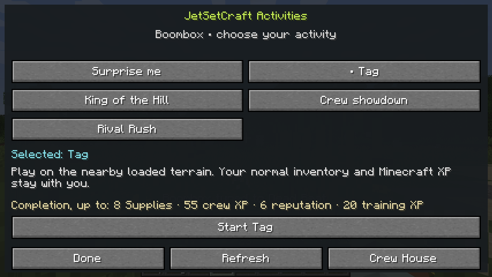
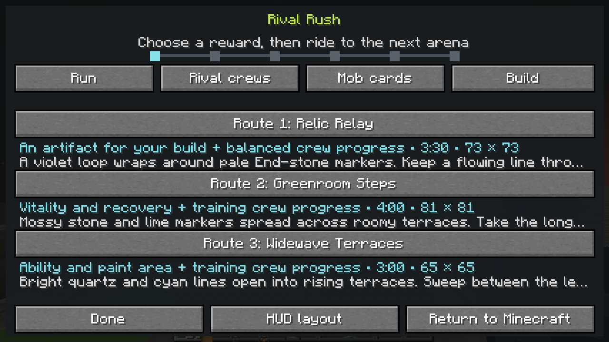
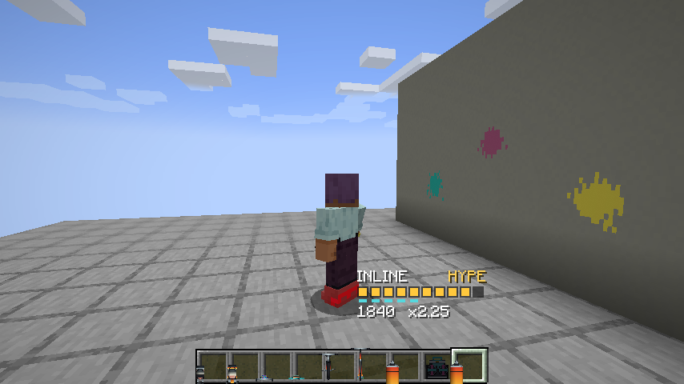
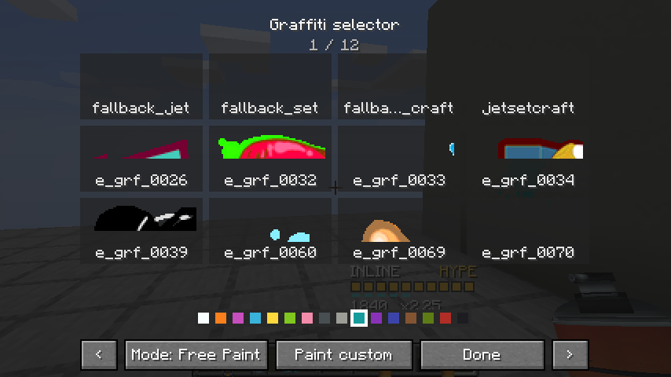
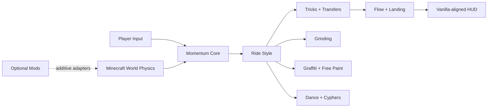

# 🛼 JetSetCraft

> [!IMPORTANT]
> **JetSetCraft turns ordinary Minecraft worlds into a momentum-first street-sports playground without replacing the player, the world, or vanilla control.** Inline skates, quad skates, a street board, BMX, hoverboard, and scooter share one expressive movement language built around tricks, grinding, flow, dance, graffiti, and emergent Minecraft physics.

## ✨ Start here

| I want to… | Go here |
|---|---|
| Install the verified release and take a first ride | **[Getting Started](Getting-Started)** |
| See exactly what is shipped and tested | **[Release & Capability Status](Release-Status)** |
| Understand the complete feature set | **[Feature Overview](Feature-Overview)** |
| Learn every input without permanent forward motion | **[Controls](Controls)** |
| Pick skates, a board, BMX, hoverboard, or scooter | **[Ride Styles](Ride-Styles)** |
| Build tricks, combos, transfers, and Flow | **[Tricks, Combos & Flow](Tricks-Combos-and-Flow)** |
| Paint tags, create custom art, or use Free Paint | **[Graffiti](Graffiti)** |
| Choose an isolated skating roguelite session or an arena circuit | **[Rival Rush](Rival-Rush)** — optional `0.4.0-alpha.3` development mode |
| Build a house, develop crew profiles and send dispatch jobs | **[Player Chapters and Crew Houses](Player-Chapters-Posse-and-Mob-Archetypes)** |
| Browse games, music, art and engineering inspiration | **[Inspiration & Research](Inspiration-and-Research)** |
| Build a compatible modpack or server | **[Modpack Maker Guide](Modpack-Maker-Guide)** |
| Inspect architecture and verification evidence | **[Developer Architecture](Developer-Architecture)** · **[Testing](Testing-and-Verification)** |

## 🧪 Verified development: shared activities and arena circuits

**Choose your next session at a Boombox:** Tag, King of the Hill, Crew Showdown or **[Rival Rush](Rival-Rush)**, with an explicit reward preview before starting. The generic invitation can reveal a random activity; the Boombox lets you choose deliberately. Completed street games and arenas contribute to the same Supplies, crew XP, member training and gang reputation, including earnings banked before you found a house.

Rival Rush keeps **Free streets** for thirty-minute or Endless skating survival and adds **Arena circuits** with six-room routes, different build rewards, authored layouts and Encore continuation. Named rival crews, paint combat, independent Rush XP, persistent mob cards, graffiti rewards and music stops share the mode with magnet caches, critical/area upgrades and three artifact slots. A reusable paper + cyan-dye flyer also opens its menu. Players opt in and can return to their saved Minecraft state; the alpha requires Easy, Normal or Hard.

The current development checkpoint is **`0.4.0-alpha.3`**, merged through [PR #41](https://github.com/Herbertofury/JetSetCraft/pull/41). It builds on Rival Rush from [PR #39](https://github.com/Herbertofury/JetSetCraft/pull/39) and the alpha.2 [player-built crew house](Player-Chapters-Posse-and-Mob-Archetypes) from [PR #40](https://github.com/Herbertofury/JetSetCraft/pull/40): named roster profiles, manually placed facilities, house expansion, dispatch jobs and optional Rush preparation. **Visible residents and follower AI remain future work.** Stable **`v0.3.0` remains unchanged**, with its nine original GameTests.

**Completed alpha.3 verification:** [base Forge/client gate #280](https://github.com/Herbertofury/JetSetCraft/actions/runs/41356358215) and [provider matrix #56](https://github.com/Herbertofury/JetSetCraft/actions/runs/41356358302) passed **all 28 real GameTests in each of nine configurations**, with dedicated-server readiness/save/shutdown throughout. The base client audit produced **ten reviewed captures** and checked inventory/XP/dimension return. Native Aether/Precasia return and the actual Iron Firebolt collision passed their provider-present checks. The [arena-circuit receipt](https://github.com/Herbertofury/JetSetCraft/tree/main/docs/verification/arena-circuit) ties the tested source to merged commit `e57e9ab` and records the binary, jobs, captures and limits.

| Choose a Boombox activity — actual Tag preview | Plan the circuit — actual first route choice |
|---|---|
|  |  |

[View all ten real-client captures and the exact build receipt](https://github.com/Herbertofury/JetSetCraft/tree/main/docs/verification/arena-circuit) · [Read the compatibility evidence and provider limits](Compatibility#rival-rush-dimensions-rivals-and-the-firebolt-relay).

The visual audit selected the first route, entered travel and returned; arena combat and clears are covered by real server GameTests. It does not show a complete six-room journey or claim to measure human thirty-minute/Endless enjoyment. [Testing and Verification](Testing-and-Verification) distinguishes those scopes. The [nineteen-test, eight-capture alpha.2 receipt](https://github.com/Herbertofury/JetSetCraft/tree/main/docs/verification/crew-house) and [fifteen-test alpha.1 receipt](https://github.com/Herbertofury/JetSetCraft/tree/main/docs/verification/rival-rush) remain preserved historical checkpoints.

## 🎧 New research collection

**[Open the visual Inspiration Atlas](https://herbertofury.github.io/JetSetCraft/research.html)** — **505 entries**, including **76 games, 160 music candidates, 40 art/culture references, 38 engineering references and 18 research papers**, alongside the preserved 173-entry earlier catalogue. The **[November 1 expansion adds 136 references](https://herbertofury.github.io/JetSetCraft/research.html?batch=2026-11-01)**, eight creator/replay/social briefs and a **[new 12-track listening route](https://herbertofury.github.io/JetSetCraft/research.html?path=city-after-hours)**. Search by topic or research pass, filter images and direct videos, follow either listening sequence, save a shortlist and export matching entries. The four [research lanes](Inspiration-and-Research) contain the detailed applications, credited media and prototype questions.

## 🎮 The current experience

| Ride, world physics, and compact HUD | Tag selector and custom painting |
|---|---|
|  |  |

## 🟢 Stable v0.3.0 capabilities

| System | Shipped surface |
|---|---|
| **Street movement** | Player-controlled stride acceleration, neutral stopping, powerslides, manuals, ledge vaults, wall kicks, wind redirects, world-geometry grinding, transfers, and preserved vanilla swimming. |
| **Ride identities** | Six ride styles with attached player-following models, distinct tuning, 24 tricks, and 72 validated animation clips. |
| **Flow & presentation** | Combo/Flow scoring, landing grades, a compact vanilla-aligned HUD, reduced-motion controls, and 28 dance moves with multiplayer cyphers. |
| **Graffiti** | 139 persistent aspect-aware tags, custom tag creation, Tag/Free Paint modes, 16 colors, six-face splashes, and throwable paint balloons. |
| **Minecraft physics** | Ice, slime, honey, Soul Speed, water, bubbles, redstone rails, pistons, explosions, currents, knockback, and optional Create geometry remain useful movement tech. |
| **Street Gear & gangs** | Reversible gear on compatible source-owned mobs, physical Boombox tuning, data-driven gang identity, bounded actors, anti-farm cleanup, and original entrance stingers. |
| **Stable verification** | Deterministic asset generation, nine real Forge GameTests, clean client/server builds, dedicated-server smoke, real-client visual audit, and TestGrid protocol proof. The current activity/arena/crew-house development suite and its 28 tests across nine configurations are recorded separately above. |

## 🧭 What makes JetSetCraft different

**The player stays the player.** Weapons, tools, inventory, enchantments, dimensions, mobs, rails, terrain, redstone, fluids, and optional mods remain part of the same play space.

**Neutral means neutral.** Releasing directional input settles through Minecraft friction to a complete stop. Sprint kickoffs, vaults, wall kicks, and redirects require deliberate input—there is no permanent camera-forward motion.

**The world is the skatepark.** JetSetCraft follows real rail shapes, collision-shape ledges, walls, and optional Create tracks rather than requiring a separate course made from special blocks.

**Research is additive.** The project studies excellent work across Java, Bedrock, tools, models, animation, graffiti, music, and vehicles while preserving JetSetCraft's identity and recording permission/provenance boundaries.

## 🚦 Status legend

| Badge | Meaning |
|---|---|
| ✅ **Verified** | Runtime or packaged-artifact evidence exists for the exact release. |
| 🟢 **Implemented** | Present in current source and documented as a current capability. |
| 🧪 **Experimental** | Implemented behind a deliberate compatibility or stability boundary. |
| 📚 **Research** | Inspiration or an implementation reference—not bundled code or a shipped promise. |
| 🚧 **In development** | Active work that is not safe to call complete. |
| 📋 **Design lineage** | Preserved future design, explicitly separated from `0.3.0`. |

## 🔗 Project links

- **Repository:** https://github.com/Herbertofury/JetSetCraft
- **Verified 0.3.0 release:** https://github.com/Herbertofury/JetSetCraft/releases/tag/v0.3.0
- **Research atlas:** https://docs.google.com/spreadsheets/d/1liWhRQL7rmPy8LLgSRVlkrLANqUIJE4UbFX3--KMJjg/edit?gid=1570163195#gid=1570163195
- **Canonical project Drive:** https://drive.google.com/drive/folders/1npHf1VwOj-tybm791XShz2IvY8LmjjUU
- **Roadmap:** [Roadmap](Roadmap)

> [!NOTE]
> Natural gang hangouts, story chapters, physical posse systems, Junior Atlas and other future concepts remain design lineage unless **[Release Status](Release-Status)** marks them shipped. The optional [Rival Rush](Rival-Rush) and [profile-based crew-house alpha](Player-Chapters-Posse-and-Mob-Archetypes) have their own implementation boundaries and recorded evidence.

---

**New here?** Continue with **[Getting Started →](Getting-Started)**.
