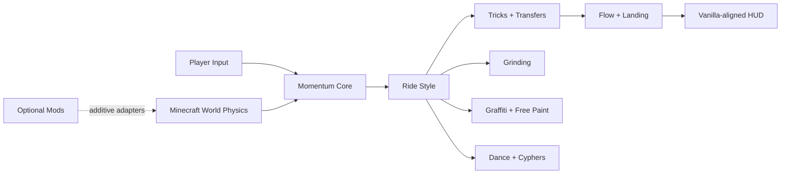

# 🛼 JetSetCraft

> [!IMPORTANT]
> **JetSetCraft turns ordinary Minecraft worlds into a momentum-first street-sports playground without replacing the player, the world, or vanilla control.** Inline skates, quad skates, a street board, BMX, hoverboard, and scooter share one expressive movement language built around tricks, grinding, flow, dance, graffiti, and emergent Minecraft physics.

## ✨ Start here

| I want to… | Go here |
|---|---|
| Install the verified release and take a first ride | **[Getting Started](Getting-Started)** |
| See exactly what is shipped and tested | **[Release & Capability Status](Release-Status)** |
| Understand the complete feature set | **[Feature Overview](Feature-Overview)** |
| Learn every input without permanent forward motion | **[Controls](Controls)** |
| Pick skates, a board, BMX, hoverboard, or scooter | **[Ride Styles](Ride-Styles)** |
| Build tricks, combos, transfers, and Flow | **[Tricks, Combos & Flow](Tricks-Combos-and-Flow)** |
| Paint tags, create custom art, or use Free Paint | **[Graffiti](Graffiti)** |
| Choose an isolated skating roguelite session or an arena circuit | **[Rival Rush](Rival-Rush)** — merged and verified `0.4.0-alpha.7` |
| Pod-drop into a rival district, recover research and extract on skates | **[Liberty Grind](Liberty-Grind)** — current development implementation |
| Build a house, develop crew profiles and send dispatch jobs | **[Player Chapters and Crew Houses](Player-Chapters-Posse-and-Mob-Archetypes)** |
| Browse games, music, art and engineering inspiration | **[Inspiration & Research](Inspiration-and-Research)** |
| Build a compatible modpack or server | **[Modpack Maker Guide](Modpack-Maker-Guide)** |
| Inspect architecture and verification evidence | **[Developer Architecture](Developer-Architecture)** · **[Testing](Testing-and-Verification)** |

## 🛸 Liberty Grind: drop, tag, extract

**[Liberty Grind](Liberty-Grind)** adds a selectable war-map expedition with pod insertion, actual TaCZ Helldivers weapons, rival-held graffiti objectives, pirate radio, courier routes and ship extraction back to your original world. Recover super credits and samples for six research projects that improve graffiti and unlock Rival Rush preparations. Objectives also grow the same crew account and Style Library. Read the guide for exact optional-pack installation, controls and current individual-mission scope. Its new verification is separate from the historical alpha.7 checkpoint below.

## 🧪 Verified alpha.7: room contracts and earned Pit stops

Optional **Relay, Paint and Hunt** contracts give arena routes an additional goal. A genuine room clear earns one **Pit stop** choice, or two with a completed contract, shared by **Tune, Patch, Rewind and Remix**. Accepted feedback and Last run counters show what actually changed; required time, rivals and headliners still decide each clear.

[PR #46](https://github.com/Herbertofury/JetSetCraft/pull/46) merged as [`af8e7f1b7a41b0e491f04d3f3f8ca4288ac5eed7`](https://github.com/Herbertofury/JetSetCraft/commit/af8e7f1b7a41b0e491f04d3f3f8ca4288ac5eed7), retaining tested tree `e33c221bb02df4c949c28766007893215d7ca2ed`. [Base verification](https://github.com/Herbertofury/JetSetCraft/actions/runs/41397720888) and the [provider matrix](https://github.com/Herbertofury/JetSetCraft/actions/runs/41397720946) passed **63 required Forge GameTests in each of nine configurations — 567 executions of 63 distinct tests**, all builds and normal dedicated-server save/shutdown. Base also passed its **23-capture native-client gate**. The [23-image independent local gallery and receipt](https://github.com/Herbertofury/JetSetCraft/blob/main/docs/verification/contracts/README.md) show the real Paint goal, earned stop and accepted Tune from rank one to two, with scripted arrival/hit and clock fixtures explicitly identified. These development results do not change stable `v0.3.0` or establish a full human circuit, every provider combination or installed-JAR runtime.

## Historical alpha.4: rewards, journeys and builds

**See what every session contributes.** Alpha.4 adds sixteen persistent reward receipts showing the Supplies, crew XP, training and reputation actually credited across street games, arenas, qualifying Rush returns and claimed missions. **[Crew Charter → Progress](Player-Chapters-Posse-and-Mob-Archetypes#progress-see-what-you-earned-and-what-to-build-next)** works before founding and shows the next practical home goal, its cost and physical requirements. You still place the blocks yourself.

**[Rival Rush](Rival-Rush)** now has a **Journey** map of visited rooms, the current destination and actual next-room offers, with banked amounts distinguished from possible rewards. **Build** shows current statistics and artifacts. **Line battery, Air break and Breakbeat mark** reward actual riding, qualified landings and focused attacks; an optional **remix** after a genuine arena clear changes one artifact family while retaining its exact rank and the three-slot limit.

Choose Tag, King of the Hill, Crew Showdown or Rival Rush at a tuned Boombox; a random invitation is reviewed before acceptance. Rush retains thirty-minute/Endless **Free streets** and six-room **Arena circuits**, separate XP/vitality, persistent mob cards and return to the saved Minecraft state. The reusable paper + cyan-dye flyer also opens it. The alpha requires Easy, Normal or Hard. **Visible residents and follower AI remain future work.** Stable **`v0.3.0` remains unchanged**, with its nine original GameTests.

**Merged and verified through [PR #43](https://github.com/Herbertofury/JetSetCraft/pull/43):** merge [`e826694`](https://github.com/Herbertofury/JetSetCraft/commit/e826694c3429394b2b264f153cd9ea34b1fb9051) has the same tree as the source tested by [base gate #286](https://github.com/Herbertofury/JetSetCraft/actions/runs/41379581968) and [provider matrix #59](https://github.com/Herbertofury/JetSetCraft/actions/runs/41379581891). They passed **all 35 real GameTests in each of nine configurations**, each with build, dedicated-server readiness, RCON stop and normal saved-dimensions shutdown. The base produced **thirteen reviewed 1280 × 720 client captures**. The [reward/journey receipt](https://github.com/Herbertofury/JetSetCraft/blob/main/docs/verification/reward-journeys/README.md) records the exact source, artifacts and scope.

| Journey — actual first offered routes | Build — actual initial statistics |
|---|---|
|  |  |

[Open all thirteen client captures and exact evidence](https://github.com/Herbertofury/JetSetCraft/tree/main/docs/verification/reward-journeys), including the genuine empty-history **Progress** view and its next home goal. [Read the compatibility scope](Compatibility#rival-rush-dimensions-rivals-and-the-firebolt-relay).

The visual audit selected the first route, entered travel and returned; its Build slots and reward history are empty early states. Completed-room settlement, artifact mechanics, remix and mission claims are covered by GameTests. No completed six-room client journey or human thirty-minute/Endless enjoyment result is claimed. [Testing and Verification](Testing-and-Verification) distinguishes those scopes.

The [alpha.3 receipt](https://github.com/Herbertofury/JetSetCraft/tree/main/docs/verification/arena-circuit) preserves PR #41's merged `e57e9ab` checkpoint with **28 tests × nine configurations and ten captures**. Its dated correction distinguishes provider dedicated-server startup from the base's normal save/shutdown proof. The [nineteen-test, eight-capture alpha.2 receipt](https://github.com/Herbertofury/JetSetCraft/tree/main/docs/verification/crew-house) and [fifteen-test alpha.1 receipt](https://github.com/Herbertofury/JetSetCraft/tree/main/docs/verification/rival-rush) remain separate historical checkpoints.

## 🎧 New research collection

**[Open the visual Inspiration Atlas](https://herbertofury.github.io/JetSetCraft/research.html)** — **505 entries**, including **76 games, 160 music candidates, 40 art/culture references, 38 engineering references and 18 research papers**, alongside the preserved 173-entry earlier catalogue. The **[November 1 expansion adds 136 references](https://herbertofury.github.io/JetSetCraft/research.html?batch=2026-11-01)**, eight creator/replay/social briefs and a **[new 12-track listening route](https://herbertofury.github.io/JetSetCraft/research.html?path=city-after-hours)**. Search by topic or research pass, filter images and direct videos, follow either listening sequence, save a shortlist and export matching entries. The four [research lanes](Inspiration-and-Research) contain the detailed applications, credited media and prototype questions.

## 🎮 The current experience

| Ride, world physics, and compact HUD | Tag selector and custom painting |
|---|---|
|  |  |

## 🟢 Stable v0.3.0 capabilities

| System | Shipped surface |
|---|---|
| **Street movement** | Player-controlled stride acceleration, neutral stopping, powerslides, manuals, ledge vaults, wall kicks, wind redirects, world-geometry grinding, transfers, and preserved vanilla swimming. |
| **Ride identities** | Six ride styles with attached player-following models, distinct tuning, 24 tricks, and 72 validated animation clips. |
| **Flow & presentation** | Combo/Flow scoring, landing grades, a compact vanilla-aligned HUD, reduced-motion controls, and 28 dance moves with multiplayer cyphers. |
| **Graffiti** | 139 persistent aspect-aware tags, custom tag creation, Tag/Free Paint modes, 16 colors, six-face splashes, and throwable paint balloons. |
| **Minecraft physics** | Ice, slime, honey, Soul Speed, water, bubbles, redstone rails, pistons, explosions, currents, knockback, and optional Create geometry remain useful movement tech. |
| **Street Gear & gangs** | Reversible gear on compatible source-owned mobs, physical Boombox tuning, data-driven gang identity, bounded actors, anti-farm cleanup, and original entrance stingers. |
| **Stable verification** | Deterministic asset generation, nine real Forge GameTests, clean client/server builds, dedicated-server smoke, real-client visual audit, and TestGrid protocol proof. Current development evidence is recorded separately above. |

## 🧭 What makes JetSetCraft different

**The player stays the player.** Weapons, tools, inventory, enchantments, dimensions, mobs, rails, terrain, redstone, fluids, and optional mods remain part of the same play space.

**Neutral means neutral.** Releasing directional input settles through Minecraft friction to a complete stop. Sprint kickoffs, vaults, wall kicks, and redirects require deliberate input—there is no permanent camera-forward motion.

**The world is the skatepark.** JetSetCraft follows real rail shapes, collision-shape ledges, walls, and optional Create tracks rather than requiring a separate course made from special blocks.

**Research is additive.** The project studies excellent work across Java, Bedrock, tools, models, animation, graffiti, music, and vehicles while preserving JetSetCraft's identity and recording permission/provenance boundaries.

## 🚦 Status legend

| Badge | Meaning |
|---|---|
| ✅ **Verified** | Runtime or packaged-artifact evidence exists for the exact release. |
| 🟢 **Implemented** | Present in current source and documented as a current capability. |
| 🧪 **Experimental** | Implemented behind a deliberate compatibility or stability boundary. |
| 📚 **Research** | Inspiration or an implementation reference—not bundled code or a shipped promise. |
| 🚧 **In development** | Active work that is not safe to call complete. |
| 📋 **Design lineage** | Preserved future design, explicitly separated from `0.3.0`. |

## 🔗 Project links

- **Repository:** https://github.com/Herbertofury/JetSetCraft
- **Verified 0.3.0 release:** https://github.com/Herbertofury/JetSetCraft/releases/tag/v0.3.0
- **Research atlas:** https://docs.google.com/spreadsheets/d/1liWhRQL7rmPy8LLgSRVlkrLANqUIJE4UbFX3--KMJjg/edit?gid=1570163195#gid=1570163195
- **Canonical project Drive:** https://drive.google.com/drive/folders/1npHf1VwOj-tybm791XShz2IvY8LmjjUU
- **Roadmap:** [Roadmap](Roadmap)

> [!NOTE]
> Natural gang hangouts, story chapters, physical posse systems, Junior Atlas and other future concepts remain design lineage unless **[Release Status](Release-Status)** marks them shipped. The optional [Rival Rush](Rival-Rush) and [profile-based crew-house alpha](Player-Chapters-Posse-and-Mob-Archetypes) have their own implementation boundaries and recorded evidence.

---

**New here?** Continue with **[Getting Started →](Getting-Started)**.
