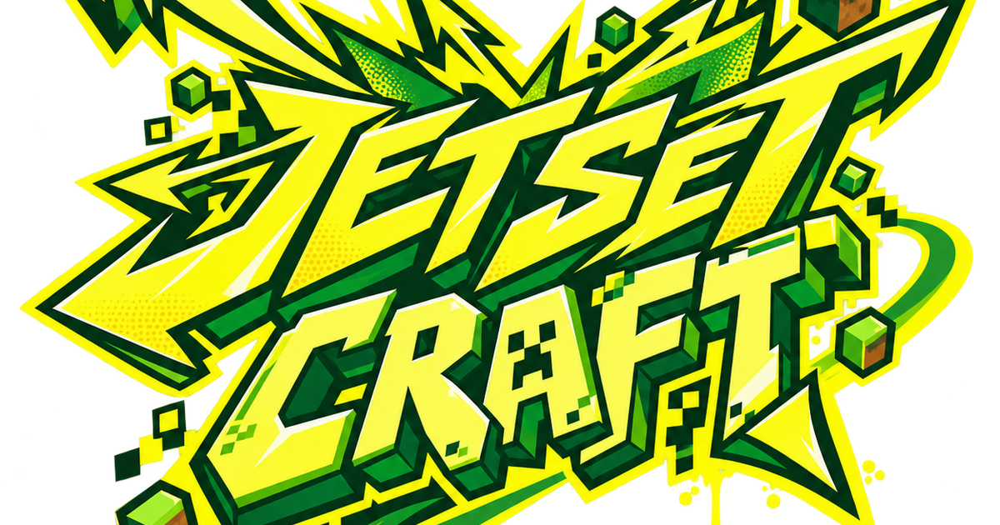

# 🎧 JetSetCraft Inspiration & Research Atlas

**[Open the visual research browser →](https://herbertofury.github.io/JetSetCraft/research.html)** · [Repository catalogue](https://github.com/Herbertofury/JetSetCraft/tree/main/docs/research) · [Development roadmap](Roadmap)

## A bigger world of ideas, organized around JetSetCraft

The **31 October 2026 research pass adds 196 entries**: **40 games, 100 music tracks, 24 art/culture/presentation references, 22 engineering references and 10 choreography papers**. The earlier **173-entry atlas** remains in the same four research lanes. The visual browser now holds **369 catalogue entries**, with search, filters, source media, a personal shortlist and CSV export. These are research records; different entries may study different aspects of the same creator or project.

The creative goal is a coherent street-sports world: satisfying movement, places worth learning, recognizable crews, expressive graffiti, great music and responsive presentation. Every new game/reference entry explains the JetSetCraft connection and a useful experiment. The music collection supplies exact artist/track links, scene ideas, crew palettes and a starting sequence.

**Status:** this pass contributes research and design. Proposed experiments have not been run in the mod, and performance gains are not claimed. Existing owner-approved designs, selected songs and the [finish execution contract](https://github.com/Herbertofury/JetSetCraft/blob/main/docs/JETSETCRAFT_CLAUDE_FINISH_EXECUTION.md) remain the implementation authority.

## Four canonical research lanes

| Lane | New in this pass | Earlier entries | What you will find |
|---|---:|---:|---|
| **[Games, Movement & Rides](Research-Street-Movement-and-Rides)** | **40 games** | 44 | Skating, parkour, combat, world design, ride identity, co-op, ten refinements and six course briefs; official images and video links. |
| **[Music, Graffiti & Audio](Research-Graffiti-Music-and-Audio)** | **100 tracks** | 19 | A 16-track starting sequence, seven listening shelves, 12 cover cards, scene palettes, 25 crew-specific candidates and artist/label routes. |
| **[Art, Animation & Creators](Research-Animation-Models-and-Creators)** | **24 references + 10 papers** | 78 | Street-art history, individual artists, readable motion, crew identity, wayfinding and editable choreography methods. |
| **[Engineering & Performance](Research-Frameworks-Java-and-Bedrock)** | **22 references** | 32 | Ten code-specific opportunities with acceptance checks; audio, networking, animation, HUD, secondary motion and profiling. |

The [earlier 173-row research sheet](https://docs.google.com/spreadsheets/d/1liWhRQL7rmPy8LLgSRVlkrLANqUIJE4UbFX3--KMJjg/edit?gid=1570163195#gid=1570163195) remains available. The new source catalogue is maintained in the repository. Earlier scores and version notes remain historical metadata; they are not relabeled as freshly measured results.

## The strongest creative directions

### Make the whole movement line satisfying

Use **[Bomb Rush Cyberfunk](https://team-reptile.com/press/sheet.php?p=Bomb_Rush_Cyberfunk)**, **[HYPERFUNK](https://store.steampowered.com/app/3183480/HYPERFUNK/)**, **[Haste](https://store.steampowered.com/app/1796470/Haste/)** and **[Driftwood](https://store.steampowered.com/app/2223700/Driftwood/)** as complementary references. Compare one connected sequence: acceleration, a meaningful turn, grind entry, transfer, landing and a recoverable mistake. Record the exact transition where intention is lost.

The six existing ride styles and [approved boostpack/ride expansion](Approved-Ride-Expansion-and-Trick-Combat) give this work its foundation. HYPERFUNK remains **TBA** on the checked official store page; its advertised systems are research targets, not independently measured behavior.

### Turn ordinary terrain into memorable places

Pair **[SLUDGE LIFE](https://store.steampowered.com/app/1144770/SLUDGE_LIFE/)** and **[Umurangi Generation](https://playism.com/en/game/umurangi-generation/)** with **[A Short Hike](https://ashorthike.com/press/)**. Give a useful route a viewpoint, local character, meeting place or memorable artwork. A hidden tag should be associated with the line that reaches it and the place it marks.

For industrial scale, study **[MOTORSLICE](https://store.steampowered.com/app/2830030/MOTORSLICE/)**, **[Lorn's Lure](https://store.steampowered.com/app/1417930/Lorns_Lure/)** and **[BETON BRUTAL](https://store.steampowered.com/app/2330500/BETON_BRUTAL/)**. Large spaces work when the next landing and recovery route remain clear from the actual camera. These ideas support the existing [terrain-aware event circuits](Terrain‐Aware-Event-Circuits-and-Boss-Arenas).

### Give each crew a recognizable musical and visual identity

Start with the [16-track listening path](Research-Graffiti-Music-and-Audio), then explore the seven shelves. The collection spans Naganuma/BRC lineage, funk, house, breaks, jungle, bass music and the established crews' own traditions. It includes current discoveries from 2 Mello, GRRL, wev, Bteck and the Denshattack soundtrack alongside enduring references.

Build a shared identity kit across silhouette, emblem, art vocabulary, movement phrasing, musical palette and arrival. Study [Lady Pink](https://www.ladypinknyc.com/fine-art-page), [FUTURA LABORATORIES](https://futuralaboratories.com/pages/about), [OSGEMEOS](https://pinacoteca.org.br/programacao/exposicoes/osgemeos-segredos/) and [Henry Chalfant at STRAAT](https://www.straatmuseum.com/en/press/from-new-york-to-amsterdam-straat-museum-shows-graffiti-culture-through-the-eyes-of-henry-chalfant) for broader authored street culture.

The established [music-driven dance and boss specification](Music‐Driven-Dances-and-Mob‐Themed-Bosses), selected songs, crew names and individual recruits remain intact. New music candidates support the owner's later auditions and outreach.

### Make spectacle respond to play without interrupting it

The already-approved [trick-ammo combat loop](Approved-Ride-Expansion-and-Trick-Combat) deserves a focused test: route choice, refill accounting, reload interruption, animation ownership and clear feedback. [Roll7's own Rollerdrome combat guide](https://blog.playstation.com/2022/08/11/prepare-for-rollerdrome-with-dev-combat-tips-out-august-16/) is the primary starting point.

For music, combine immediate confirmed-action accents with larger changes at musical boundaries. Audio, crew response, announcer and lighting should share a meaningful timeline. Player inputs, hits, collision and scoring remain immediate and authoritative. The engineering lane includes late-join, cancellation, muted-play and duplicate-event checks.

### Give artists control over music-driven choreography

**[CustomDance](https://xulongt.github.io/customdance-project-page/)** exposes phrase choices and repair; **[AtomicDance](https://github.com/oceanflowlab/AtomicDance)** makes movement structure explicit; **[DanceEditor](https://lzvsdy.github.io/DanceEditor/)** studies iterative changes. **[ChoreoStudio](https://arxiv.org/abs/2610.32325)** is a **23 October 2026 preprint** separating formation, timing and dancer roles.

Evaluate an offline authoring workbench against authored clips and established baselines. Useful output must retain crew vocabulary, contact quality, editability and compatible skeletal motion. The ten-paper register includes explicit experiments and distinguishes author-reported results from demonstrated JetSetCraft behavior.

## Twelve practical priorities

This is an editorial study/implementation sequence. Existing task IDs and issues linked from each lane remain canonical.

| Order | Improvement | First useful evidence |
|---:|---|---|
| 1 | **One excellent connected movement line** | Input/motion recording across boost, turn, grind, wall exit, landing and recovery. |
| 2 | **Readable HUD with personal layout control** | GUI-scale, localization and overlay trials; measured text bounds and full information. |
| 3 | **Graffiti decoding/cache experiment** | Identical pixels and six-face output; allocation/frame-time comparisons in a dense wall scene. |
| 4 | **A complete music and scene audition** | Compare exact candidate versions in exploration, chase, battle, hangout and finale contexts. |
| 5 | **One shared musical event timeline** | Immediate feedback plus phrase transitions; correct cancellation, late join and mute behavior. |
| 6 | **Distinct crew identity kits** | Recognizable silhouettes, art, gear, motion and music without a name label. |
| 7 | **Artist-directed choreography workbench** | Edit a phrase/body region while preserving neighboring choices and gameplay ownership. |
| 8 | **Fast graffiti blackbook navigation** | Find and reuse earned art through search, favorites, recent items and crew filters. |
| 9 | **Useful mistakes and fast retries** | Time to another meaningful attempt; slower recovery routes and optional mastery branches. |
| 10 | **The approved trick-ammo combat slice** | Real adapter behavior under firing, refill, reload, gun switches and duplicate events. |
| 11 | **Approved NPC secondary motion** | Turns, braking, landings and reset cases on the existing CPM quality benchmark. |
| 12 | **Terrain-aware events and Trick Trains** | Real contact, fairness, source-world preservation, vehicle identity and complete recovery. |

## Six course briefs ready to prototype

| Course | Creative purpose | Main references |
|---|---|---|
| **Depot loop** | Social practice and increasingly expressive tag approaches. | JSR/JSRF, BRC, Refunct |
| **Rooftop relay** | Street, rail and roof approaches supporting pursuit and team play. | Rooftops & Alleys, Hover, Splatoon 3 |
| **Timberline descent** | Controlled carving, braking and surface changes. | Driftwood, Descenders, Lonely Mountains |
| **Signal tower** | Industrial scale, visible destinations and recovery terraces. | MOTORSLICE, Lorn's Lure, Umurangi Generation |
| **Recharge rink** | Readable skating/gunplay and the approved trick-ammo loop. | Rollerdrome, Sunset Overdrive, Helskate |
| **Crew freight** | Staged minecart/Create work for the existing train goal. | Denshattack!, Solar Ash |

Full layouts, illustrative starting footprints and acceptance questions live in [Games, Movement & Rides](Research-Street-Movement-and-Rides). Footprints are test briefs rather than content limits or verified movement distances. [Trick Trains and Create](Trick-Trains-and-Create) remains the existing train specification.

## Evidence and upkeep

- **Sources and media:** developer/publisher/artist/label/museum sources, original documents and direct creator interviews; clickable store images, covers, production stills, videos and demos. Linking media does not claim that every complete track/video was played or analyzed.
- **Dates and priorities:** checked dates, release dates, announced features and preprints are separate. Priorities express JetSetCraft fit; actual game feel, usability and performance require controlled tests.
- **Music:** candidates are not restricted to royalty-free selections. Exact artist/version links and public entry points support later outreach. New clearance is not claimed; earlier selections keep their existing status.
- **Continuity:** all **51 existing live wiki pages** are preserved, including **19 pages previously absent from the repository mirror** and seven newer page versions. The four research lanes are expanded in place.

Update canonical entries with their sources and checked dates. The [catalogue build instructions](https://github.com/Herbertofury/JetSetCraft/tree/main/docs/research) explain how to refresh the visual browser and retain a coherent research collection.
