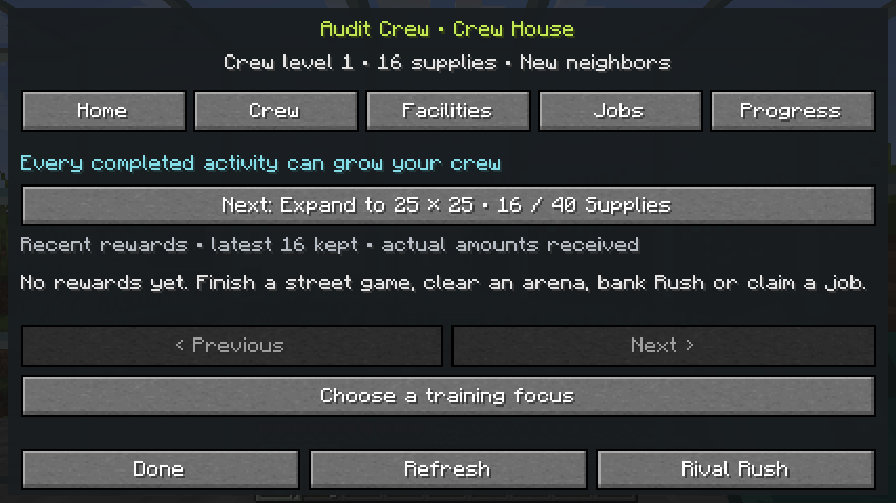
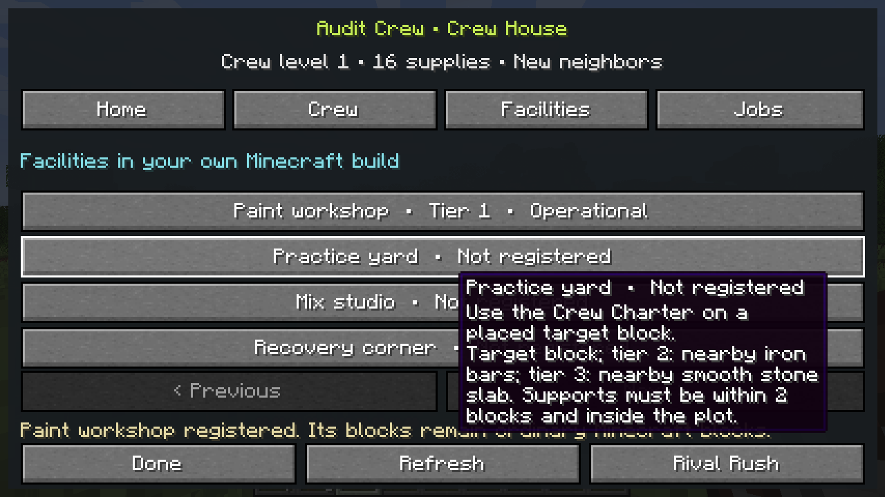
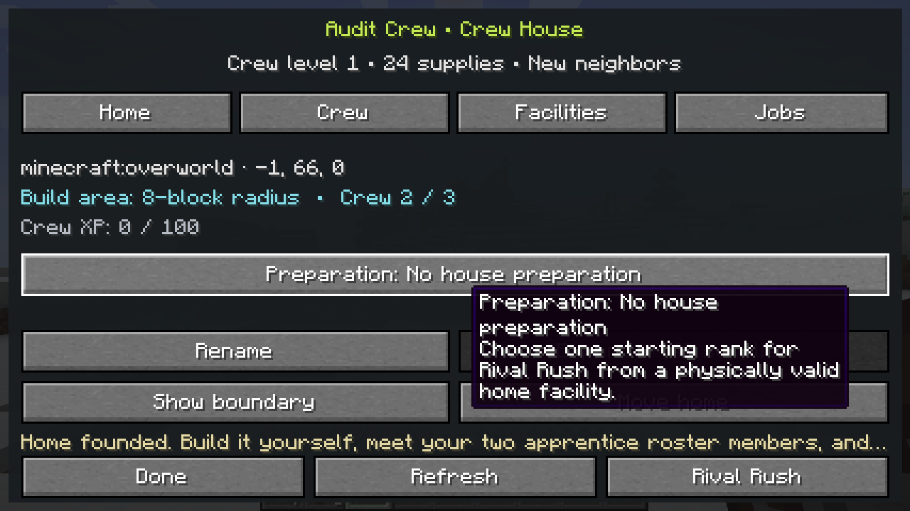
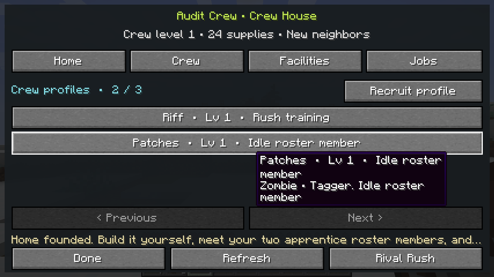
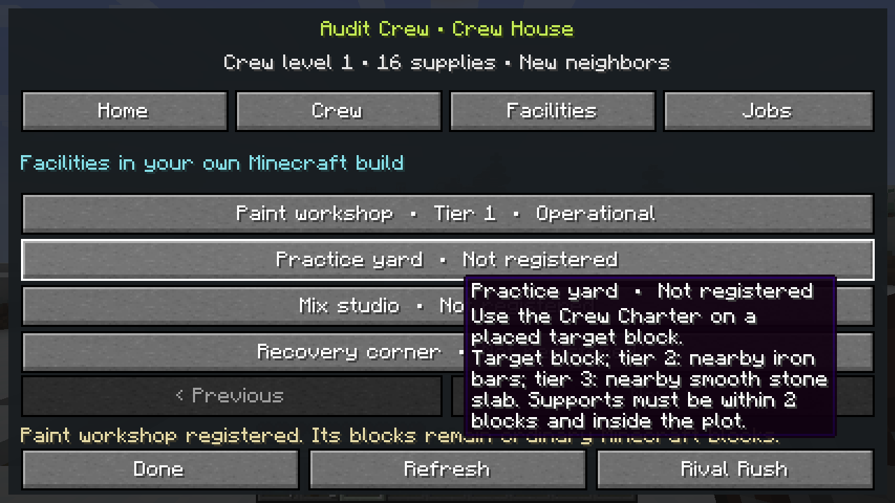
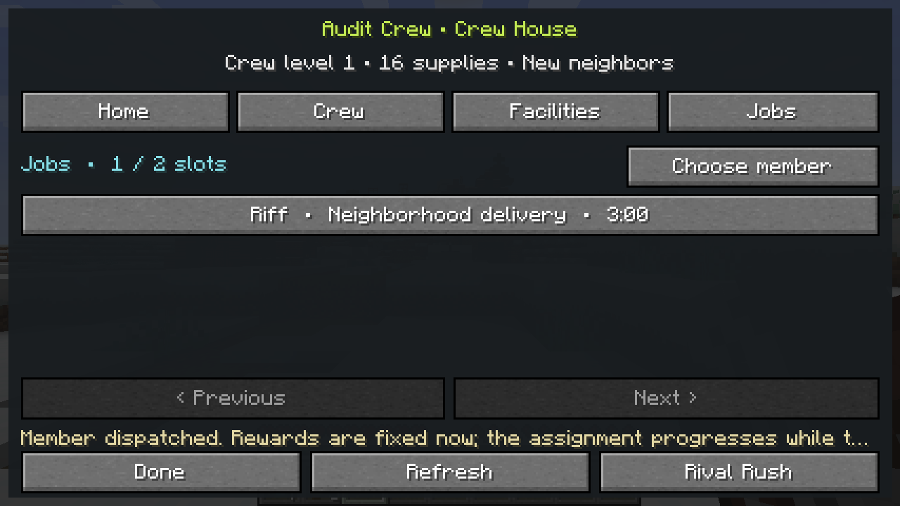

# Player Chapters, Crew Houses, Posse & Mob Archetypes

**Development status: `0.4.0-alpha.4`, merged and verified through [PR #43](https://github.com/Herbertofury/JetSetCraft/pull/43).** The new **Progress** tab records the rewards actually credited across modes, provides nonblocking reward feedback and shows practical home goals. These additions keep the existing reward amounts and activity eligibility.

[Base #286](https://github.com/Herbertofury/JetSetCraft/actions/runs/41379581968) and [provider matrix #59](https://github.com/Herbertofury/JetSetCraft/actions/runs/41379581891) passed **35 real GameTests in each of nine configurations**, every build, dedicated-server readiness, RCON stop and normal saved-dimensions shutdown. The base produced **thirteen reviewed client captures**. Merge [`e826694`](https://github.com/Herbertofury/JetSetCraft/commit/e826694c3429394b2b264f153cd9ea34b1fb9051) has the same tree as the tested source, recorded in the [reward/journey receipt and gallery](https://github.com/Herbertofury/JetSetCraft/blob/main/docs/verification/reward-journeys/README.md). New crew tests verify actual cap-adjusted rewards, saved history and once-only founding transfer, zero-training reasons, and mission XP/level changes for the assigned member.

The **historical alpha.3 baseline** in [PR #41](https://github.com/Herbertofury/JetSetCraft/pull/41) added shared street-game/arena rewards and banking before the first house. Player-built facilities, a persistent named roster, levels, dispatch jobs and optional Rival Rush preparation were introduced in alpha.2, whose historical evidence remains below. **Members are saved profiles: visible residents, skating followers and physical posse AI are future work.** Stable `v0.3.0` is unchanged. The [Crew House design study](https://github.com/Herbertofury/JetSetCraft/blob/main/docs/CREW_HOUSE_DESIGN.md) contains eight primary-source inspirations and clearly labelled extensions. Older receipts retain their own source identities and scope.

## Alpha.4 Progress capture

The real **1280 × 720** capture shows the audit account's **empty reward history**, its registered workshop and **16/40 Supplies** toward the next **25 × 25** footprint. The assigned job is still running. It does not show a claimed mission, an earned receipt or a human progression session; GameTests separately exercise the credited history and mission settlement. [The full gallery](https://github.com/Herbertofury/JetSetCraft/blob/main/docs/verification/reward-journeys/README.md) preserves the early Journey/Build states and native hover tooltips in crew frames 05–07.

## Historical verified alpha.3 checkpoint

[Verify JetSetCraft #280](https://github.com/Herbertofury/JetSetCraft/actions/runs/41356358215) and [all eight provider configurations in #56](https://github.com/Herbertofury/JetSetCraft/actions/runs/41356358302) passed **28 real GameTests per configuration** and dedicated-server startup. The base also verified normal save/shutdown and produced **ten reviewed captures**, including real Charter founding, two saved profiles, an operational placed workshop, a dispatched job, the Boombox activity chooser and the first arena fork. The [alpha.3 receipt and gallery](https://github.com/Herbertofury/JetSetCraft/blob/main/docs/verification/arena-circuit/README.md) ties those results to the exact merged tree and binary. Its **2026-11-02 scope correction** explains that provider smoke used SIGTERM/SIGKILL cleanup without a normal-shutdown assertion; base #280/#282 and separate GameTest-server normal-save evidence remain valid.

The workshop above was registered from a real placed crafting table. The original capture preserves a native hover tooltip over some secondary rows and controls; crew captures 05–07 retain these overlays. The job shown elsewhere in the gallery is **dispatched and still running**. GameTests cover its ready-time boundary and claim, shared activity rewards, pending training transfer and replay rejection. The screenshots do not demonstrate a finished mission or a human progression playtest.

## Historical alpha.2 crew-house captures

These four **1280 × 720** images come from the alpha.2 real-client audit. They show the actual profile-based implementation and its placed-workshop fixture. [Open all eight captures and the source/binary verification receipt](https://github.com/Herbertofury/JetSetCraft/tree/main/docs/verification/crew-house).

| Home and expandable footprint | Named crew profiles |
|---|---|
|  |  |
| **Registered physical facilities** | **Dispatch jobs** |
|  |  |

### Recorded alpha.2 verification

[Verify JetSetCraft #274](https://github.com/Herbertofury/JetSetCraft/actions/runs/41350812751) passed the clean Forge build, **19 real GameTests**, dedicated-server readiness and normal RCON shutdown, and the eight-screen graphical client audit. [All four optional-provider configurations](https://github.com/Herbertofury/JetSetCraft/actions/runs/41350812645) passed the same 19 tests and server smoke. The [receipt](https://github.com/Herbertofury/JetSetCraft/tree/main/docs/verification/crew-house) identifies the tested source, binary and [PR #40 publication](https://github.com/Herbertofury/JetSetCraft/pull/40).

The client used the Charter, founded a home through production actions, displayed its two apprentices, registered an operational placed workshop and dispatched a real timed job. That job was still running in the capture; deterministic Forge checks cover its saved ready-time boundary, claim and replay rejection. These are historical machine integration checks, not a human house-progression playtest or proof of physical NPC behavior. They do not verify the later alpha.3 shared-activity or pre-house banking changes. [Testing and Verification](Testing-and-Verification) distinguishes those checkpoints and their scope.

## Start a crew house

1. Craft a reusable **Crew Charter** from **book + cyan dye + copper ingot**. Use it in the air, or enter `/jetsetcraft crew`, to open the crew book.
2. Place a normal Boombox at your chosen home. Its resolved gang becomes the chapter's gang when founded; a box without a resolved target defaults to Dead Beat. Finish any active Boombox challenge first.
3. Use the Charter on the Boombox, choose **Found a home**, review the location and confirm **Found here**. Selecting a block or reading the book alone never founds a house or spends supplies.
4. Build your own house and facilities. Founding grants **24 starting Crew Supplies, plus any previously banked activity earnings**, and creates two named profiles: **Riff** (Courier) and **Patches** (Tagger). Pending crew XP and reputation transfer too; all pending member training goes to **Riff, the initially focused member**, so he can begin above level one. No structure or resident mob is generated.
5. In **Crew**, choose a member and a job; in **Jobs**, claim its result when ready. You can keep building, skating or playing ordinary Minecraft while the assignment advances.

The alpha.4 book has **Home**, **Crew**, **Facilities**, **Jobs** and **Progress** tabs. You can inspect it away from home; managing members, jobs or facilities requires returning to the same dimension, standing inside the registered plot and having its Boombox naturally loaded and present. Finish or cancel a street activity, or return from Rival Rush, before managing the house. The server can disable this optional feature with `[crewHouse] enabled = false` while retaining saved progression.

Each player has one owned house. **Show boundary** previews its square footprint. This area determines which facilities belong to the house; it does not protect blocks, reserve building permissions, create terrain or force-load chunks. Registered crew plots cannot overlap one another or extend past the world border, but ordinary Minecraft building remains governed by the server's usual rules.

### Progress: see what you earned and what to build next

Open **Crew Charter → Progress**, or `/jetsetcraft crew` and select **Progress**. It works before founding a home. Alpha.4 shows your **latest sixteen reward receipts**, newest first, across completed street activities, arena clears, qualifying Rush returns and claimed missions. Each receipt records the Supplies, crew XP, training XP and gang reputation **actually credited**, including reductions at account caps, the recipient and any crew/member level change.

Activity training goes to the selected idle member. A busy member or missing focus produces an explicit **zero training XP** result. A claimed mission trains **its assigned member**, regardless of the current activity focus. Before founding, training is banked; founding transfers that balance to Riff and moves the original receipt rows and IDs once. It creates no second payout or invented reward-history entry. Older saves begin with an empty display history; past earnings are not reconstructed as fabricated receipts.

Accepted rewards show a **seven-second native toast** without opening a menu. Reduced motion uses a static text notification instead. The persistent sixteen-row display history is separate from the existing 128-entry settlement replay guard; both follow normal world-save durability.

**Next goal** shows a practical step such as founding, registering a workshop or expanding the plot, with available Supplies, cost and shortfall. Its review action opens the relevant page without spending anything. **Affordable** and **physically ready** are different: you still place the required blocks, keep the home valid and loaded, and explicitly confirm an eligible purchase. No goal automatically builds your house.

### An early loop: earn, found, build

With crew progression enabled and the standard rewards, complete **one Tag round, one King of the Hill round and one Showdown before founding**. Their genuine completed objectives bank **34 Crew Supplies** and **77 member training XP**. Founding adds its 24 Supplies and gives that pending training to **Riff only**, bringing him to **level 2**; Patches begins at level 1.

| Step | Crew Supplies available |
|---|---:|
| Complete Tag, King of the Hill and Showdown before founding | 34 banked |
| Found the house and receive its 24 starting Supplies | 58 |
| Buy the first plot expansion for 40 | 18 |
| Place and register a tier-one Paint workshop for 8 | 10 |

This example assumes no other purchases. Expansion recognizes a **25 × 25** footprint and allows **five roster members**; it does not construct the extension. Place a valid crafting table or smithing table within the loaded plot, then register it through the Charter for the workshop. Supplies pay the registration cost; the physical blocks and the house are still yours to build. [The full activity reward table](Rival-Rush#shared-completion-rewards) shows the crew XP and gang reputation earned alongside this loop.

## Expand the space you build

| Stage | Radius from the anchor | Recognized footprint | Roster capacity | Concurrent jobs | Cost to reach this stage |
|---|---:|---:|---:|---:|---:|
| Founded house | 8 blocks | 17 × 17 | 3 | 2 | Founding |
| First expansion | 12 blocks | 25 × 25 | 5 | 2 | 40 Crew Supplies |
| Second expansion | 16 blocks | 33 × 33 | 8 | 3 | 100 Crew Supplies |
| Third expansion | 24 blocks | 49 × 49 | 12 | 3 | 200 Crew Supplies |

An expansion increases the recognized area and roster allowance. **It does not place walls, rooms or decorations.** Facility upgrades below give the blocks you construct a specific use. These initial costs and limits are tuning choices, not evidence of a balanced progression curve.

To move, use the Charter on another eligible placed Boombox, choose **Move home**, and review **Confirm move**. Your house identity, names, members, jobs, XP, supplies and purchased facility tiers remain. Register the facilities at their new physical locations; re-registration is free and requires the blocks for their already-purchased tiers. Moving does not copy your building or create another roster. A missing home Boombox leaves the saved crew and jobs intact: replace it at the anchor or relocate.

## Build and register four useful facilities

Place the ordinary Minecraft blocks yourself, use the Charter on the facility's base block, then choose **Register facility**. First registration costs **8 Crew Supplies**. Upgrading from tier 1 to 2 costs **16**; tier 2 to 3 costs **32**.

| Facility | Base block for tier 1 | Add for tier 2 | Also add for tier 3 | Optional Rush preparation |
|---|---|---|---|---|
| **Paint workshop** | Crafting table or smithing table | Anvil, chipped anvil or damaged anvil | Grindstone | **Paint pressure**: one damage rank |
| **Practice yard** | Target block | Iron bars | Smooth stone slab | **Quick hands**: one firing-rate rank |
| **Mix studio** | Jukebox | Note block | Redstone lamp | **Style dividends**: one style-reward rank |
| **Recovery corner** | Brewing stand | Empty or water-filled cauldron | Bed | **Easy breathing**: one recovery rank |

Supports must be within **two blocks along each axis** of the registered base, inside the plot and naturally loaded. Tier 3 requires both supporting block types. The blocks retain their ordinary Minecraft function and are not consumed by registration. If a required block is removed or unloaded, the facility stops contributing until its full purchased-tier requirements are valid again; the purchased tier remains saved.

Each operational tier above 1 adds **5 percentage points** to mission supply rewards. A DJ assigned with an operational Mix studio adds another **10 percentage points** within the same **30% total facility-bonus cap**. These bonuses are evaluated when a job starts. The studio does not yet provide an interactive music minigame, and the recovery corner does not spawn or heal physical crew NPCs.

## Name, recruit and develop members

Members have a permanent profile ID, name, creature identity, gang, role and member XP. Rename them in the crew book. Recruiting costs **max(20, 20 + 5 × current member count − home-gang reputation discount)** Crew Supplies. With no prior home-gang reputation, adding the first extra member to the two starters costs **30**. Reputation earned before founding can already qualify the new house for a discount. Choose **Courier**, **Tagger**, **Technician** or **DJ** at recruitment.

The available species pool includes a representative of the house's gang plus eligible installed species already discovered in your mob-card album, up to 64 choices. Recruiting creates a roster profile; it does not capture, replace or remove a world mob. The starting gang representative remains recruitable without playing Rush, so house expansion and role development have a non-Rush route.

Member level is capped at **10**. The cumulative XP required for level `L` is `60 × (L − 1)²`: level 2 needs 60 XP and level 3 needs 240. A level contributes **2% more mission supplies per level above 1**, reaching **18% at level 10**. Crew XP is a separate house-wide record, capped at level **20**, with cumulative threshold `50 × (L − 1) × L`. Neither is Minecraft experience, and a crew level does not automatically purchase an expansion or facility.

Use **Start training** to select **one idle member** to receive XP from completed **Tag, King of the Hill, Showdown and arena objectives**, as well as qualifying Rush returns. The roster marks that member **Training focus**; **Stop training** clears the selection. A dispatched member remains busy until the job is claimed or cancelled and receives no activity training while busy. Claiming a mission separately grants its frozen XP to the assigned member. The selected profile does not follow the player into an activity.

Reputation is stored by player and canonical gang identity. A claimed mission grants reputation for its assigned member's gang; completed street games, arena clears and qualifying Rush returns grant reputation for their target or rival gang. Home-gang reputation reduces recruitment prices by **2 / 4 / 6 / 8 Crew Supplies** at **50 / 150 / 400 / 1,000 reputation**, with a minimum price of **20**. The crew book shows the current discount. Growth remains available without a reputation threshold. Wider trust-gated chapter skins, individual bond scenes and follower privileges described later are future design.

## Dispatch jobs without a login schedule

| Assignment | Matching role | Duration in server game time | Base Crew Supplies | Member XP | Crew XP | Gang reputation |
|---|---|---:|---:|---:|---:|---:|
| **Neighborhood delivery** | Courier | 3 minutes | 12 | 35 | 40 | 6 |
| **Community mural commission** | Tagger | 8 minutes | 30 | 90 | 100 | 14 |
| **Workshop salvage circuit** | Technician | 15 minutes | 55 | 160 | 180 | 25 |
| **Soundcheck circuit** | DJ | 8 minutes | 30 | 90 | 100 | 14 |

Any idle member can take any job. A matching role adds **25%** to base supplies; member-level and facility percentages are added to that bonus, then the final supply amount is rounded down. The XP and reputation amounts in the table do not receive this supply multiplier. All inputs are fixed at dispatch: a later level-up, broken facility or upgrade does not retroactively change an active assignment's promised reward.

Durations use the overworld's game time, with the displayed minutes assuming normal 20-tick-per-second simulation. Time stops when the server stops; it can advance while you are offline if a multiplayer server keeps running. Ready results remain available indefinitely. There is no reward expiry, decay, automatic repeat or missed-login penalty, and no remote mission chunks or travelling mobs are simulated.

Choose **Claim rewards** at home to bank the saved supplies, member XP, crew XP and gang reputation together once. A ready job still occupies its member and slot until claimed. **Cancel job** requires confirmation and returns the member without rewards. These assignments are a background roster activity; the named mural, delivery and soundcheck jobs do not yet contain playable field missions.

## Keep Rival Rush optional

Missions and completed **Tag, King of the Hill and Showdown** rounds can fund house growth without entering Rush. Arena clears also settle their own shared rewards. A qualifying Rush return adds a separate reward after at least **one minute of active run time and three rival defeats**; finishing all six arenas is not required. [The exact shared reward table](Rival-Rush#shared-completion-rewards) lists supplies, crew XP, member training and reputation. These rewards can be earned before founding and transfer with their recent settlement receipts when the first house is created. Ordinary mob kills, menu refreshes, cancelled street rounds and unloaded legacy Boombox actors do not settle these rewards. Crew Supplies never become vanilla items or XP orbs.

In **Facilities**, **Choose preparation** selects at most **one** starting perk from an operational facility. The default is **No house preparation**. The benefit applies only when starting Rush from inside the valid, loaded home plot, and always grants one rank even if the facility is tier 3. It does not change ordinary Minecraft health, damage or item yield. The existing mob-card album's starting-draft milestones remain a separate Rush system.

The first slice provides no physical NPC residents, follower navigation, provider-backed recovery, playable expeditions, personal bond scenes or music-timed house activities. Those ideas have a clear place in the extension design below and in the [eight-game research study](https://github.com/Herbertofury/JetSetCraft/blob/main/docs/CREW_HOUSE_DESIGN.md).

House progression and pre-house earnings live in the world's saved crew record, separately from Rush's temporary player-return snapshot. Activity receipts and their rewards update together; the account retains the most recent **128 receipts** to reject repeated settlements, and founding transfers those identities with the pending earnings. Claiming a mission removes its job and adds its rewards together. These are bounded server-side replay protections; durability follows ordinary Minecraft world saves. An abrupt crash can lose changes since the last completed world save. Unrecognized save schemas are retained read-only, with management blocked until recovery or a compatible mod version is available.

## Future physical chapters and posse design

**Everything in this section is the longer-term design contract, not a claim about the profile-only crew-house runtime above.** Its approximate five-resident example, high-trust founding reward, themed Chapter Boomboxes, physical followers and archetype recovery describe later work. The current reusable Charter and roster rules above take precedence for the implemented first slice.

High reputation with a gang should eventually let the player bring that gang **home** without turning JetSetCraft into a settlement/worldgen mod.

The prestige reward is a gang-specific **Chapter Boombox**: a themed version of the Boombox bound to the gang's stable `gang_id`. Placing it at a player-selected location establishes a small player-founded chapter there.

Examples should be playful and species-aware. A Mooshroom gang can award a mushroom-covered **Shroom Box**; aquatic gangs can use bubbles/water motifs; Bone Drones can use skeletal speaker cages. These are data-driven gang models/skins over one compatible Chapter Boombox implementation rather than separate invasive systems.

### Found Your Own Chapter

At a high configurable reputation tier (default target: Member/Veteran-level trust), the player unlocks that gang's Chapter Boombox.

Placing it:

- creates a stable player-founded `site_id` linked to the gang's `gang_id`;
- makes the placed Boombox the chapter's home anchor;
- creates/invites roughly **five permanent residents by default** (configurable/server-budgeted);
- uses original vanilla/mod-owned entity types rather than JetSetCraft replacements;
- equips real JetSetCraft Street Gear so normal persistent gangification rules apply;
- never creates a worldgen structure, reserves terrain, force-loads chunks, or replaces source/player blocks.

The Chapter Boombox can be intentionally picked up and moved. Its `site_id`, roster, customizations, gang identity, names, and posse assignments survive the move. Re-placing the same chapter anchor relocates home without duplicating residents.

### Stable crew roster, temporary physical bodies

Each permanent member gets a JetSetCraft `crew_member_id`. That is the character identity across deaths and provider changes; a runtime entity UUID is only the current physical body.

A roster entry can persist:

- `crew_member_id`;
- `gang_id`;
- stable semantic `mob_archetype_id`;
- current/preferred provider `entity_type_id`;
- player-chosen display name;
- role/personality seed;
- Street Gear/cosmetic loadout;
- home `site_id`;
- home/following/participating/recovering/missing-provider state;
- posse assignment;
- bounded memorable interaction flags;
- optional signature trick/favorite move.

These residents are not disposable event actors. The player can name them, interact with them, and—after sufficient trust—invite them into their **posse**.

### Posse followers

Eligible chapter residents can become followers and travel/skate with the player, join JetSetCraft activities, pose/dance, and return home when dismissed.

Performance remains bounded:

- no follower chunk tickets;
- no global per-tick missing-member scans;
- normal loaded navigation first;
- bounded catch-up/rejoin only when a member is hopelessly separated;
- all residents can be follower-eligible while servers may configure an active-posse budget;
- residents left at home use the cheap shared Hangout Brain.

The player still has one canonical reputation relationship with the gang's `gang_id`; naming individual members does not create five global reputation meters.

### Chapter Boombox is their bed/spawn point

The placed Chapter Boombox is the permanent crew's **home/spawn anchor**, conceptually like a player's bed while remaining entirely JetSetCraft-owned.

If a chapter resident or posse member is killed or otherwise truly dies:

1. its current source entity death lifecycle is allowed to complete;
2. its `crew_member_id` roster entry becomes `recovering`;
3. after a configurable recovery delay it may return/re-form near its bound Chapter Boombox;
4. recovery happens **only when the home chunk is naturally loaded**—JetSetCraft never force-loads the base just to respawn a member;
5. the recovered member keeps its name, role, gang, posse assignment, JetSetCraft memories, Street Gear and cosmetics;
6. a fresh runtime UUID is allowed/expected after true death; `crew_member_id` is the stable character identity.

JetSetCraft minigame defeats do not have to kill the mob. A non-lethal downed/resting result can simply send the member home. Vanilla/mod combat death uses the recovery system.

If the Chapter Boombox is picked up while a member is recovering, the member remains safely pending until that same chapter anchor is placed again.

#### No death-farm or duplication exploit

Home recovery must not duplicate equipment, inventories, or turn permanent residents into infinite source-mob farms.

- Bound JetSetCraft Street Gear/cosmetics belong to the roster and return with the member rather than duplicating as drops.
- Any death/loot adjustments apply only to JetSetCraft-owned chapter residents through narrow Forge events/accounting; never modify global loot tables or unrelated mobs.
- Repeatable resurrection must have sensible loot/cooldown rules so repeatedly killing one chapter member cannot farm vanilla/modded drops forever.

### Super-intelligent Mob Archetype Resolver

JetSetCraft must recognize **creature concepts**, not depend on one provider mod forever.

This matters for mobs such as **Mooblooms**. A Moobloom might come from one backport today, another mod tomorrow, a replacement fork, a future implementation, or multiple installed providers at once.

Use three separate identities:

- `mob_archetype_id` — semantic creature identity, e.g. `jetsetcraft:moobloom`;
- `entity_type_id` — the installed mod's current physical provider;
- `gang_id` — the gang the archetype maps to.

Resolution should be confidence-based and cached after registry load:

1. explicit JetSetCraft/Forge archetype tags and server overrides;
2. curated version-gated provider aliases/adapters;
3. normalized registry path/translation-key/name synonyms (`moobloom`, `moo_bloom`, etc.);
4. safe family/trait evidence from public server-side metadata/tags/capabilities;
5. modpack/user aliases for differently named equivalents;
6. unresolved/dormant if confidence is insufficient—never guess and corrupt a save.

Never identify an archetype by one Java class, one namespace, a mod filename, renderer internals, or texture scanning. Optional providers remain optional and must never be hard-classloaded when absent.

#### Multiple providers

If two mods both provide a Moobloom:

- explicit server priority wins first;
- otherwise use curated confidence/compatibility scoring;
- expose the chosen provider in the Mob Atlas/debug UI;
- never randomly swap an already-living member's entity type.

#### Provider changed or removed

Persist both `mob_archetype_id` and the last provider.

If the provider disappears:

- the JetSetCraft roster/hangout identity survives because it is keyed to the archetype;
- a missing member enters `missing-provider`/dormant state instead of crashing or being deleted;
- on a later safe spawn/recovery, another installed provider satisfying the same archetype may be selected;
- JetSetCraft preserves its own identity data (name, `crew_member_id`, gang, role, gear, memories) but never pretends it can recreate third-party provider-specific NBT from an absent mod.

This architecture should generalize beyond Mooblooms to old-vote mobs, backports, variants, butterflies, sharks, fireflies, copper golems, rascal-style mobs, and any future creature concept implemented by competing mods.

### Acceptance gates

1. High reputation unlocks the correct gang-specific Chapter Boombox via stable `gang_id`.
2. Placing it at the player's chosen base creates one bounded chapter with about five permanent roster members and no worldgen/chunk-ticket side effects.
3. Residents can be named and recruited/dismissed as posse followers.
4. Moving the Chapter Boombox preserves chapter/roster identity without duplication.
5. Killing a permanent member sends the roster entry into recovery; it returns at the home Boombox after the delay when the chunk is naturally loaded.
6. Recovery preserves JetSetCraft identity but does not duplicate Street Gear/inventory or create an infinite mob-loot farm.
7. `jetsetcraft:moobloom` resolves correctly from provider A, survives provider removal at the save-data level, and can rebind on later recovery/spawn to provider B.
8. Two Moobloom providers resolve deterministically and never randomly swap a living member.
9. No safe provider means dormant/recoverable state plus a useful diagnostic, not a crash or deletion.

See also [[Gang Hangouts, Soft Territory & Reputation|Hangouts-Territory-and-Reputation]], [[Gang Wars, Boombox & Mob Atlas|Gang-Wars-Boombox-and-Mob-Atlas]], [[Standalone Compatibility Covenant|Standalone-Compatibility-Covenant]], and [[Compatibility]].
