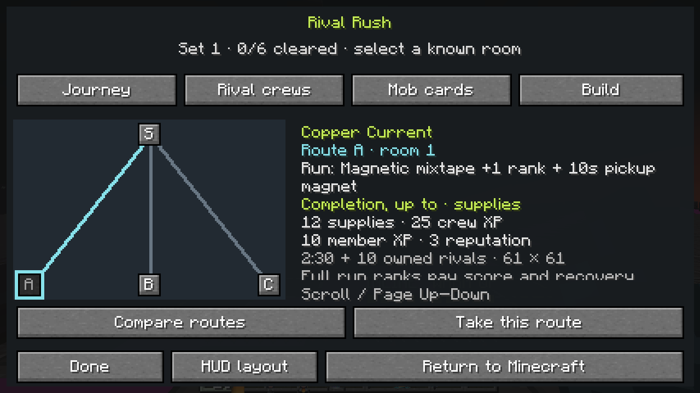
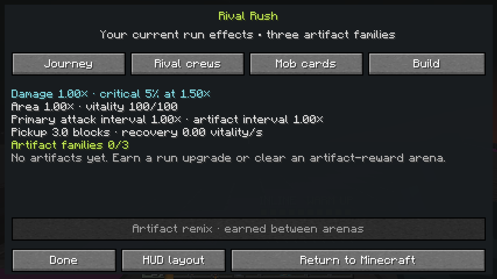
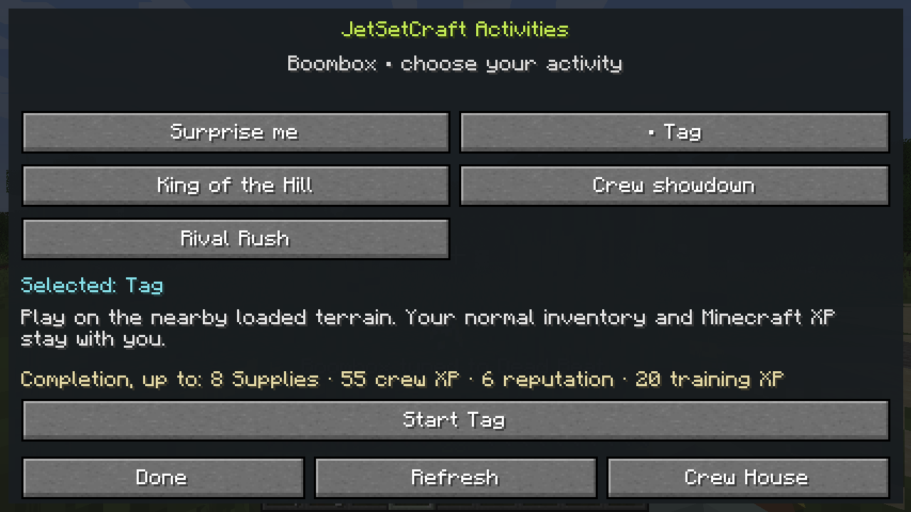
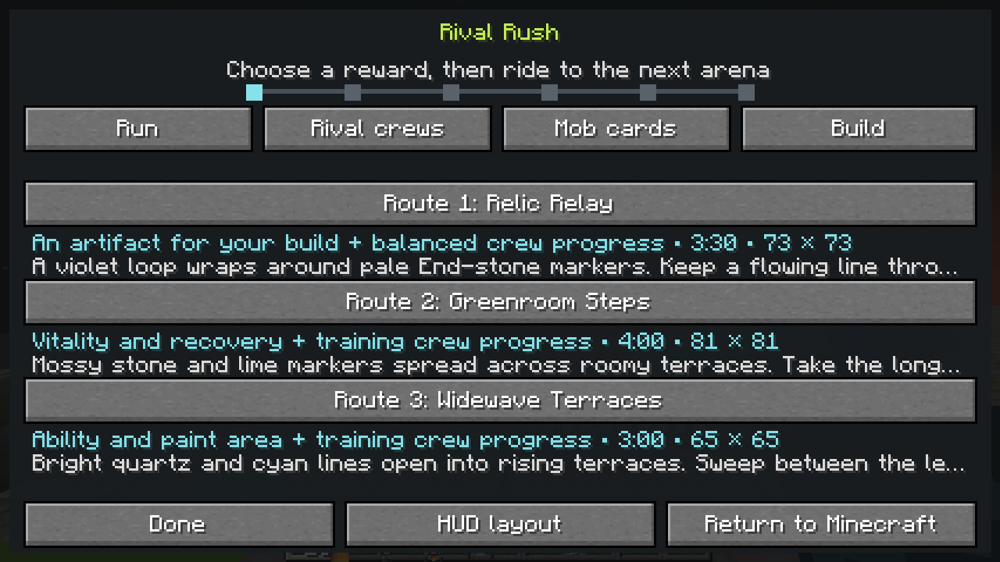
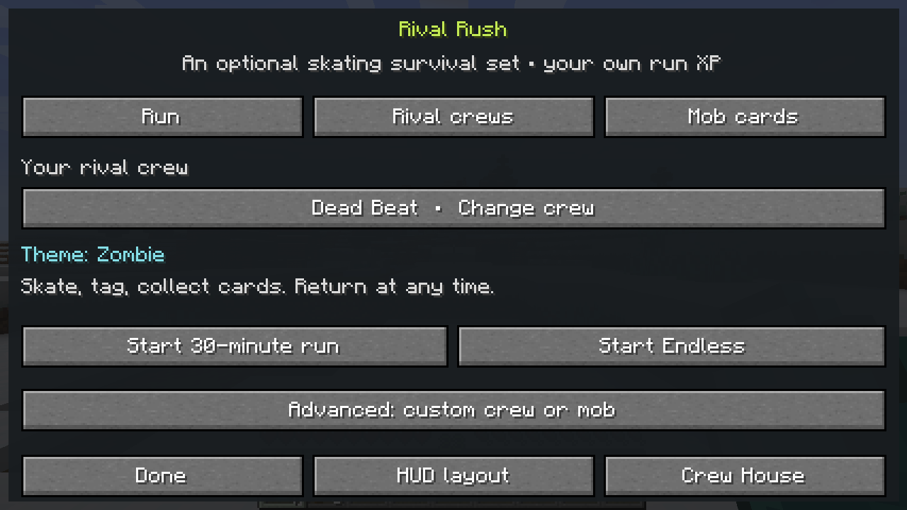
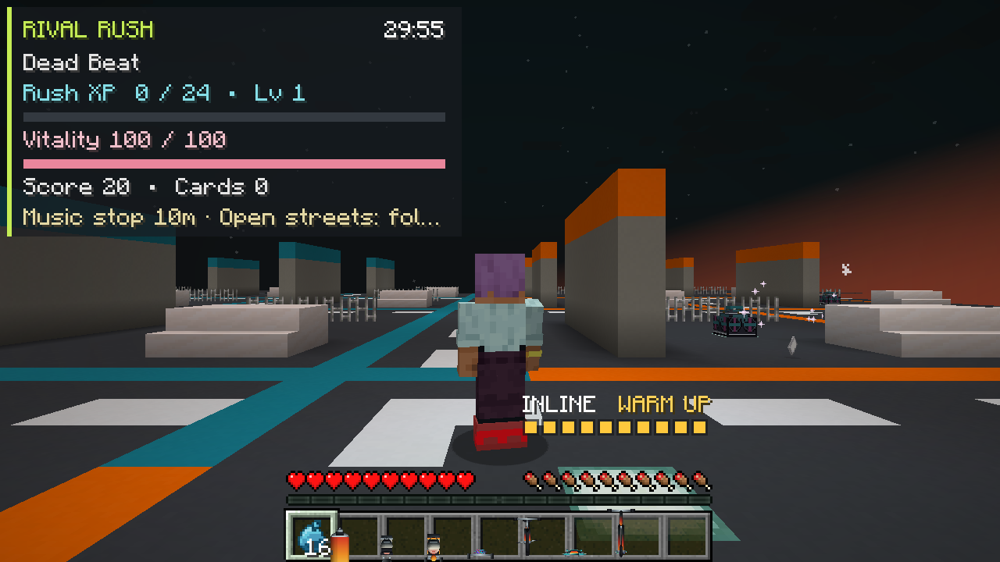

# Rival Rush — optional skating roguelite

## Connected Streets candidate — six evolutions and shared tour goals

The unreleased **alpha.10 / protocol 18** source adds three evolutions to Build Paths. Its [candidate verification receipt](../docs/verification/connected-streets/README.md) distinguishes completed local checks from pending Forge/client acceptance. The original alpha.7 and earlier evidence below retain their original source identities.

| Evolution | Rank-three ingredients | Play effect |
| --- | --- | --- |
| Chromatic finale | Arc paint + Firework cap | Every sixth primary tag sends up to three secondary sparks beyond the ordinary firework blast. Visible owned rivals take eight base damage within ten blocks of the impact, with area reach capped at eighteen. No recursive primary hits. |
| Bass drop | Air break + Bass horn | A real moving landing creates one fixed aftershock circle, pulsing after one, two and three active seconds. Each pulse hits at most six visible owned rivals for six base damage. Radius starts at six blocks and caps at ten. A new landing replaces it. |
| Soul reprise | Soul mixtape + Soul burst | A successful offensive burst spends five souls, recovers up to six run vitality and refreshes three active seconds with a 30% shorter firing interval. It cannot stack duration or spend the separate healing-soul reserve. |

The headliner-earned forge opportunity, one selected evolution, three artifact slots and single starting preparation are unchanged. Removing an ingredient makes the evolution dormant. Bass drop's remaining pulses appear in Build/HUD feedback; Build Paths retains exact requirements and paged descriptions for all six choices.

Actual arena clears and qualifying returns also advance **Crew House → Progress → Crew Tour**. A return qualifies through the existing server participation gate (at least one active minute and three defeats); leaving a fresh run does not stamp a milestone. Tour claims grant the same crew XP that unlocks Style Library starts, so street wins and expedition results can help prepare the next Rush. Nine core milestones require no Liberty provider.

**Verified arena-contract checkpoint: `0.4.0-alpha.7`; original gameplay checkpoint merged through [PR #46](https://github.com/Herbertofury/JetSetCraft/pull/46).** Optional Relay, Paint and Hunt contracts earn a second Pit stop service when their room genuinely clears. Tune, Patch, Rewind and Remix share that bounded stop budget; accepted rewards have their own feedback and Last run counters. Protocol **15** requires matching clients and servers. [Base verification](https://github.com/Herbertofury/JetSetCraft/actions/runs/41397720888) and the [provider matrix](https://github.com/Herbertofury/JetSetCraft/actions/runs/41397720946) passed **63 required Forge GameTests in each of nine configurations — 567 executions of 63 distinct tests**, all builds and normal dedicated-server save/shutdown. Base also passed its **23-capture native-client gate**.

**Verification follow-up:** [PR #47](https://github.com/Herbertofury/JetSetCraft/pull/47), merge [`1fcb78852f893f083749aac2e566addc3acca78b`](https://github.com/Herbertofury/JetSetCraft/commit/1fcb78852f893f083749aac2e566addc3acca78b), strengthens the retained midpoint fixture to handle genuine pickup-earned XP drafts before room settlement. Production gameplay and the 63-test count are unchanged. The [addendum](https://github.com/Herbertofury/JetSetCraft/blob/main/docs/verification/contracts/README.md#post-merge-verification-follow-up) records the failed push, controlled reproduction and corrected verification separately from the original PR #46 results and gallery.

Original PR #46 merge [`af8e7f1b7a41b0e491f04d3f3f8ca4288ac5eed7`](https://github.com/Herbertofury/JetSetCraft/commit/af8e7f1b7a41b0e491f04d3f3f8ca4288ac5eed7) retains the verified source tree `e33c221bb02df4c949c28766007893215d7ca2ed`. The [alpha.7 receipt and gallery](https://github.com/Herbertofury/JetSetCraft/blob/main/docs/verification/contracts/README.md) identify the local checkpoint, feature and tested integration, and 23 independently reproduced, reviewed local PNGs. The added Paint sequence uses real accepted patches and owned defeats, a normal room clear and a confirmed Tune from rank one to two. Arrival, combat placement/hits and active-clock compression are logged fixtures, not evidence of human traversal or a full six-room run. Native ForgeGradle tasks execute the source set while separately building the JAR; local artifacts do not establish CI binary or pixel equality.

**Historical alpha.6 predecessor: `0.4.0-alpha.6`, merged and verified through [PR #45](https://github.com/Herbertofury/JetSetCraft/pull/45).** Merge [`6e85fb3`](https://github.com/Herbertofury/JetSetCraft/commit/6e85fb3015620a19a6bd4a69b0154cbe8d248527) has the identical locally and CI-tested source tree. Telegraphed elites/headliners, three discoverable build paths, finite reroll/banish choices and a persistent **Last run** report are implemented. [Base verification](https://github.com/Herbertofury/JetSetCraft/actions/runs/41392665091) and the [provider matrix](https://github.com/Herbertofury/JetSetCraft/actions/runs/41392665154) passed **55 real Forge GameTests in each of nine configurations — 495 executions**, all builds and normal dedicated-server save/shutdown. The base also passed its **nineteen-capture native gate**. A separate fresh local replay passed five validators and the same base gates, with all nineteen local images visually reviewed.

**Verified alpha.5 predecessor: [PR #44](https://github.com/Herbertofury/JetSetCraft/pull/44).** Shared crew XP learns sixteen starting styles. Its six additional artifact families bring the pool to **27 ranked choices**, or 26 without the optional relay. Colored reward caches, actual build-reward debriefs and provider-themed arenas remain part of the current mode.

[Base verification](https://github.com/Herbertofury/JetSetCraft/actions/runs/41388639847) and the [provider matrix](https://github.com/Herbertofury/JetSetCraft/actions/runs/41388639856) passed **44 real Forge GameTests in each of nine configurations**, every build and normal dedicated-server save/shutdown. The base passed its **fifteen-screen native audit gate**. Merge [`5bad458`](https://github.com/Herbertofury/JetSetCraft/commit/5bad45891b6fe7a5c7c133ed0a19ac0556dd5af8) has the identical tested source tree. CI archive downloads were blocked by browser URL policy, so independent CI binary hashing and pixel inspection are not claimed. The [alpha.5 receipt and gallery](https://github.com/Herbertofury/JetSetCraft/blob/main/docs/verification/style-library/README.md) instead identify fifteen independently reproduced local captures from that exact source, with passing native audit markers and normal save/shutdown.

In the historical alpha.6 audit, the four additional local captures show initial recipe requirements, a genuine XP draft after a reroll/banish, a live headliner tell and a reopened report. Logged owned-rival hit/placement and active-clock fixtures shorten the setup; the final run records **two defeats, two cards, no arena/headliner clears and no qualifying return award**. These frames do not show a completed evolved build, boss victory or human session. Alpha.5's passing receipts below remain evidence for alpha.5.

The historical [alpha.6 receipt and gallery](https://github.com/Herbertofury/JetSetCraft/blob/main/docs/verification/headliners/README.md) records the exact scope. CI results are verified from workflow metadata; CI archives, binary hashes and screenshot pixels were not independently inspected. Native ForgeGradle checks execute the source set, with the distributable JAR built separately; an installed reobfuscated-JAR runtime is not claimed. New encounter/evolution fixtures use the Dead Beat zombie-family cast. Pinned-provider lanes establish the tested coexistence and integration paths, not every provider mob's encounter phases or every native spell.

**Historical alpha.4 checkpoint: [PR #43](https://github.com/Herbertofury/JetSetCraft/pull/43).** **Journey** shows the rooms actually visited and offered, **Build** explains current artifacts and statistics, and **Crew Charter → Progress** records the rewards actually credited across modes. Line battery, Air break and Breakbeat mark reward riding, landings and focused attacks; an optional artifact remix after each genuine arena clear preserves the replaced family's rank. Their exact rules are described below.

[Base #286](https://github.com/Herbertofury/JetSetCraft/actions/runs/41379581968) and [provider matrix #59](https://github.com/Herbertofury/JetSetCraft/actions/runs/41379581891) passed **35 real Forge GameTests in each of nine configurations**, every build, dedicated-server readiness, RCON stop and normal saved-dimensions shutdown. The base produced **thirteen reviewed 1280 × 720 client captures**. Merge [`e826694`](https://github.com/Herbertofury/JetSetCraft/commit/e826694c3429394b2b264f153cd9ea34b1fb9051) has the identical tested tree recorded in the [reward/journey receipt and gallery](https://github.com/Herbertofury/JetSetCraft/blob/main/docs/verification/reward-journeys/README.md). These checks establish the specified mechanics; human thirty-minute pacing and Endless balance remain to be evaluated.

The **historical alpha.3 baseline** in [PR #41](https://github.com/Herbertofury/JetSetCraft/pull/41) added the shared activity menu, arena circuit and earlier artifact families. Its [separate receipt](https://github.com/Herbertofury/JetSetCraft/blob/main/docs/verification/arena-circuit/README.md) preserves 28 tests in nine configurations and ten reviewed client captures, with the dated provider-startup scope correction. The stable `v0.3.0` release is unchanged and does not include Rival Rush, which first arrived through [PR #39](https://github.com/Herbertofury/JetSetCraft/pull/39). Rival Rush is one optional mode inside JetSetCraft; normal movement, graffiti, crews, Boombox challenges and Minecraft continue independently. The [18-game research and design study](https://github.com/Herbertofury/JetSetCraft/blob/main/docs/RIVAL_RUSH_DESIGN.md) separates source observations, implemented rules and future proposals.

## One activity menu, shared crew progress

Use a tuned Boombox with an empty hand, or `/jetsetcraft activity`. The activity catalogue contains **Random, Tag, King of the Hill, Showdown and Rival Rush**. Random rolls a preview; you explicitly accept before actors appear or Rush moves you into its separate district. Selecting an explicit mode at the Boombox keeps that selection.

Tag, King of the Hill and Showdown now have real server-owned objectives on nearby loaded terrain. Only the accepting player's valid actions advance those objectives. Actor removal, chunk unload, missing anchors and cancellation do not award a victory. The activity menu displays the current objective and reward.

Completed **Tag, King of the Hill and Showdown objectives, arena clears, qualifying Rush returns and claimed house missions** feed the same **Crew Supplies, crew XP, member training and gang reputation** account. Before a first house exists, earned activity rewards remain in that account. Founding transfers them into the house alongside its **24 starting Supplies**; accumulated training goes to **Riff, the initially focused starter member**. Pending reputation can already qualify the new house for a recruitment discount. These rewards are virtual and do not award Minecraft items or Minecraft XP.

### Shared completion rewards

These configured amounts carry forward from alpha.3, with crew progression enabled and room below the account caps. Alpha.4's passing suite checks actual credited deltas, capped/absent training, persistence and mission recipients alongside the existing settlement paths. The amounts remain tuning choices awaiting human progression playtests.

| Completed activity | Crew Supplies | Crew XP | Member training XP | Gang reputation |
|---|---:|---:|---:|---:|
| Tag: six rivals tagged | 8 | 55 | 20 | 6 |
| King of the Hill: three hills captured | 14 | 90 | 32 | 8 |
| Showdown: four rivals, three tags each | 12 | 75 | 25 | 8 |
| Arena clear: balanced | 6 | 35 | 15 | 4 |
| Arena clear: supplies emphasis | 12 | 25 | 10 | 3 |
| Arena clear: training emphasis | 4 | 45 | 35 | 3 |
| Arena clear: reputation emphasis | 4 | 30 | 10 | 9 |
| Qualifying Rush return, Free streets or circuit | 9–44 | 26–240 | 23–140 | 3–32 |

After founding, activity training goes to **one selected idle member**. A member away on a mission receives no activity training until that job is claimed or cancelled; clearing the training focus also disables it. A claimed mission trains its assigned member. [The crew-house guide](Player-Chapters-Posse-and-Mob-Archetypes) lists mission rewards and physical upgrade costs.

A Rush return qualifies after at least **one active minute and three genuine rival defeats**. Let `M` be completed active minutes capped at 30, `C` collected cards capped at 20, and `T` the loaded operational Practice yard tier, or zero. Its reward is `8 + M + floor(C / 3)` Supplies, `20 + 6M + 2C` crew XP, `20 + 3M + 10T` training XP and `2 + M` reputation. Training reaches at most 110 without a facility bonus, or 140 with tier three. An arena clear and the later qualifying return are separate earned rewards with separate receipt IDs; a full six-room finish is not required to qualify for the return reward.

The account retains its most recent **128 settlement receipts** to reject repeated reward calls, and those receipts move with pre-house earnings on founding. Each result also has a server-owned completion lifecycle. Mission claims remove the claimed job. These are bounded replay protections; durability follows normal world saves, so an abrupt crash can lose changes since the last completed save. Menu refreshes, ordinary mob kills, cancelled street games and unloaded legacy Boombox actors do not settle these rewards.

### See what actually advanced your crew

Alpha.4 adds a **recent reward history with sixteen persistent entries** spanning street activities, arena clears, qualifying Rush returns and claimed missions. Each entry records what was actually added to the account, including reduced amounts at a cap and whether training was applied, saved before founding, unavailable because the focused member was away, or unavailable because no focus was selected. This presentation history is separate from the 128-entry replay guard above; viewing an old receipt does not pay it again.

Successful awards produce a **nonblocking Minecraft toast** with their contribution and any crew/member level change. With reduced motion enabled, a text notification carries the same result. Open **Crew Charter → Progress** to review recent receipts and their detail. Pre-house history moves into the founded house with its earned progress; those entries preserve their original pre-house meaning.

The Progress tab also shows the next practical home goal: the supply cost or shortfall, the required placed blocks, and the relevant home/facility page. Suggestions can lead from founding and registering a workshop to expanding the plot and adding facilities. You still place the blocks yourself and explicitly purchase eligible upgrades. Viewing a goal spends nothing. This history follows normal world saves and is not an unlimited activity archive.

### Permanent starting styles — alpha.5 continuation

Open **Crew Charter → Progress → Style Library** to choose a learned starting artifact. The library has **sixteen lessons at 55–2,000 cumulative shared crew XP**. Completed street games, arena clears, qualifying Rush returns and claimed missions all advance that same XP total. No second currency or purchase is required: the first completed Tag round earns 55 crew XP and learns **Line battery**, even before a house exists. Previously earned crew XP counts too; founding keeps the earned progress and selected style.

Selecting a learned, available style is free and grants **exactly one rank** at the start of the next Rush, using one of its three artifact slots. It replaces the facility preparation rather than adding another starting perk. Choose **Use home preparation**, the default, to retain the existing operational-facility rules; without an eligible facility the run uses its ordinary starting build. The mob album's earned starting drafts remain separate.

You can change your choice away from home, including before founding, after finishing any active street game or Rush. Firebolt relay needs its provider/API both to be selected and to apply. If that provider later disappears, the saved choice remains and the next run falls back to an eligible house preparation, or the ordinary build. **All available artifact families remain in normal run drafts from the start**; learning a style unlocks a deliberate starting choice. [The crew guide lists every lesson and threshold](Player-Chapters-Posse-and-Mob-Archetypes#style-library-every-modes-xp-helps-the-next-run).

## Arena circuit: choose, ride, clear, collect

Rush setup has two play styles. **Free streets** retains the thirty-minute/Endless district. **Arena circuit** gives a six-stop journey; a Boombox Rival Rush invitation starts this circuit. At each fork, choose one of up to three profiles showing the reward, size and duration, then skate along the generated nine-block-wide connection to the next room. The HUD shows route progress, distance and the current combat objective.

Every arena requires its active combat duration and owned-rival defeat target. Since alpha.6, **rooms three and six additionally require their actual headliner victory**. Leaving the boundary pauses the objective. Upgrade and route choices pause the participant's simulation. Arena timers range from 30 to 360 seconds by data pack; the supplied rooms use 120–240 seconds. Six rooms therefore have 12–24 minutes of configured combat plus travel, decisions and any unfinished headliner, rather than an enforced thirty-minute circuit timer.

Each clear gives its stated build reward and a distinct shared crew reward. A victory magnet collects nearby owned cards before the next route, so the player need not abandon earned pickups to continue. After six clears choose **Return to Minecraft** or **Encore**. Encore preserves the build and begins another six-room set from the circuit lobby.

Alpha.7 replaces the separate remix opportunity with a shared **Pit stop**. A genuine clear earns one service, or two if that room's optional contract was completed. Services are available after earned XP drafts, while choosing the next room and after the sixth clear. Unused choices close when you depart or begin Encore. See [Pit stops](#pit-stops--alpha7) below.

Open **Journey** to inspect the current set's visited rooms, current destination and up to three offered routes. Select a known room or offer to read its reward, objective and travel state. Offers show shared rewards as **up to** amounts; cleared rooms show the exact accepted amounts already banked. The map adds those accepted results to **Banked this set** and explicitly identifies unavailable or still-unrecorded settlement. The next destinations are actual server-held choices, and choosing one retains the ride along its connector. Encore starts a fresh six-room map; the shared reward history remains available in Progress.

The map marks the start with **S**, completed rooms with their numbers, and current offers with **A/B/C**. It does not draw unknown future branches. A new clear opens the latest room's debrief after any earned XP draft, including its actual settlement and a note if the progress is saved before founding. The separate route comparison remains available for choosing the next arena.

In the **alpha.5 continuation**, forks favor profiles not yet visited in the current set and different reward families when the installed catalogue permits. The cache result and room debrief also name the **actual build changes**: the ranks gained and their resulting ranks, score granted at a cap, vitality actually restored and any owned-card magnet. A full build does not receive a fictional rank or full-heal claim. The existing shared settlement still reports the amounts actually credited to the crew account.

| Arena | Layout / radius | Combat time / rivals | Build reward | Shared emphasis | Optional contract |
|---|---|---|---|---|---|
| Signal Yard | Plaza / 24 | 120 s / 8 | Paint damage | Balanced | Paint 3 |
| Needlepoint Crossing | Crossing / 28 | 150 s / 10 | Critical chance and power | Reputation | Hunt 2 |
| Widewave Terraces | Terraces / 32 | 180 s / 12 | Ability area | Training | Relay 3 |
| Relic Relay | Loop / 36 | 210 s / 16 | Artifact | Balanced | Hunt 3 |
| Copper Current | Loop / 30 | 150 s / 10 | Magnet and pickup reach | Supplies | Relay 3 |
| Greenroom Steps | Terraces / 40 | 240 s / 20 | Recovery | Training | Paint 3 |
| Cloudline Circuit, with Aether | Loop / 32 | 180 s / 12 | Magnet and pickup reach | Training | Relay 4 |
| Runecast Crossing, with Iron's Spells — alpha.5 | Crossing / 28 | 150 s / 10 | Ability area | Training | Paint 3 |
| Embervault Loop, with Cataclysm — alpha.5 | Loop / 36 | 210 s / 16 | Artifact | Reputation | Hunt 3 |
| Expedition Steps, with AoA — alpha.5 | Terraces / 32 | 180 s / 12 | Recovery | Supplies | Relay 3 |

The supplied catalogue has **six base profiles**, or **ten with Aether, Iron's, Cataclysm and AoA installed**. Each optional profile requires its named provider. Cloudline Circuit uses Aether materials with vanilla fallbacks; Embervault Loop uses safe decorative Cataclysm materials with vanilla fallbacks. Runecast Crossing and Expedition Steps use vanilla materials to express their themes. These are rooms inside Rush, not copies of provider dimensions, native boss dungeons or absent legacy AoA worlds.

Rooms are generated only inside the registered Rush dimension. Terrain from the original world, player builds, mobs and inventories are not imported. Connectors preserve passable lanes through walls and authored blocks. Generation advances in bounded batches using loaded chunks; it adds no persistent chunk tickets.

### Optional arena contracts — alpha.7

Contracts give a room a second goal that fits its route and reward. They are tracked automatically while the room is active. They never replace the required combat time, owned-rival quota or headliner gate, and missing one does not prevent a clear. Finish it **and clear the room** to earn one additional Pit stop service. Leaving early does not bank the bonus.

| Contract | What counts | What the player sees |
|---|---|---|
| **Relay** | Ride through the ordered checkpoints with continuous movement. Standing still, walking, paused movement, teleport resets and jumps over four blocks do not count. | The next owner-visible marker, direction, distance and checkpoint number. |
| **Paint** | Paint distinct, accepted wall patches inside the active room. The same patch cannot count twice for that contract. | Fresh patches completed and the target. |
| **Hunt** | Defeat your run's actual elite or captain rivals, including headliners. Ordinary rivals, native deaths, removed bodies and another owner's targets do not count. | Dangerous rivals defeated and the target. |

Relay markers use the room's protected crossing and require a loaded, built, supported and clear standing position. They create particles, not blocks or extra entities. A still-building location remains pending; a genuinely blocked location disables the optional goal with a reason. The Journey view previews offered contracts, tracks the active one and records the actual completed or missed result when the room clears.

### Pit stops — alpha.7

The stop shares **one earned choice**, or **two with a completed contract**, across these services. Each service can be used once at that stop; the bonus does not permit two Tunes. Complete pending XP drafts first, then choose the service and inspect its exact preview.

| Service | Effect | When it cannot be spent |
|---|---|---|
| **Tune** | Add one rank to an already-owned stat or artifact within its normal cap. A target preview shows the resulting effect. | No eligible owned rank remains, the provider is unavailable or Tune was already used. |
| **Patch** | Restore up to 40% maximum vitality and 50% equipped maximum ward, limited to what is actually missing. | Vitality and available ward are already full. It does not equip a ward. |
| **Rewind** | Restore one reroll and one banish, capped at three and two. Existing excluded draft choices remain excluded. | Both controls are already at their caps. |
| **Remix** | Replace an owned artifact family with an available unowned family at its exact rank. | No owned artifact is available, the target is unavailable or Remix was already used. |

The result names the accepted change and the remaining choices. A full-cap, invalid, stale or repeated request spends nothing. Tune and Remix keep the three-artifact limit; the same services work at the room-six Encore decision. Departure closes unused choices. Services spend no supplies, mint no extra permanent reward receipt and do not change ordinary Minecraft inventory or XP.

Accepted cache claims, card mastery, contract completion, headliner rewards, evolutions and services now have separate run feedback. Repeated snapshots do not replay a notice, and objective hints cannot overwrite an accepted reward. Reduced-motion mode uses text feedback. Permanent crew awards continue to use their existing receipt feedback.

### Read the threat — alpha.6

Headliners arrive in **rooms three and six** of each circuit set, and every **five active minutes in Free streets**. There is at most one alive; missed windows do not accumulate. Circuit rooms three and six need their headliner defeated as well as the ordinary time and rival quota. At two-thirds and one-third virtual health the boss changes phase: circle/lane warnings expand to rings and then a delayed second circle. A phase change cancels the previous warnings and gives a short break.

Three elite patterns appear after thirty active seconds, on every fifth eligible ordinary spawn, with at most four elites alive:

| Elite | Warning | Counterplay |
|---|---|---|
| **Linebreaker** | A fixed ten-block lane, one block to either side; 30 active ticks | Move sideways out of the lane. |
| **Bombardier** | A fixed circle with a 2.5-block radius; 32 active ticks | Leave the marked circle. |
| **Basswarden** | A ring from 2.25 to seven blocks from its center; 36 active ticks | Move inside the inner edge or outside the outer edge. |

The marked areas stay fixed during their warning. A vertical dodge beyond 1.65 blocks also avoids impact; walls and unloaded terrain prevent a hit. After a special attack, a 28-tick recovery window takes **25% extra virtual damage**. These are session-owned patterns on the chosen crew's source mob, not native boss AI or health replacements.

A real headliner defeat earns its ordinary captain reward and **one evolution opportunity plus one reroll, up to three**. The opportunity does not stack and waits if the build is not ready. A missing body, invalid ownership or exhausted bounded spawn retries safely ends the encounter without a victory award. The thirty-minute Free streets Return/Encore choice still appears even if a headliner is unfinished; withdrawing that boss grants no boss victory. Controlled functional checks passed locally and in all nine CI configurations; these tuning values still need human playtests.

## Reward caches and three artifact slots

Glowing personal caches offer **magnet, paint damage, critical chance/power, area, recovery or an artifact**. In alpha.5 each has a distinct colored floor pattern as well as a readable name. Open **Build → Scout reward caches** for up to six nearby caches, their compass direction, distance, current benefit, recharge time and the defeats still needed. Inspecting the list does not claim a reward.

| Cache marker | Reward while the relevant rank is available |
|---|---|
| Orange | Paint pressure: more tag damage |
| Magenta | Critical rhythm and Finishing touch: critical chance and damage |
| Cyan | Bigger chorus: ability and paint area |
| Purple | One available artifact rank, respecting the three-family limit |
| Yellow | Magnetic mixtape: pickup reach, plus a ten-second owned-card magnet |
| Lime | Easy breathing: recovery between threats, plus up to 25 immediate vitality |

In an arena, **three new owned rival defeats in the current room charge one claim**. After collecting, three further defeats charge the next choice; unused defeats from an earlier room do not precharge the next arena. Skate through a charged cache with a clear approach to collect it. A magnet reaches only owned run-card pickups. Each arena has a fresh set; Free streets uses the same three-defeat claim requirement while continually discovering nearby caches. Claimed locations replenish after at least ten active minutes using a bounded conservative cooldown ledger. At a rank or slot cap, the result reports its accepted score and recovery instead of promising another rank.

Runs have **three artifact-family slots**. The alpha.5 continuation has **27 ranked choices: eleven stat upgrades and sixteen artifact families**. Firebolt relay requires the optional Iron's provider/API, leaving **26 ranked choices and fifteen families** without it. The historical alpha.4 pool had 21 choices and ten families, or twenty and nine without the relay. Each artifact has **four ranks**; taking another rank strengthens an existing family. Full builds still receive useful score/recovery rewards; a stale draft cannot open a fourth slot.

| Artifact | Implemented behavior |
|---|---|
| Arc paint | Accepted paint hits chain to a bounded number of nearby rivals |
| Firework cap | Every sixth primary hit makes a damaging area burst |
| Bass horn | Periodically pushes nearby rivals away and briefly staggers their directed attacks |
| Rail shockwave | Moving grinds, wall rides and tricks trigger a forward damage pulse on a cooldown |
| Tempo drive | Every eighth defeat grants a brief faster-firing window |
| Soul mixtape | Defeats charge a bounded recovery pool; five charges fuel a healing pulse |
| Firebolt relay | When the pinned Iron's provider/API is present, periodically launches its real native Firebolt |
| Line battery — alpha.4 | Ride 24 actual horizontal blocks to charge a stronger next primary paint or contact tag |
| Air break — alpha.4 | Complete a moving airborne interval and land to pulse nearby visible rivals |
| Breakbeat mark — alpha.4 | Briefly expose a visible priority rival to greater mode damage |
| Venom ink — alpha.5 | Primary tags apply refreshing, nonstacking damage over active time |
| Chill paint — alpha.5 | Primary tags briefly slow Rush-directed rival steering and attack cadence |
| Split chorus — alpha.5 | Every fourth primary tag hits additional visible rivals in a forward cone |
| Radiant groove — alpha.5 | Every sixth accepted primary tag restores run vitality |
| Beat ward — alpha.5 | A virtual shield absorbs run damage and recharges after a quiet interval |
| Soul burst — alpha.5 | Owned defeats charge an automatic nearby burst, separate from Soul mixtape's healing pool |

**Critical rhythm** adds critical chance, **Finishing touch** raises critical damage, **Bigger chorus** expands paint/artifact area and **Fast rewind** reduces artifact intervals. These are run statistics. They do not change vanilla weapon damage or carry temporary run equipment home.

The optional Firebolt relay is a focused integration. Native spellbook casting, provider mana/cooldowns, summons and arbitrary third-party capability restoration are outside its scope. See [Compatibility](Compatibility) for the exact tested versions and evidence.

### Six new artifact rules — alpha.5 continuation

These are the alpha.5 implementation's tuning values; its passing CI cases and controlled-fixture limits are recorded in the [verification receipt](https://github.com/Herbertofury/JetSetCraft/blob/main/docs/verification/style-library/README.md). Let **r** be the artifact rank, from one to four, **A** the current area multiplier and **I** the artifact-interval multiplier. Twenty active ticks are one second at normal simulation speed; upgrade and route decisions pause active time. Human balance evaluation remains separate.

| Artifact | Trigger, scaling and limits |
|---|---|
| **Venom ink** | A primary tag applies **1 + r** base virtual damage every **20 active ticks** for **60 + 20r ticks**. Reapplying refreshes the duration without stacking another effect or delaying its next tick. |
| **Chill paint** | A primary tag chills for **40 + 10r active ticks**. Rush-directed steering speed is multiplied by **0.8 − 0.05r**; the directed attack interval is multiplied by **1 + 0.15r**. |
| **Split chorus** | Every fourth accepted primary tag hits **1 + floor(r / 2)** additional visible rivals: **1 / 2 / 2 / 3** by rank. They must be in the forward cone (`dot ≥ 0.8`) and within **min(28, (10 + 2r) × A)** blocks. Base damage is **2 + r** per target. |
| **Radiant groove** | Every sixth accepted primary tag heals **2 + 2r** run vitality, up to the current maximum. |
| **Beat ward** | Shield capacity is **8 + 4r**. It absorbs run damage before vitality; after **120 active ticks** without incoming run damage, it restores **2 + r** shield each active second, up to capacity. |
| **Soul burst** | While equipped, owned defeats fill a separate pool capped at **20 charges**. An automatic burst spends **five** when a visible target is in range and its **round(100 × I)-tick** interval is ready. It deals **4 + 3r** base damage within **(4 + 0.5r) × A** blocks to at most **twelve visible owned rivals**. |

Secondary damage uses the run's applicable damage multipliers but does not critically hit or recursively trigger primary-tag artifacts. Venom and Chill affect the session's virtual combat; they do not add native poison or slowness potions or rewrite provider attributes. Radiant groove and Beat ward use run vitality and shielding, not Minecraft hearts or armor. Soul burst and Soul mixtape hold independent charge pools. All six families support the existing four-rank, three-slot and between-room remix rules.

### Ride a line, land a pulse, use the opening

These are **implemented alpha.4 rules covered by the passing runtime gate**. Their values remain initial tuning; long-session balance has not been measured.

**Line battery** fills from 24 actual horizontal blocks travelled on your JetSetCraft ride, including real riding along arena connectors. Native passenger mounts, fall flight and swimming do not count. A single observation exceeding four horizontal or four vertical blocks is rejected. That excludes large position jumps; it does not claim to recognize every possible short teleport from another system. The next valid **primary tag**, delivered by paint or direct contact, consumes a full charge for **1.50× / 1.65× / 1.80× / 1.95×** damage at ranks one through four. Misses, splash, chains, landing pulses and native Firebolts do not spend this charge.

**Air break** needs at least six observed airborne ticks, 1.5 blocks of horizontal travel and 0.6 blocks of vertical travel, followed by a real landing during combat. Its base cooldown is **100 active ticks**; Fast rewind shortens that interval. At ranks one through four, its base radius is **3.5 / 4 / 4.5 / 5 blocks**, damage is **5 / 7 / 9 / 11**, and surviving targets receive **15 / 20 / 25 / 30 active ticks** of directed stagger. Bigger chorus scales the radius. The pulse affects at most twelve visible rivals belonging to your session; it changes virtual combat health and briefly delays directed rival attacks, leaving their native health untouched. The airborne trigger clears during connector travel, so only Line battery charges there.

**Breakbeat mark** looks for a visible owned rival within twenty blocks, prioritizing captains and bruisers. Its base interval is **140 active ticks**, shortened by Fast rewind; no target means no mark. At ranks one through four, the opening lasts **50 / 60 / 70 / 80 active ticks** and increases virtual damage to **1.25× / 1.30× / 1.35× / 1.40×**. It is a mode-specific opening, not a vanilla potion. A charged tag and the marked target can give a line a deliberate finish.

At the usual twenty simulation ticks per second, those base cooldowns are five and seven seconds. Upgrade and route decisions pause the run clock; they do not consume the mark's remaining active time. Observations reset after pauses and rejected discontinuities, so paused menu time does not accumulate ridden distance or aerial progress.

The runtime test preserves a rank-one mark through **five paused manager calls**, observes it at active tick 49 and proves its expiry at **50 active ticks**. It checks the exposed label and damage multiplier disappear, while the rival's native health and effects remain unchanged. This uses controlled fixture calls; it is not a human maneuver or pacing test. The same marker passed in all nine configurations.

### Remix a three-slot build

After clearing a real arena, the **Remix** Pit stop service lets you replace **one owned artifact family with a different available family you do not already hold**. The replacement carries the old family's exact rank. For example, replacing a rank-three Bass horn with Line battery gives rank-three Line battery while retaining the same three-slot limit.

The choice is optional and only available between rooms, including the decision after room six. Remix consumes one choice from that stop's shared budget and can be used once there; unused choices never stack across rooms. Rejected, unavailable, unchanged or stale-version requests spend nothing. Removing a charged family clears its associated charge instead of moving that charge into another ability. The optional Iron's relay can only be selected when its provider/API is available. Normal drafts still provide new ranks; remix changes build direction.

Open **Build** to see the current run statistics and artifact descriptions. When a remix is available, choose the owned source, choose an available replacement, review the displayed **source → replacement** and retained rank, then explicitly confirm. Opening the page or inspecting a replacement makes no change.

These original mechanics draw from Dungeons I's [movement-triggered build effects](https://www.minecraft.net/en-us/article/dungeons-september-dev-blog), its [Light Feather and Gong of Weakening](https://www.minecraft.net/en-us/article/minecraft-dungeons--9-essential-artifacts), and Dungeons II's [gear refinement and connected effects](https://news.xbox.com/en-us/2026/08/26/minecraft-dungeons-ii-new-features-gamescom-2026/amp/). They do not import either game's complete item catalogue, assets or native equipment. The [focused design notes](https://github.com/Herbertofury/JetSetCraft/blob/main/docs/RIVAL_RUSH_DESIGN.md#144-focused-alpha4-adaptation-four-useful-decisions) distinguish the reference mechanisms from JetSetCraft's own numbers and rules.

### Discover a build path — alpha.6

Open **Build paths** to see every recipe, its two required families, your current ranks and its actual proc count. Each recipe needs **rank three in both families** and an earned headliner opportunity. Select it during an XP draft, between arenas or at Encore. In Free streets, an opportunity earned during combat waits for the next genuine XP draft or Encore; opening the menu alone does not pause combat for forging.

| Evolution | Rank-three ingredients | Payoff |
|---|---|---|
| **Cryo shatter** | Venom ink + Chill paint | Tag a rival that is already inked and chilled to consume both effects and deal 10 base damage to at most four visible owned rivals, including that target if it survives. Radius is six blocks scaled by area, capped at twelve; at most once per three active seconds. |
| **Railstorm** | Line battery + Rail shockwave | Spend a genuinely charged 24-block battery on a primary tag to hit at most five other visible owned rivals for 8 base damage. The forward lane starts fourteen blocks long and two blocks to either side; area scales those to caps of 24 and four. |
| **Radiant barrier** | Radiant groove + Beat ward | Every sixth primary tag, unused Radiant groove healing restores up to six ward, including during its quiet delay. Ward capacity still applies; unused overheal is never stored. |

You keep **three artifact slots, four ranks per family and one selected evolution**. Selecting a different evolution requires another earned opportunity. Remixing away an ingredient makes the selected path dormant; rebuilding both required ranks reactivates it automatically. Secondary hits cannot spend Line battery, critically hit or recursively trigger these primary-tag effects. Healing from another source does not trigger Radiant barrier. The names and numbers above are original Rush rules, with no native poison, slowness, hearts or armor changes.

## Historical alpha.4 Journey, Build and Progress captures

These are unchanged **1280 × 720** captures from the passing native client audit. They show actual early states: the first offered routes and a Build page with zero artifacts. [All thirteen captures and the exact verification receipt](https://github.com/Herbertofury/JetSetCraft/blob/main/docs/verification/reward-journeys/README.md) include Progress with empty reward history and **16/40 Supplies** toward a **25 × 25** house goal.

| Journey — actual first fork | Build — actual initial state |
|---|---|
|  |  |

The audit selected a route, entered the real connector and returned. It does not picture a completed arena, a developed build, a remix, an earned-history row or a claimed mission. Server GameTests cover combat, settlement, build rules and persistent receipts separately. The early album frame is empty; the later Free streets result records **score 95, one rival and one collected card**. The screenshots retain native hover tooltips in frames 05–07 and the still-running dispatched job.

## Historical alpha.3 activity and arena captures

These actual **1280 × 720** base-client captures show the Boombox activity preview and the first circuit fork. The client then chose a route and entered its connected travel path. Arena combat, clear conditions and settlement were exercised separately by server GameTests with shortened test clocks. [Open all ten captures, checksums and verification details](https://github.com/Herbertofury/JetSetCraft/blob/main/docs/verification/arena-circuit/README.md).

| Choose a mode and review its rewards | Choose the next arena |
|---|---|
|  |  |
| The preview leaves the choice with the player; opening the menu alone does not start a game. | These are the first three offered rooms. A completed arena or six-room journey is not pictured. |

## Historical alpha.2 client captures

These images come from the passing alpha.2 real-client audit. The album capture remains the fresh audit player's genuine empty state. [Open all eight Rush/crew-house captures and their verification receipt](https://github.com/Herbertofury/JetSetCraft/tree/main/docs/verification/crew-house). The [alpha.1 captures and receipt](https://github.com/Herbertofury/JetSetCraft/tree/main/docs/verification/rival-rush) remain historical evidence.

| Choose a crew and session | Separate district and run HUD |
|---|---|
|  |  |

## Start and return

Craft a **Rival Rush Flyer** from **paper + cyan dye**, then use it to open the menu. Reading the flyer does not start a session or consume it. Alternatively, enter `/jetsetcraft rush`, or bind **Rival Rush menu** in Minecraft's Controls settings; that key is unbound by default to avoid taking over another mod's control.

This alpha requires **Easy, Normal or Hard** difficulty. Peaceful removes the native hostile mobs used by the crews, so entry explains the limitation before moving the player or lending equipment. Rival Rush never changes the world's difficulty.

Choose a named rival crew using **Change crew**, review its creature theme, then choose **30-minute run** or **Endless**. Ordinary setup uses readable crew and creature names. **Advanced: custom crew or mob** lets experienced players enter registry IDs and select a specific installed creature instead of the crew's themed cast; **Apply selection** returns to setup without starting a run. The normal run counts active simulation time; choosing upgrades pauses your own run and its rivals, not the server. After thirty active minutes, choose **Return to Minecraft** or **Encore** to continue the same build indefinitely.

**Return to Minecraft** is always available in the run menu. `/jetsetcraft rush leave` is an independent exit. You return to your original dimension and position with the saved normal inventory, physical ride, Minecraft XP, survival state and effects restored. If the original dimension is no longer available, recovery uses the overworld spawn and explains the fallback. Invalid return journals are retained for recovery rather than silently discarded.

Collected cards update the separate album when picked up. Uncollected field cards and temporary run upgrades do not accompany the player into Minecraft. Disconnecting ends the run and restores the saved state; an interrupted-session journal is recovered on login.

### Return and persistence scope

The return journal covers the captured **vanilla player state and JetSetCraft ride state**. It does not snapshot arbitrary capabilities owned by other mods.

Album changes are persisted with **normal player saves**, not a disk flush for every card. An abrupt crash can lose changes since the last completed save. Successful entry and restored exit require their player-save checkpoints to be acknowledged.

If the entry checkpoint cannot be saved, the run stops before lending equipment or teleporting. If the restored exit cannot be saved, the player is disconnected with an explanation; reconnect after the server's storage problem is fixed.

### Review the last run — alpha.6

After returning, **Last run** preserves one report with the result and saved exit reason, active time, room/headliner clears, cards, final artifact/stat ranks, selected evolution and proc count, rerolls/banishes used, **Contracts banked** and **Services used**. Contracts banked counts completed goals whose rooms actually cleared; a goal achieved before an early return is not counted. Older saved reports display zero for the new counters. Its combat totals count **actual** primary and secondary virtual damage, vitality lost/restored and ward absorbed/restored. Overkill, unused healing and newly added shield capacity do not inflate those totals. Scroll or use Page Up/Down to inspect the reward and final-build sections below the initial combat summary.

**Accepted return award** shows the matching saved settlement's actual contribution. It covers the return only; earlier arena awards are already separate entries in crew Progress. Banking normally, running out of vitality, completing the qualified six-room headliner ending and an interrupted restoration have distinct result labels. Viewing the report never pays a reward again. It follows ordinary player saving, replaces the preceding report and cannot resume a finished build. Recovery without the original live run data does not invent a new result.

## The first playable loop

1. Enter a separate generated street district with a temporary loadout.
2. Skate around crew-themed rivals. Automatic paint shots let movement remain the main task; manually aim and throw the loan paint balloons for deliberate splash attacks.
3. Ride over the paper mob-card pickups. They add to the album and grant **Rush XP** and mode score.
4. Choose one of three upgrades when the Rush level rises; inspect its next effect, or spend a bounded reroll/banish to steer the draft.
5. Tag fresh wall patches, use rails and tricks, and seek music stops for extra rewards.
6. Read elite/headliner tells and build toward one of the three evolution recipes. Earn its forge from a real headliner victory, then select it at a decision stop. Bank the session whenever you want.

The loan inventory supplies paint balloons, a spray can, and all six existing ride styles. The equipped physical ride is preserved across the return snapshot. Run paint is supplied by the session; it is not a way to manufacture normal-world items.

## Run, album and shared crew rewards

| Reward | Earned from | What happens after returning |
|---|---|---|
| **Rush XP** | Collected cards, eligible new graffiti patches, movement style, music stops and captains | Temporary level/build ends; vanilla XP is untouched |
| **Run score** | Rival defeats, collection mastery, walls, style, cyphers and terminal draft rewards | Shown in the result summary; never converted into vanilla currency |
| **Mob-card album** | Actually collected mode-owned card pickups | Persists by original mob registry ID and crew ID |
| **Shared crew progression** | Completed street objectives, arena clears, qualifying Rush returns and claimed missions | Supplies, crew XP, member progress and gang reputation remain in the house account or its pre-house balance |

The run has its own **vitality**, separate from Minecraft hearts. Only the owning session's director resolves its rival attacks. Another player's run, native mob damage and unrelated projectiles cannot spend that vitality. Falling outside the playable district returns the player safely.

## Cards and increasing rewards

Every eligible rival defeat creates a collectible card pickup. Nearby cards of the same species can combine visually, retaining the exact count. Uncollected cards expire after five minutes of active run time or when left more than 160 blocks behind; upgrade and Encore decisions do not consume that lifetime. The director claims a defeat once; a discarded or unrelated world mob grants no card.

Duplicate collection reaches mastery milestones at **1, 5, 15, 40, 100, 250 and 600 cards** for that mob-and-crew identity. Higher milestones grant increasing one-time Rush XP and score bonuses; per-card rewards remain bounded. At **20, 60 and 150 total album cards**, future sessions begin with **one, two and three earned draft choices**, respectively. These advantages exist only inside Rival Rush.

The album shows the creature identity, crew, count, tier and next threshold. It uses pages rather than truncating the collection. Thresholds and combat numbers are initial tuning, not measured proof of a balanced thirty-minute session.

## Optional crew-house connection

A [player-built crew house](Player-Chapters-Posse-and-Mob-Archetypes) can prepare **one selected starting rank** when a run begins from its valid loaded plot. Alpha.5's learned Style Library choice can use that same single preparation slot without requiring a house; see [Permanent starting styles](#permanent-starting-styles--alpha5-continuation). The album's earned starting drafts remain separate. Qualifying run results also bank bounded Crew Supplies, crew XP, gang reputation and training for a selected idle roster member. House dispatch jobs provide a non-Rush progression route and help learn styles. These are persistent profiles; physical companions do not enter the run.

## Build choices

| Upgrade | Current effect | Maximum rank |
|---|---|---:|
| **Paint pressure** | Increased tag damage | 8 |
| **Quick hands** | Faster automatic firing, with a bounded minimum interval | 8 |
| **Wide spray** | Larger splash reach | 6 |
| **Magnetic mixtape** | Larger card collection radius | 6 |
| **Second wind** | More maximum run vitality and immediate recovery | 8 |
| **Easy breathing** | Recovery after avoiding damage | 6 |
| **Style dividends** | Stronger mode rewards for eligible walls and movement | 6 |
| **Critical rhythm** | Higher paint critical chance, capped at 35% | 6 |
| **Finishing touch** | More critical-hit damage | 6 |
| **Bigger chorus** | Larger paint and artifact area | 6 |
| **Fast rewind** | Shorter artifact intervals, with bounded minimums | 6 |

These eleven stat upgrades join alpha.5's sixteen artifact families, or fifteen without the optional relay. Alpha.4 had ten families, alpha.3 had seven, and the original alpha.2 pool had seven stat upgrades. All artifacts cap at rank four. Once capped, drafts remain useful through **Fresh wheels** healing, **Victory lap** score, and temporary **Overdrive** damage. Style Library unlocks do not restrict ordinary drafts. Choices validate the player, current run UUID, offer version and offered index. Replaying an old request cannot buy an upgrade in a new run.

### Shape the draft — alpha.6

Each run starts with **three rerolls and two banishes**. **Reroll** changes the three choices without spending another level or XP, avoiding the old options when alternatives are available. If only the same three terminal rewards can be offered, it is disabled and spends nothing. Each real headliner victory restores one reroll, up to three; Encore itself does not refill it.

**Banish** replaces one offered ranked upgrade and keeps the other two choices. That upgrade stays out of later XP drafts for this run. Existing ranks remain, and physical caches or artifact remix can still grant that family. Banishes do not refill; repeatable healing, score and Overdrive rewards cannot be banished. The excluded list and remaining budgets are visible, and each offer shows the server-calculated next-rank change.

Ordinary drafts favor an available rank-up for an owned artifact, while rerolls prioritize genuinely different options. Three-slot limits, maximum ranks and the optional relay's availability still apply. An unavailable or stale request spends no control budget.

## Optional crew-house preparation and training

The [player-built crew-house layer](Player-Chapters-Posse-and-Mob-Archetypes) supports Rush through physical workshop, practice, studio or recovery facilities. With **Use home preparation** selected in the Style Library, enter from inside your valid, loaded house plot to receive its **one** chosen rank. An earned, available starting style takes that same preparation slot instead; an unavailable selected provider style falls back to the house rules. Higher facility tiers do not stack more starting ranks. Album-earned draft choices remain separate.

A settled run with at least one minute of active time and three genuine rival defeats can earn virtual Crew Supplies, crew XP, reputation with that rival gang and training for one selected idle roster member. Those rewards never become vanilla items or XP. Dispatch missions provide a separate route to house progress while playing ordinary Minecraft. Crew members are currently persistent roster profiles, not physical followers.

Optional local-pack soundtrack playback now supports the home and Rush, with credits and fade-in/out. The two identified Sonic-related recordings have metadata entries; their audio files are not bundled yet. [Music integration and importer](https://github.com/Herbertofury/JetSetCraft/blob/main/docs/MUSIC_INTEGRATION.md) documents the exact recording versions and controls. This adds contextual playback, not beat-scored combat.

## Crews and enemy variety

Canonical gang names, colors and music identities come from the existing gang registry. Nine initial themed roster files provide multi-species casts where appropriate:

| Crew | Initial cast |
|---|---|
| Dead Beat | Zombie, husk, drowned, zombie villager |
| The Bone Drones | Skeleton, stray, wither skeleton |
| Arachnaphobia | Spider, cave spider, silverfish, endermite |
| Hex Appeal | Witch, evoker, vindicator, pillager |
| Goo Groove | Slime, magma cube |
| The Milk Run | Cow, mooshroom, goat, sheep |
| Hive Five | Bee, allay, bat, parrot |
| Creepaku Gouji | Creeper |
| Current Affairs | Guardian, drowned, squid, glow squid |

Other registered crews use their representative mob. Choosing an explicit different mob ID in **Advanced** uses that species. Installed modded AI mobs can be selected there by registry ID without a hard dependency on their mods. Creation, Street Gear admission, loaded terrain and clearance must succeed; this is not a claim that every third-party AI has been runtime-tested.

The existing Street Gear incompatibility tag currently excludes the **Ender Dragon and Wither** alongside non-mob/player entries. These scripted bosses need dedicated presentation/lifecycle adapters before they can safely join this mode. Their existing gang identities remain in the registry; selecting an excluded actor produces an explanation.

Rivals are freshly created from their real registered entity type and equipped through Street Gear. Natural residents are never recruited, replaced or stripped of AI state. Run-specific roles add skaters, ranged taggers, bruisers and captains. Tagger attacks mark a position, then resolve **0.8 seconds later**, allowing an actual dodge.

## Endless streets and objectives

The dedicated `jetsetcraft:rival_rush` dimension uses a flat generated street base. Small district pieces are decorated in already-loaded chunks: open avenues, accent lanes, graffiti walls, rails, a small ramp and lit Boombox stops. Decoration is spread across ticks, and no gang chunk is force-loaded. The normal Minecraft world is not rebuilt into an arena.

- **Fresh walls:** successful graffiti earns mode rewards. A four-block wall patch has a five-minute repeat cooldown, so repainting it continuously is not a scoring strategy.
- **Style:** moving grinds, wall rides and tricks can earn periodic Rush XP and score.
- **Music stops:** dance near a lit district Boombox for four seconds. A completed stop rewards XP, score and vitality, and plays the crew's existing entrance stinger through the Records sound category. A stop becomes eligible again after ten active minutes.
- **Captains:** stronger encounters reward additional Rush XP and recovery. Only one captain can be active in a run; an undefeated captain never creates a growing backlog of bosses in Endless.

Five-minute mixes rotate ordinary composition, tagger-heavy encounters, bruiser-heavy encounters, a recovery-oriented cypher mix, quicker telegraphed crossfire, and a relay mix. Enemy speed, health scaling and simultaneous pressure remain bounded; Endless continues through these mixes with the current build and album rewards. This first district is a reusable street grammar, not a completed hand-authored city campaign.

## Server and datapack controls

The server config exposes `[rivalRush] enabled = true`. Setting it false prevents entry and returns active participants. It does not disable ordinary JetSetCraft play.

Add a roster at `data/<namespace>/jetsetcraft_rush_rosters/<name>.json`:

```json
{
  "gang": "jetsetcraft:dead_beat",
  "entities": ["minecraft:zombie", "minecraft:husk", "minecraft:drowned"]
}
```

The mode filters absent entity IDs without requiring optional mods. A completely unavailable cast cannot start. Use the existing gang data system to define or map additional named crews. The client HUD has independent drag, scale, visibility and reset controls, persisted locally; those preferences cannot award gameplay state.

### Custom arena data packs

Start with the [ready-to-edit arena data pack](https://github.com/Herbertofury/JetSetCraft/tree/main/examples/arena-data-pack). It contains **three complete profiles** with optional contracts, pack metadata and installation instructions. Crossfade Yard includes four authored corner markers.

| Example profile | Layout / radius | Combat time / rivals | Build reward | Shared emphasis |
|---|---|---|---|---|
| Crossfade Yard | Crossing / 28 | 150 s / 10 | Critical chance and power | Reputation |
| Collector's Loop | Loop / 24 | 120 s / 8 | Pickup reach and owned-card magnet | Supplies |
| Chorus Terrace | Terraces / 32 | 180 s / 14 | Two ability-area ranks | Training |

Install the folder under the world's `datapacks`, then `/reload` or restart. Choose **Arena circuit** and a starting profile in Rush setup. The example adds profiles to the route pool rather than forcing a three-room order. A running circuit keeps the definitions it started with; begin another run after editing/reloading to use the changes.

Add `data/<namespace>/rush_arenas/<name>.json`. The server loads at most 32 profiles. The optional `requires_mod` key hides a provider-specific profile when that provider is absent. Palette entries may be one block ID or an ordered array of up to eight fallback IDs.

```json
{
  "name": "My paint park",
  "description": "Broad lines, a critical reward and extra gang reputation.",
  "radius": 28,
  "seconds": 150,
  "defeats": 10,
  "layout": "cross",
  "reward": "critical",
  "reward_ranks": 1,
  "shared_reward": "reputation",
  "contract": {"type": "paint", "target": 3},
  "palette": {
    "floor": "minecraft:smooth_stone",
    "accent": "minecraft:magenta_concrete",
    "wall": "minecraft:light_gray_concrete",
    "rail": "minecraft:iron_bars"
  },
  "blocks": [
    {"x": 10, "y": 1, "z": 10, "block": "minecraft:quartz_block"}
  ]
}
```

Limits: radius **16–48**, duration **30–360 seconds**, **3–80** required defeats, **1–2** reward ranks, at most **4096 authored blocks**. Layouts are `plaza`, `cross`, `loop`, `terraces`; rewards are `damage`, `critical`, `area`, `relic`, `magnet`, `recovery`; shared emphasis is `balanced`, `supplies`, `training`, `reputation`. Blocks use offsets from the floor center, `y=1..8`, and must leave the central crossing clear (`abs(x)>4` and `abs(z)>4`, inside radius minus four). An optional `properties` object sets valid block-state properties.

The optional `contract` object accepts `relay` with **2–4 checkpoints** (default 3), `paint` with **1–8 fresh patches** (default 3), or `hunt` with **1–4 dangerous rivals** (default 2). Omit it for no contract; existing packs retain their original clear rules. Invalid types and out-of-range targets reject that profile instead of silently raising its reward.

Inventories, entity data, block-entity NBT, fluids, portals and explicitly dangerous vanilla blocks are rejected. The actual ride-in connector has priority over authored blocks so every chosen branch stays passable. This is a bounded block-map format, not an arbitrary structure-NBT importer or in-game arena editor.

## Historical verified alpha.3 checkpoint

[PR #41](https://github.com/Herbertofury/JetSetCraft/pull/41) merged the same source tree that passed these gates. The [arena-circuit verification receipt](https://github.com/Herbertofury/JetSetCraft/blob/main/docs/verification/arena-circuit/README.md) records the exact feature, tested integration and merge commits, shared tree identity, binary checksum and original captures.

| Check | Evidence and result |
|---|---|
| Base Forge and graphical client | **[PASS — Verify JetSetCraft #280](https://github.com/Herbertofury/JetSetCraft/actions/runs/41356358215):** clean build, **28 real Forge GameTests**, dedicated-server readiness and normal shutdown, plus ten actual **1280 × 720** client captures reviewed against the audit log. |
| Optional-provider matrix | **[PASS — all eight configurations, #56](https://github.com/Herbertofury/JetSetCraft/actions/runs/41356358302):** Alex's Mobs, Alex's Caves, Cataclysm, their combined lane, Aether, Iron's, AoA and the Aether/Iron's/AoA/Cataclysm combined lane each passed **28 GameTests** and dedicated-server startup. Their SIGTERM/SIGKILL cleanup did not assert normal save/shutdown. Base plus these eight lanes gives nine tested configurations. |

The receipt's **2026-11-02 scope correction** preserves the historical job successes, counts and hashes while distinguishing startup-only provider smoke from base #280/#282 normal shutdown and the separate GameTest-server save output. Alpha.4's all-configuration RCON/save gate is new evidence; it does not change those old jobs.

The real client used the Charter, founded a house, registered a physically placed workshop, dispatched a job, opened the Boombox activity menu, explicitly selected Rival Rush and chose its first circuit route. Both the short Free streets run and the circuit entry/return checked restoration of the saved inventory, Minecraft XP and original dimension/position. The Free streets result recorded **one rival defeat and zero collected cards**; its album was empty. The dispatched job was still running. Crew captures 05–07 preserve their native hover tooltips, which cover some secondary information. These images do not show a completed mission claim, populated album or completed circuit.

Server GameTests cover actual owner-only street objectives, pre-house reward transfer and replay rejection, bounded arena profiles, circuit/Encore rules, real owned-rival combat and arena settlement. The provider lanes also exercise native Aether/Precasia departure and return and the narrowly admitted Iron's Firebolt where installed. See [Testing and Verification](Testing-and-Verification) for individual markers and scope. **No human thirty-minute or Endless playtest is claimed.** These checks establish machine integration behavior; enjoyment, long-session balance and performance still need human sessions.

### Historical alpha.2 verification

The recorded **alpha.2** verification covers candidate [`d5ecadd`](https://github.com/Herbertofury/JetSetCraft/commit/d5ecadd0651c35fdffb505fa2790bda718e830db) on tested PR integration [`b9bcec8`](https://github.com/Herbertofury/JetSetCraft/commit/b9bcec8258e164aa41af5838a89df8aac04bd7c7). The [crew-house verification receipt](https://github.com/Herbertofury/JetSetCraft/tree/main/docs/verification/crew-house) records that checkpoint's exact tested source, binary checksum, workflow artifacts and eight captures. Its historical results remain separate from the alpha.3 evidence above.

| Check | Evidence and result |
|---|---|
| Main Forge/client gate | **[PASS — Verify JetSetCraft #274](https://github.com/Herbertofury/JetSetCraft/actions/runs/41350812751):** clean Forge build, **19 real Forge GameTests**, dedicated-server readiness, normal RCON shutdown, and an actual **1280 × 720 graphical client audit with eight captures**. |
| Optional-provider configurations | **[PASS — all four matrix configurations](https://github.com/Herbertofury/JetSetCraft/actions/runs/41350812645):** combined providers, Alex's Mobs, Alex's Caves, and Cataclysm each passed the same 19 GameTests and server smoke. |

The graphical audit captured setup, the district HUD, an **empty** album, the return result, crew home, roster, facilities and jobs. Its Rush fixture entered and left through the real packet flow with **7 diamonds, 5 bread, 23 XP levels and 17 XP points**. It compared the complete saved inventory and XP level/total, accepted an XP-progress difference of at most `0.000001`, and checked return to the original dimension and within one block of the saved position. The subsequent crew audit used the actual Charter, founded a home, registered an operational workshop and dispatched a still-running timed job.

The nineteen GameTests comprise nine original tests, six Rival Rush tests and four crew-house/integration tests. [Testing and Verification](Testing-and-Verification) records their scopes and the distinction between deterministic deadline checks and the short graphical audit. These are **machine integration smoke checks**. They do not establish thirty-minute enjoyment, Endless or house-economy balance, every modded mob's AI behavior, or every multiplayer interruption case. **No human thirty-minute or Endless playtest is claimed.** Stable `v0.3.0` retains its separate nine-test evidence.

### Historical alpha.1 checkpoint

The [alpha.1 verification receipt](https://github.com/Herbertofury/JetSetCraft/tree/main/docs/verification/rival-rush) preserves the fifteen-test checkpoint containing feature `88b2c75`, tested through PR integration `f2ac0c1`, with its original four captures, CI links and binary checksum. That historical evidence remains distinct from the later alpha.2 and alpha.3 checks.

## What remains a design proposal

Alpha.3 implements chaining, rail-triggered pulses and its seven earlier artifact families. Alpha.4 adds the three verified families and rank-preserving artifact remix described above. Alpha.5 adds six more families and the **limited sixteen-lesson permanent Style Library**. Alpha.6 adds the three specific evolutions and bounded XP-draft controls above, with all nine CI configurations passing the controlled acceptance cases. Painted drift trails, full equipment/enchantment collections, native equipment rerolls and the comprehensive Dungeons item catalogues remain design work. The Style Library preserves one starting choice. Human playtesting is still needed for the implemented families.

The alpha.5 baseline's captains supply tougher priority targets and rewards. Alpha.6 adds the bounded elite patterns and phased headliners described above. Paired bosses, distinct authored finales for every crew/species and the proposed full thirty-minute narrative remain future work. Free streets retains its timer decision; the circuit additionally requires the scheduled room-three and room-six headliner victories. Both retain Return/Encore.

Music stops currently measure **four seconds of dancing** and play an existing crew stinger. They do not judge beats, analyze a soundtrack, or implement rhythm-scored combat. Tag relays, carried crates, crew murals, richer procedural neighborhoods, and coordinated co-op are also proposals. Human sessions should now test the existing skating, combat, collection and exit loop before expanding it.

**Continue:** [Controls](Controls) · [Graffiti](Graffiti) · [Mob Gangs](Mob-Gangs) · [Research and design](https://github.com/Herbertofury/JetSetCraft/blob/main/docs/RIVAL_RUSH_DESIGN.md)
